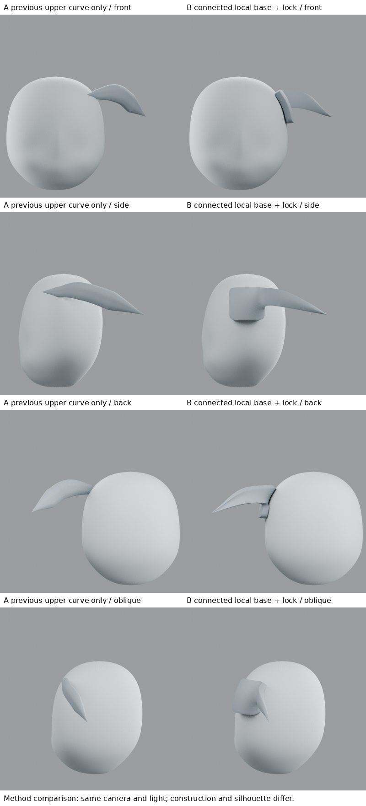
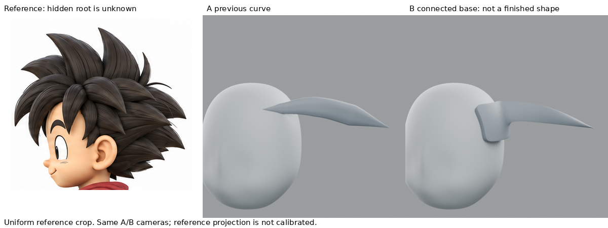
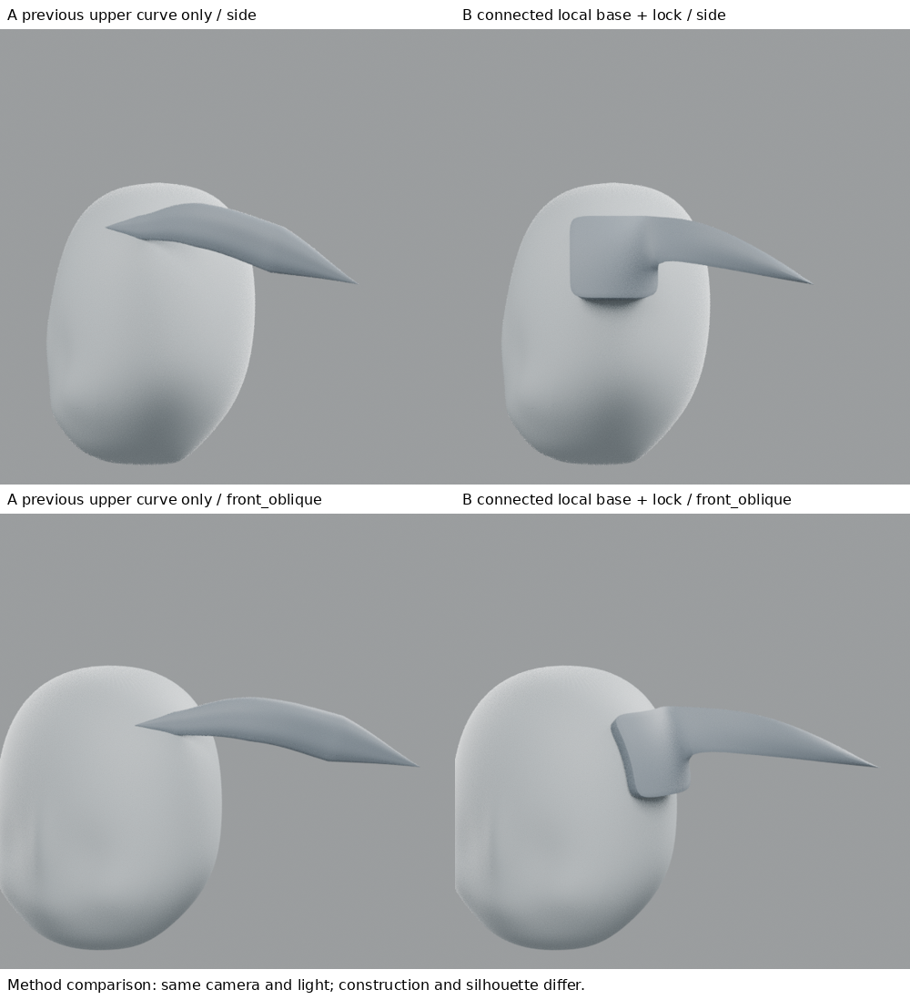

# 局部髮底到髮束：連續網格擠出練習

2026-10-28 19:06。**做出底片與髮束共用頂點的連續表面，並修正等厚尖端；但造型仍是矩形髮片接長尖，不能說像原圖，不整合全頭。**

## 本輪實讀來源與具體步驟
1. [UCBUGG Polygon Hair Modeling](https://www.ucbugg.com/labs/modeling/polygon-hair-modeling)，Front Hair 段落：細分平面貼合頭部、調偏移、切分分界、調出體積後擠出厚度。此為Maya動漫長髮課程，不是本案例短髮直接答案。已讀完整該段文字。
2. Soni Kumari，[Female Character Modeling in Blender: Part 5](https://design.tutsplus.com/tutorials/female-character-modeling-in-blender-part-5--cms-21211)：實讀第2節抽取頭皮面、第3節放大及調形、第5節由髮網格擠出髮長。嘗試獲取第2／5節配圖，一張回傳Cache miss、直接下載兩張403，**未以完整看圖或影片自稱**。本輪依可讀的文字步驟實作。
3. 六色，[Hair Modeling](https://note.com/rikuhayasaka/n/n5ab4a25233d1?hl=en)，實讀第4–6節：截面與分叉變形、貼合底層、Solidify頂點權重減薄尖端。採用最後一點修正首次鈍尖。

## 實作，不是完全照抄作者造型
從低密度四邊面開始，沿實際頭部射線投影到局部表面並留偏移，等價於此區域的貼合平面階段；不是聲稱複製了原始頭皮面。選後方兩個相連邊段，擠出三列並收束成一束。底片與髮束使用同一組共享頂點，沒有布林融合，也沒有另一個根物件相交。

原圖可見後尖，根被其他髮束遮擋。這個底片邊界與深度是為學習構造而設定，並非還原隱藏髮底。只做局部，沒有擴張為全頭帽殼。

A為上一輪的上方單條曲線（下方束在對照中隱藏）；B為局部連續網格。構造、路徑、截面、覆蓋範圍都不同，屬方法比較，**不是單變因實驗**。同一列視角、燈光、頭部均相同。B_cage.png 是實際控制網格的線框渲染，並非概念示意。

## 比對、修改、再比
- 第一版底片與束連續，但仍像片狀基座，非自然髮量；等厚Solidify又讓極窄尖端保留0.06厚度，變鈍。
- 保存第一次模型／腳本／圖到 failed-uniform-tip，再按來源的權重方法逐漸減少末端厚度。最新尖端明顯變細，未改整個頭或新增遮擋束。
- **局部尖端改善不等於髮根成功。** 目前根區是方片，基座到長束的凹角與側面寬度不自然，尚未建立原圖流動髮量。四角都有保留，背側也不能稱可用。
- 控制網格為開放面，Solidify封厚；未做完整碰撞、變形、UV與生產拓撲驗收。連通性只是結構證據，不是藝術品質分數。

## 學到／仍不懂
學會從貼合底片擠出一束連續形體，而不是將兩端尖曲線直接貼頭；也實際理解為何等厚會破壞尖端。仍不會把底片的輪廓、曲率和束間谷整理成自然髮量。下一步需學習作者如何布置髮塊分界與控制頂點方向，先改局部底片形狀，不能直接複製成帽殼。完整人物04與所有舊練習保留。

## 公開版範圍與復現限制

本文是既有實驗筆記的整理；「實讀／實看」與數值結果指當時紀錄，本次公開整理未獨立重跑。原始 `.blend`、實驗腳本、渲染圖、研究用三視圖及第三方教材圖片均未隨本文提供。文中檔名只用於說明歷史證據，不是可下載附件；不可僅憑此文字版宣稱已復現或驗收角色。

## 公開附圖

下列為當時保存的原始圖片檔，這次僅整理上傳，沒有重新建模或渲染。研究分析板與舊版渲染不代表新模型；實驗成功、失敗及限制以本文記錄為準。

[固定角色原始三視圖](../../images/reference/character-three-views.png)
