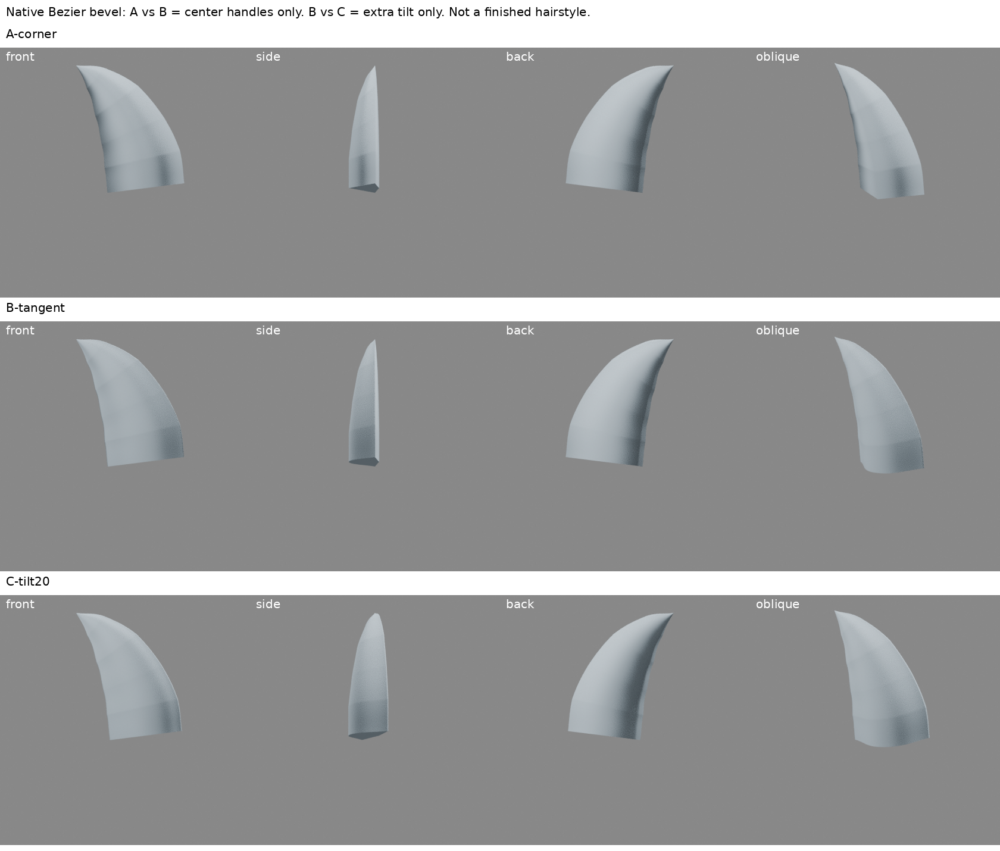
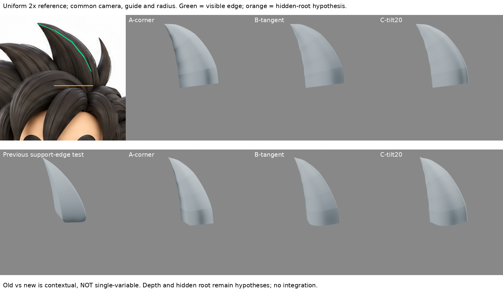

# 原生 Bevel 截面：中央切線與傾斜分開測試

- 日期：2026-10-30 Asia/Taipei，10:06 排程輪（約10:08–10:12實作）。
- 階段：頭髮／單束局部實驗。不是完成髮型，不新增第二束、不整合角色，iteration04未改。
- 接續讀取：spike-profile-curvature-research、closed-hair-sections、spike-support-edges、spike-control-cage；本地 LEARNING_INDEX、pending-sync/STATUS 與遠端 README、LEARNING_INDEX、STORAGE_POLICY。
- 遠端寫入仍有未決核准；本輪無 GitHub 寫入、換路或重試。可公開筆記另由整理者加入待同步。

## 問題與新依據

前輪緊支撐邊保留寬度但中央硬稜明顯；反覆加支撐線不能代替理解截面切線。這次不是再做菱形對自製弧面網格，而是保留原生可編輯2D Bézier Bevel Object，直接改其中央控制柄。

### 實際讀看程度

1. [stjun：Blenderで髪の毛を作る](https://stjun.hatenablog.com/entry/2022/02/27/190000)：重新讀3.1–3.3文字，並實看3.2單拱截面靜態截圖（前輪已看過的作者靜圖，本輪重新查看）。圖示為上凸、下側較平的不對稱截面，配合導向曲線形成尖髮束；作者說明位置G、旋轉R、縮放S/控制柄、Alt-S半徑。未觀看嵌入影片。本例是通用曲線方法適配，不宣稱作者教了本角色短尖髮或提供我們的數值。
2. [Blender 4.3 Geometry](https://docs.blender.org/manual/en/4.3/modeling/curves/properties/geometry.html)：web讀取402，改由dot雲端瀏覽器實讀Object、Fill Caps、3D Curve等文字。Bevel Object採局部XY截面，3D截面會投影XY；Fill Caps封端；Tilt繞導向扭轉截面。本輪無讀取失敗後假稱看過。
3. [Blender 4.3 Structure](https://docs.blender.org/manual/en/4.3/modeling/curves/structure.html)：雲端瀏覽器實讀Bézier與Handle Types：Vector可形成直線/尖角，Aligned共線讓連接無尖角，Free兩柄獨立。以此建立可檢查的因果測試。

不公開第三方教學截圖；只保留來源連結。我們的數值/導向為實驗假設，並非抄作者筆刷或原始檔。

## 實驗設計

共同：Blender 4.3.2 原生 CURVE；六點AUTO導向；固定半徑 `[1,1,.877,.677,.354,0]`；LINEAR radius interpolation；單一閉合四點2D截面；封端；固定材質、兩盞面光、24 samples、420x420正側背斜角、ortho_scale 2.1。截面座標、導向、半徑、tip、相機全由build.py保存。

- A-corner：截面凸側中央Vector柄；中央切線轉角68.18996°。
- B-tangent：**僅中央兩柄**改成水平共線Aligned，控制點不動；切線轉角0°。其餘三點仍Vector，沒有暗中平滑整個截面。
- C-tilt20：完全使用B截面，**只在共同基準90°上額外20°tilt**。不是另一個曲率修正。

### 真正遇到的失敗與有限修正

第一批基準tilt0°將截面寬面朝側面。四向實渲看出框架朝向不對；整批保存在 `initial-frame-mismatch/`，沒有覆蓋抹去。對A/B/C一致改基準tilt90°重渲，C仍額外20°。這是已觀察到的局部框架校正，不是拉伸參考或個別為各版改相機。

## 結果與限制

- A→B：正面、斜角中央由折面式明暗轉折變較連續拱面；原生切線檢查68.19°→0°支持「中央截面尖角確實移除」，但這不是全髮束所有稜線消失。側邊與背側控制點仍有折角。
- B→C：側面投影更寬、正面明暗分布改變；傾斜是朝向控制，不能拿來冒充曲率修正。沒有證據C較像原圖，不選它作人物基線。
- 各版根部上方仍見橫向帶狀明暗轉折。可能涉及半徑分段插值與導向變化，**本輪尚未隔離原因，不稱已診斷**。不能同時改半徑/導向再把改善歸因中央控制柄。
- 原圖同尺度比對：尖端位置與右側弧線仍不等於完整剪影吻合；本模型是近似外輪廓，沒有原圖髮絲/次級分層；隱藏左邊、根部、深度皆假設。曲線截面繞導向旋轉，非每一高度的寬度都能直接等於2D量測值。
- 根部平切封口尚未和頭皮銜接，尖端半徑0產生收束，未做動畫拓撲/變形驗收。
- 舊支撐邊版本與新曲線版本比較只作脈絡，不是單因素比較：工具/截面/導向都不同。只A/B與B/C可主張隔離變因。

## 可重用方法卡

適用：大塊風格化髮束，想在保留少量可編輯控制點下，把中央折角改成單拱面。

1. 先檢查截面確實在局部XY，以四向確認寬面朝向。
2. 固定導向、半徑、光照、相機；只改凸側中央切線。
3. 透過曲線檔實際控制柄確認切線連續，不能只看smooth shading。
4. Tilt另立試驗，不和控制柄修正混在一起。
5. 保留未通過版本，局部方法通過也不自動整合角色。

失敗戒條：不要把封閉截面當已正確接頭皮；不要把0°切線角當整個模型無稜線；不要把研究者設計的profile數字說成作者數字；不要用更亮/更暗燈光掩飾折面；不要用版本數或恢復檢查當造型進步。

下一個能力缺口：在固定B截面/導向下，查官方半徑插值定義，隔離LINEAR半徑插值是否造成橫向帶狀轉折；若排除，再考慮導向曲率。先單束驗證，不增加髮束掩蓋缺點。

## 圖與恢復

- `comparison-board.png`：A/B/C四向實渲，未AI改圖。
- `reference-comparison.png`：原圖裁切 `(245,0,455,210)` 等比例2x，未拉伸；綠線標可見外邊，橘線是隱藏根部假設。下排前版明標。
- 三個 `.blend` 保存原生導向與隱藏但可取消隱藏的2D profile，不是只剩轉網格。
- `build.py` 重建與渲染；`boards.py` 排版；`verify.py` 重新開三檔確認原生物件、同導向/半徑、A/B同tilt及切線角。`restore-check.json`是實際重開結果。
- iteration04 SHA256仍為 `35cd1b71c9d288029d93d0fdb8d9741d62a5151bc3bc459ab48c789092b5aaa6`。
- ZIP含本輪檔案及保留失敗；模型ZIP留dot/Space，不自動公開GitHub原始模型。

## 公開附圖與復現範圍

本頁所述原生模型、建構及重開腳本、失敗整批和ZIP另存私人備份，**不包含在公開倉庫**。公開只附兩張自製比較板及整理後筆記；第三方教材圖片不公開。
