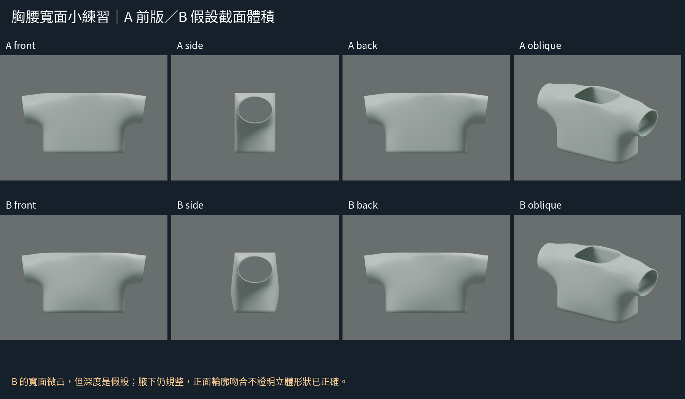
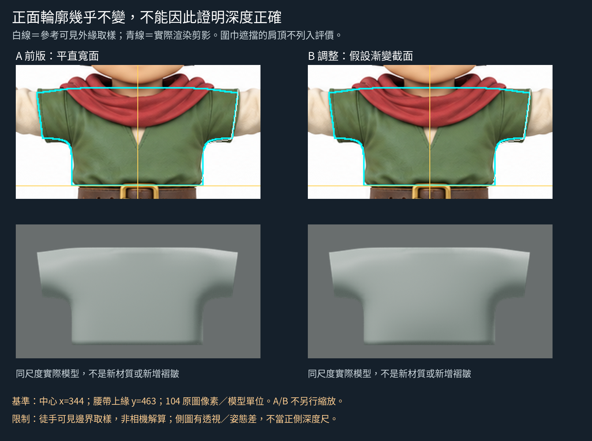
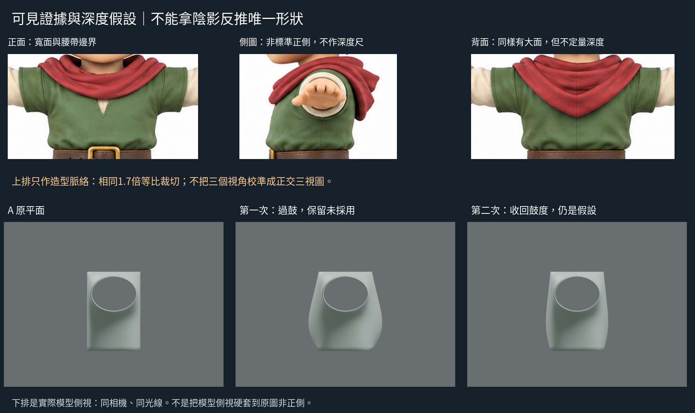

# 胸腰寬面：截面體積假設與過鼓的負結果
2026-10-29 11:36 UTC。DOTS。**這輪練習截面調形，不宣稱已證實原圖深度；正面相近的模型仍可有不同側面。**

## 方法來源，實讀與實看範圍
Soni Kumari《Female Character Modeling in Blender Part 3》，第2節軀幹第9–13步：少量水平截面列，對照正側參考調點。實讀文字並實看第10與13步的兩張配圖，圖中前後輪廓在不同高度改變，不是同深度的直壁。
https://design.tutsplus.com/tutorials/female-character-modeling-in-blender-part-3--cms-20358
實看同頁第10與13步配圖；沒有看影片，圖片不再散布。
這是人體建模的通用截面方法，不是衣物專屬教程；本次借它修正衣殼的平寬面，**沒有複製女性身體的胸腰曲線，也沒有聲稱作者示範本角色衣服**。衣殼先有包覆再修形的順序承接上一輪實看的Roblox官方服裝示範；本輪未再宣稱重新觀看該影片。

## 原圖證據與假設
原圖正面綠衣有寬面、腰帶收束與少量布量起伏；背面也不是整片均勻平板。但陰影同時受光照/材質/褶皺影響，不能從一張圖推得唯一厚度。標側面的圖手臂迎鏡、有透視姿態差，不能當真正正側量測。
本輪不動X/Z控制點、肩頂或前輪104px/單位映射；只在胸腰幾列改Y。這是合理性練習的深度假設，沒有數值由原圖證實。原圖三視局部保留等比例裁切，明標非校準深度對照。

## 小範圍實作
輸入為shoulder-reference-fit最新B的獨立副本；舊版原位保留。
胸腰前後控制點原位於y=±.4。只改x<=.8、-.69<z<.2的寬面點：中心列鼓出較多，中間列較少，外側角略收；腰緣和肩頂不動。這是離散控制點組，不是疊加細皺波形。build.py與depth_changes.json完整記錄點索引和前後值。
第一次amount=.18，實看側/斜渲染後，胸腰呈過大的桶形/枕形，不能接受為較佳基準。保存在first-overfull。
第二次只把同一截面調整量降為.08，重跑同相機四向與對照；沒有加褶、求解器或其他幾何。

## 結果與未解
- 第二次側面曲線較第一次克制，寬面不再完全平直；正面因X/Z控制點不變而輪廓幾乎相同。Solidify沿法線可能帶來極小投影差，因此不說逐像素完全相同。
- 「不那麼鼓」不是「像原圖」。胸腰仍簡化、前後對稱、像平滑衣殼；腋下過規則沒有解決，沒有受手臂支撐驗證。
- 我學到不能只看前圖配形，必須用側/斜看截面與轉面，並把深度假設和可見剪影分開。這次不足以決定正式角色的胸背深度。
- 下一個缺口是如何選擇胸腰截面與腋下過渡的合理體積範圍；不要用更多細褶或陰影把這個未定的大形遮掉。

## 公開版範圍與復現限制

本文是既有實驗筆記的整理；「實讀／實看」與數值結果指當時紀錄，本次公開整理未獨立重跑。原始 `.blend`、實驗腳本、渲染圖、研究用三視圖及第三方教材圖片均未隨本文提供。文中檔名只用於說明歷史證據，不是可下載附件；不可僅憑此文字版宣稱已復現或驗收角色。

## 公開附圖

下列為當時保存的原始圖片檔，這次僅整理上傳，沒有重新建模或渲染。研究分析板與舊版渲染不代表新模型；實驗成功、失敗及限制以本文記錄為準。

[固定角色原始三視圖](../../images/reference/character-three-views.png)
