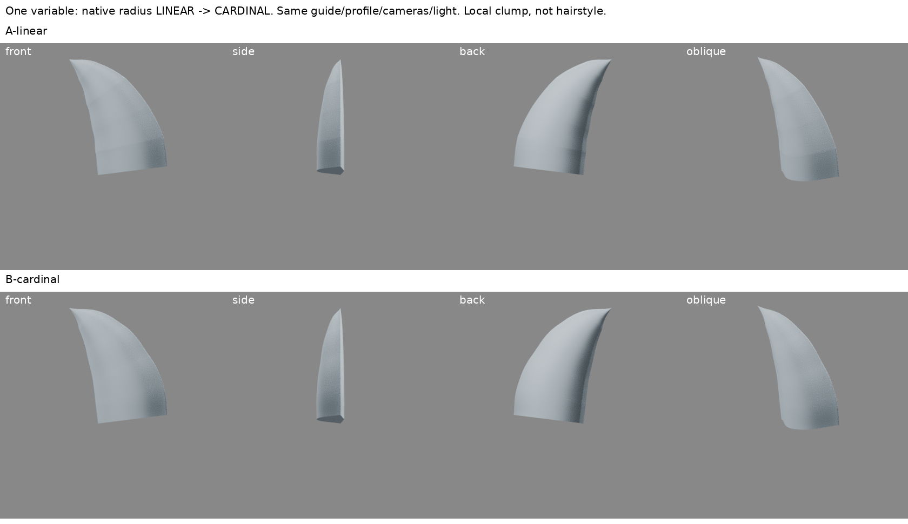
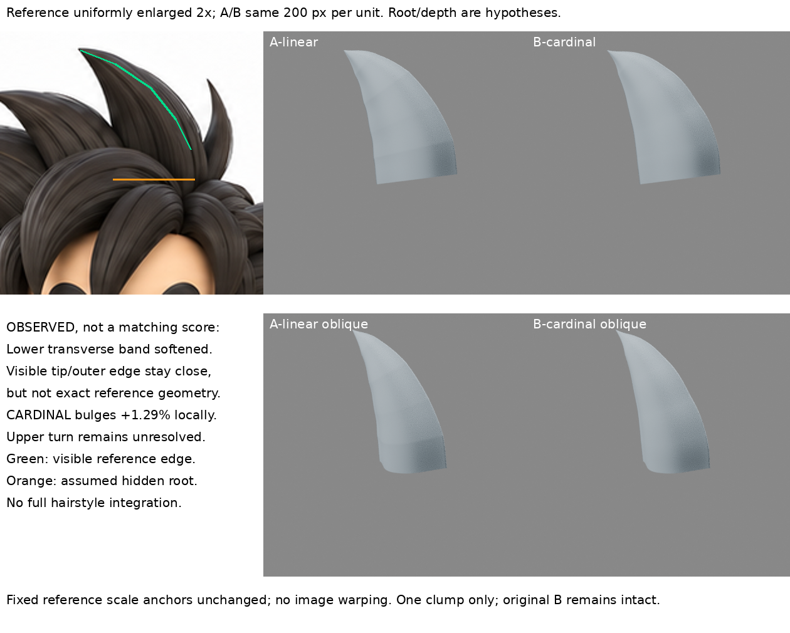

# 原生曲線：橫向帶紋與半徑插值隔離

2026-10-30，Asia/Taipei 10:36 排程輪。實際製作約 10:37–10:41。

## 問題與保留基線

前輪 `bevel-profile-handles/B-tangent.blend` 的中央截面硬折已減少，但根部上方仍有橫向帶紋。本輪不改截面、不調 Tilt、不動頭形 iteration04、不做第二束，只問：**帶紋是否與半徑沿導向的插值有關？**

原 B 原檔保留。本輪 A 是讀取原 B 後另存的 LINEAR 對照；B 只把原生 `radius_interpolation` 改為 `CARDINAL`。兩者都保持可編輯原生 Curve + Bevel Object，不是自製掃掠幾何。未整合角色。

## 實際來源閱讀

1. [Blender 4.3 Active Spline](https://docs.blender.org/manual/en/4.3/modeling/curves/properties/active_spline.html)：實際在雲端瀏覽器讀 Common Options、Bézier 的 Interpolation Tilt / Radius、Smooth。Radius 插值控制 bevel 半徑計算；Smooth 控制表面平滑著色，兩者不能混為一談。文件沒有在這頁完整解釋各插值公式，因此以下數字是本地 Blender 4.3.2 的實測，不假稱作者提供。
2. [Blender 4.3 Structure](https://docs.blender.org/manual/en/4.3/modeling/curves/structure.html)：實讀 Bézier、Automatic / Vector / Aligned / Free 控制柄段落。控制柄決定曲段，Aligned 維持同線而無尖角；不因此推定曲率、參數速度或掃掠表面全部連續。
3. 沿用而不冒稱本輪重看：前輪 stjun 的單一拱形截面方法，網址與適用限制見 `../bevel-profile-handles/NOTES.md`。此次學習是此方法的技術問題隔離，不是新的同髮型完整作者示範。

來源查詢先經網搜找到官方內容，web 開頁未能取回正文；正文閱讀來自雲端瀏覽器。沒有下載或公開第三方教學圖片。

## 先檢查，不先亂調

- 前輪導向 6 個控制點的左右切線方向差均 0°。
- 評估 mesh 有 10692 頂點 / 10624 面，全部面已 smooth；不是「忘了開平滑」的簡單問題。
- 導向左右控制柄長度不總相等，故方向相同不等於等參數速度；第 4 內部點左右長約 0.10085 / 0.07742。尚未把此現象單獨修正，不把相關性稱為已證因果。
- 固定資料：截面控制點與控制柄、導向點與控制柄、半徑控制值 `[1,1,0.877,0.677,0.354,0]`、90° Tilt、MINIMUM twist、resolution 32、材質光線、正交鏡頭尺度 2.1、420×420。
- 唯一變數 LINEAR → CARDINAL；`restore-check.json` 是實際重開兩個 blend 後的核對。

## 實驗結果

肉眼觀察：B 的根部上方橫帶明顯淡化，正面及斜角的亮暗過渡較連續。尖端附近仍有轉折，不能宣稱整束都平順。

評估 mesh 於固定截面中央縱線採樣（66 頂點一環，首重複封口環排除，161 導向採樣），控制點兩側相鄰表面邊的折向如下。這是局部離散幾何診斷，不是整體品質或原圖相似度：

| 內部接點 | A LINEAR 表面折向 | B CARDINAL 表面折向 |
|---|---:|---:|
| 1，根部上方 | 5.30° | 0.40° |
| 2 | 2.35° | 1.09° |
| 3 | 5.76° | 1.48° |
| 4，靠尖端 | 5.41° | 5.50° |

第一接點兩側相鄰頂點法線方向差 5.36° → 0.23°，與可見帶紋減弱一致。法線角度只比較方向變化，尚不是法線朝外的完整驗收。

**代價：**CARDINAL 在兩個半徑 1 控制點之間產生約 1.29% 過衝（實測最大 1.01293）。沒有悄悄縮小控制半徑補償，否則失去單變數隔離。第 4 接點幾乎未改善，下一輪需研究導向段參數化/曲率與半徑沿弧長的變化，不能把所有折痕都怪 LINEAR。

## 與固定原圖比較

原圖局部等比 2 倍，沿用前輪固定尺度與可見外緣標記，沒有拉伸原圖；渲染固定 200 px / 單位。這是既有局部比例設定的視覺比較，不是精確相似度配準。可見尖端與外輪廓大致維持，但兩者與原圖仍非完全吻合，B 的局部鼓出亦須計入差異。側、背、斜角用於檢查體積，不將被遮擋根部與非標準側圖當精確真值。

原圖主束具有根部收攏與其他髮束遮擋；本練習仍平切根、單一截面、沒有真實根流整合。不能因帶紋減少而升級為完成髮型。

## 學會、失敗戒條、下一個未知

- 可重用：遇到橫向帶紋，先分開截面尖角、導向切線、半徑插值、著色法線四種原因；用同場景單變數試驗，不用更多細分或光線掩飾。
- 本輪有證據：半徑插值是**根部這條**帶紋的重要來源。B 是後續局部候選，不取代角色基線。
- 失敗戒條：CARDINAL 不保證單調、無過衝或消除所有接點轉折；不要直接全角色套用，也不要偷偷同時移控制點。
- 未知：靠尖端的轉折是否主要來自導向段速度/曲率？朝外法線、退化尖端、根部封口亦尚未完成拓撲驗收。下一次只隔離其中一項，不加第二束、不趕整合。

## 恢復

`A-linear.blend`、`B-cardinal.blend`、8 張原始渲染、2 張對照、`build.py`、`boards.py`、`inspect.py`、`verify.py`、`inspection.json`、`metrics.json`、`restore-check.json` 保留。

`build.py` 從同級前輪 `bevel-profile-handles/B-tangent.blend` 重建；本包另含 `baseline-B-tangent.blend`，跨機恢復可改 source 指向它。直接開 A/B 無需依賴前輪檔。`boards.py` 另需原始參考圖，包中未重複帶入參考資產。

## 公開版範圍

本頁為整理後學習筆記，附兩張自製比較板。原生模型、原始建模腳本與恢復 ZIP 未納入公開庫，另作私人備份；上節檔名只說明完整實驗的恢復條件，不代表本庫附帶全部檔案。
