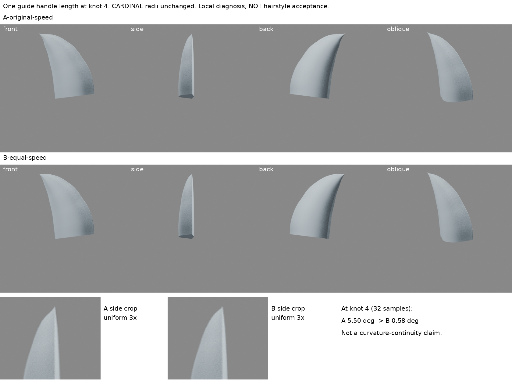
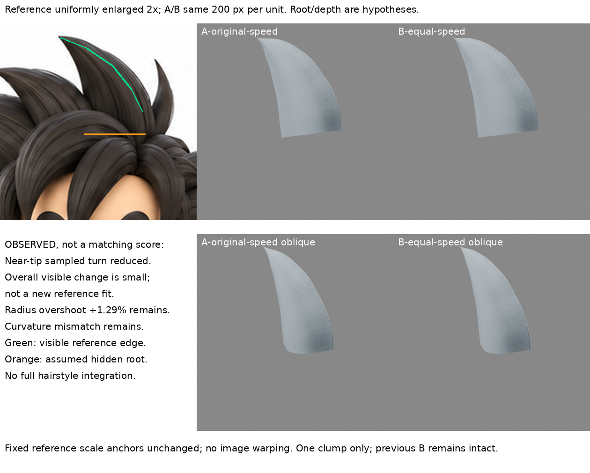

# 11:06 尖端轉折診斷：同向切線不等於同參數速度

2026-10-30，Asia/Taipei。**局部方法診斷已實作；不是髮型完成或角色還原進步。** 保留前輪 B、原 Bevel B 與 iteration04，沒有新增束或整合人物。

## 問題與讀回

讀最新遠端 README、LEARNING_INDEX、STORAGE_POLICY，及本地累積索引、待同步狀態；回查半徑插值診斷、原生 Bevel、截面研究及早期切線練習。前輪 CARDINAL 減弱下方橫帶，但近尖端第4節點仍約5.5°表面轉折。早期切線試驗混改方向和長度，不能拿它作本輪因果證據。

本輪只問：**導向兩側切線方向相同，但參數速度不同，是否仍讓收束表面出現折轉？** 不改半徑來補導向，不連續試任意柄長。

## 新來源，實際閱讀範圍

- [C.-K. Shene，Michigan Technological University：Derivatives of a Bézier Curve](https://pages.mtu.edu/~shene/COURSES/cs3621/NOTES/spline/Bezier/bezier-der.html)：實讀端點導數、Joining Two Bézier Curves with C1-Continuity、Higher Derivatives 文字。三次曲線端導數為控制柄向量的3倍；同向僅保證G1，兩段以相同參數區間連接時，等長同向才有相同一階導數。本文圖片公式未另開視覺檢視，沒有看影片。此為曲線數學教材，不冒稱尖髮作者示範。
- [Blender 4.3.2 curve.cc](https://raw.githubusercontent.com/blender/blender/v4.3.2/source/blender/blenkernel/intern/curve.cc)：實讀約1847–1889行半徑取樣。每段用fac與1/resolution步長算權重；此處不是按實際弧長插值。
- [Blender 4.3.2 key.cc](https://raw.githubusercontent.com/blender/blender/v4.3.2/source/blender/blenkernel/intern/key.cc)：實讀318–389行CARDINAL位置及切線權重；其係數0.71，不可當成Catmull-Rom的0.5。未下載執行來源程式；只以自製診斷腳本核對數學。

推論：半徑對段參數的變化即使銜接，若導向速度跳變，半徑對實際路程的變化率仍可跳變。這不表示每種截面、扭轉、掃掠方向都只要等柄長即可修好。

## 單變量局部試驗

起點為前輪 `B-cardinal.blend`，另存本輪 `baseline-cardinal.blend`。A/B均將原AUTO控制柄凍結為相同FREE座標，避免改一柄導致其他AUTO柄自動重算；A的評估網格與基準逐頂點位移為0。

- **A-original-speed**：保留全部導向座標、半徑及截面。
- **B-equal-speed**：只將第4節點右側出發柄沿原方向延長至左柄長度。柄長約0.07742→0.10085，控制點不動；其餘導向、CARDINAL半徑值、截面、Tilt、相機、燈光均不變。
- 冷開檔逐欄核對：唯一座標差異是第4節點右控制柄。兩側導向速度由0.30254/0.23226變為0.30254/0.30254。半徑沒有改成自製掃掠公式。
- A/B各真實渲染正、側、背、斜四向。420×420、正交尺度2.1、200px/單位固定。比較板另有同區域側圖等比3倍裁切；不是新視角或AI修圖。

## 結果：解釋了哪一個問題，沒有解決什麼

| 指定節點表面中央縱線診斷 | A | B |
| --- | ---: | ---: |
| 每段32取樣的相鄰線段夾角 | 5.50° | 0.58° |
| 每段128取樣的相鄰線段夾角 | 5.28° | 0.14° |
| 對此平面導向、固定截面中央點推導的極限夾角 | 5.21° | 0° |

A在加密時仍留明顯非零極限；B的有限線段角隨加密縮小。此局部結果支持**速度不匹配是這條中央表面線折轉的原因之一**，不是只把網格加密造成好看。半徑沿路程的左右導數由約-1.589/-2.070改為-1.589/-1.589。

實看四向及原圖對照：整體可見差異很小；側面上段折轉較緩，不能稱剪影更像原角色。A/B網格最大位移約0.01055小樣單位，約2.11個正視像素的尺度量級，不是原圖擬合分數。

**仍失敗／未驗證：** B左右導向曲率仍約0.418/0.943（A為0.418/1.599），不符合曲率連續，不能稱C2或全面光順。CARDINAL約1.29%過衝仍在，根仍平截且孤立，層序與接合尚未建立。截面其餘位置、法線朝外及尖端退化面沒有本輪全面驗證。背側、根與厚度仍為假設，不拿非標準側圖當精確深度。

原圖沿用前輪等比例2倍裁切與相同基準標線，沒有拉伸或重新擬合。原圖深色交疊區不是本孤立束根部的驗收依據。

## 可重用方法／停止條件

1. 先分辨導向切線方向、導向參數速度、半徑沿參數變化、曲率四種因素。
2. 只調插值仍有折轉時，檢查同向控制柄的長度與參數區間；凍結其他AUTO柄再做一項修改。
3. 同時用固定鏡頭實渲、有限取樣及解析端導數交叉檢查，別把小數值當美術驗收。
4. 本輪停止柄長微調；已解釋指定折轉，不為追求零曲率差繼續改同一孤立束。下一個造型缺口仍是**主束根如何延入主髮量及有依據的層序**。先找作者可見接合近圖／操作；沒有新證據不增加束數。

## 恢復與公開界線

本資料夾保留基準/A/B原生曲線blend、8張新渲染、兩板、自製build.py/verify.py/boards.py與metrics/restore-check。`blender -b --python build.py`使用同夾baseline，`verify.py`冷開核對。製板需固定原參考圖；恢復ZIP另附該已授權原圖，腳本可使用同夾檔案。第三方教材圖片與來源程式未打包。

公開稿只同步本筆記及兩張自製比較板；模型及腳本留私人恢復包。GitHub寫入核准仍未決，沒有提交、重試或換路；待同步不等於遠端成功。iteration04 hash重新核對不變。

## 本輪實際比較板

