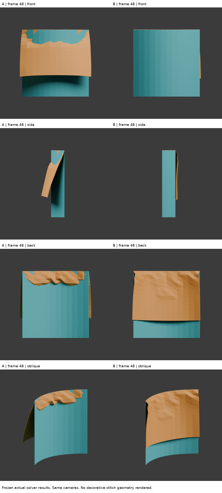
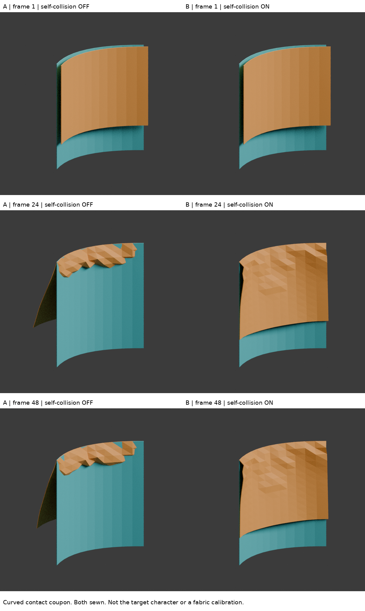

# 弧形內貼邊：接縫與自碰撞的有限驗證

2026-10-29 04:06 UTC 練習；DOTS 的方法小樣，不是人物新版。

## 問題與本輪界線
前輪只證明共平面兩片能被 sewing spring 拉住，不能證明重疊內貼邊不穿過外布。這輪只問：同樣接縫，在弧形重疊樣片上，自碰撞開／關是否造成可見、可量測的差別？不追求真實布料校準，不建立整件服裝模擬，不改 iteration04 或先前任何模型。

## 確實讀到的來源
- 官方手冊 collisions 頁此次回傳 402，未能讀取，不能聲稱已讀手冊。
- 實讀 Blender 官方 `cloth.cc` main 的 sewing 分支（1490–1517）：啟用 sewing 的鬆邊建立零自然長度縫合彈簧，其餘成為結構彈簧。這支持以真實鬆邊作接合，而不是畫裝飾針腳。
  https://raw.githubusercontent.com/blender/blender/main/source/blender/blenkernel/intern/cloth.cc
- 實讀官方 `collision.cc` main 後，再核對 **v4.3.2**（與執行版本相同）979–994 的接觸排除邏輯，以及742–803自碰撞回應：鄰接／縫合邊連接的三角形不參與同一自碰撞測試，反應同時涉及距離與相對速度。因此縫合處接近零與離縫布面間距應分開檢查；設定距離不是完成品厚度保證。
  https://raw.githubusercontent.com/blender/blender/v4.3.2/source/blender/blenkernel/intern/collision.cc
- 以上是程式閱讀，不是看過實作教學影片。沒有下載執行來源程式碼。小樣幾何及負載是本次測試設計，非來源提供的服裝版型。

## 控制設計
兩片弧面，同一 Cloth object，338頂點，每片12×12四邊面。
外片：x[-.3,.3]、z[.7,1.3]、y=.12(x/.3)^2，所有頂點固定。
內片：相同弧度、z[.85,1.3]、初始沿y偏移+.04，僅上緣13對頂點由鬆邊連接。
A/B 都有相同 sewing；唯一對照差異是 self-collision 關／開。Repeat 是B的獨立物件與求解器副本。

- Blender4.3.2；24fps，順序跑1–48幀。
- 合成負載gravity=(0,-1,-.3)，故意把內片推向外片；不是地球重力或實物穿著負荷。
- quality10、mass.3、tension/compression50、shear20、bending.5、air damping1、sewing force max10。
- B self distance.005、self friction5、collision quality4；物件碰撞關閉；不額外加人體。
- 外片全固定是控制接觸實驗，不是實際衣物會全固定的宣稱。
- 圖片是求解後真實網格，600×600、Cycles32、相同四個正交相機。渲染後置Solidify.003只是可見厚度，**不進入求解**。

## 結果
第48幀：

| 檢查 | A 自碰撞關 | B 自碰撞開 |
|---|---:|---:|
| 接縫平均間距 | .00002137 | .00004923 |
| 離縫樣點到外曲面最小無號距離 | .004356 | .006896 |
| 原始外片投影範圍內、離縫樣點落到外片背側 | 101/121 | 0/129 |
| 離縫兩排以外嚴格邊－三角形交叉命中 | 96 | 0 |

B／Repeat第48幀最大座標差0。數字是此測試座標單位，不宣稱真實公尺／縫線強度。

**重要教訓：A的無號距離也大於零，但它已經穿到另一側！不能拿「最近距離正值」當作沒有穿透。** 此次另外檢查相對側向位置、三角面交叉，以及z=1.00013實際截面。A截面翻到外片另一側，B留在初始同側。相機四角度可看出同樣現象。

這支持「sewing＋self-collision可用於這個有限弧形接觸小樣」，不是「任意衣物可直接套用」，更不是目標角色外觀已改善。

## 還不能證明什麼
- 邊／三角形檢測排除上面兩排面，且只算嚴格穿越（不算共面／相切）；0不是整個有限厚度實體的完美認證。
- 截面是幾何剖切，不是渲染。只示範一個離縫高度。側向點數分母因自由片x/z移動而不同。
- 接縫附近有可見低解析網格折痕；這不是優質成品拓撲，沒有用平滑渲染隱藏。
- 兩片弧面不是原圖袖口；原圖未確定內藏縫法。無原圖疊圖，以免暗示角色進步。
- 沒有校準布重、彈性、摩擦、真實針距或縫線斷裂；沒有實際人體、完整U形折返和動作驗證。

## 停止條件與回到角色
已關閉本輪方法問題：可把接合與接觸分開建立、診斷；不能靠裝飾縫線或單一距離指標判定成功。**不再為此小樣反覆增加參數。** 下一輪回到原圖及保留的單折返角色局部，優先確認可見輪廓／主要平面是否像，再決定是否需要模擬；不要把這組數值直接貼回人物。

## 公開版範圍與復現限制

本文是既有實驗筆記的整理；「實讀／實看」與數值結果指當時紀錄，本次公開整理未獨立重跑。原始 `.blend`、實驗腳本、渲染圖、研究用三視圖及第三方教材圖片均未隨本文提供。文中檔名只用於說明歷史證據，不是可下載附件；不可僅憑此文字版宣稱已復現或驗收角色。

## 公開附圖

下列為當時保存的原始圖片檔，這次僅整理上傳，沒有重新建模或渲染。研究分析板與舊版渲染不代表新模型；實驗成功、失敗及限制以本文記錄為準。

[固定角色原始三視圖](../../images/reference/character-three-views.png)
