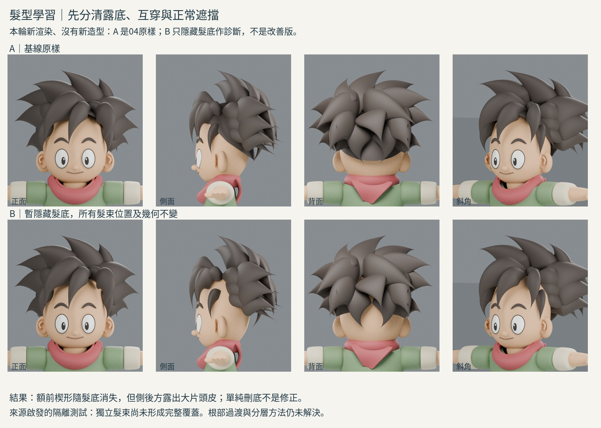
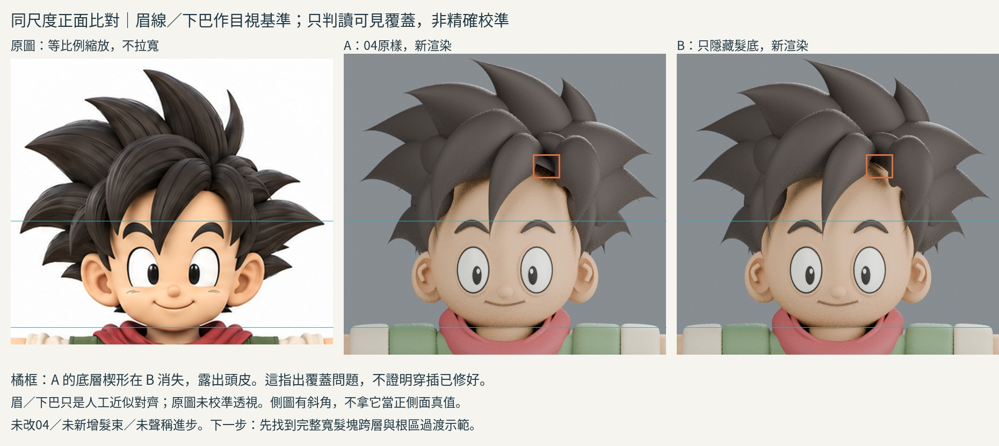

# 斜向短髮：先分清露底、穿插與正常遮擋

2026-10-29 15:06 UTC 輪。**有新來源實看與診斷渲染；沒有新造型，沒有改良版B。** iteration04原件不動。

## 具體問題與不同造型方法

上輪球殼尖瀏海能做並列下垂，不能直接產生目標額前不等寬、斜向跨層的短髮。舊曲線長束適合長髮路徑控制，卻不自動解決短寬根區；本輪尋找「先塑造寬髮塊，再安排表面髮束」的構造，而不是再調球殼或矩形片。

## 本輪實際看到的來源

[Dan Eder 本人訪談／教學](https://80.lv/articles/guide-sculpting-stylized-hair-in-zbrush)

重新讀 General Workflow、Hair Blockout、General Mistakes。與此前只有讀文字不同，這輪在瀏覽器實際放大兩段GIF和錯誤對照，再下載公開媒體供逐格閱讀：
- General Workflow 步驟2：302幀，抽看16個時序畫面。前額寬塊的頂點網格／大筆刷移形，切至側面調耳上髮塊；未顯示從第一顆球到最終形體的完整過程。
- 步驟4：146幀，抽看20個時序畫面。先孤立大髮塊，在其表面建立一條弧形束，再改端點及彎度。只看到一束，不是全頭完成或根部接合示範。
- General Mistakes 的 Clipping：2幀都看過。紅叉中鄰束互穿產生細尖碎片與突兀中斷；綠勾的遮擋邊較連續。沒有展示修正操作，不能冒稱學會作者如何修。

作者文字稱底塊為 temporary blocked out hair。因此它的角色是塑形導引，不能自行解讀成永久髮底或用帽殼遮接合問題；來源也沒有授權我們認定所有底層都應刪除。

Pablo Muñoz Gómez 的 [Stylised Hair 文字摘要](https://www.pablander.academy/tutorials/sculpting-stylised-hair-in-zbrush) 可讀，但其步驟圖未能查看；本輪僅讀文字，不聲稱看過圖或影片。

## 為何沒再造新根部

新GIF足以理解「整體髮塊先於表面束」，不足以知道完成後如何移除導引、處理跨束接合，或側面截面應有多深。若現在寫另一組根座座標，只是把猜測改名成學習。

改做可驗證的診斷問題：04中心與右瀏海之間的楔形，究竟是髮束互穿，還是髮底露出？

## 診斷操作

載入04副本，A保持原樣；B僅設定 `Continuous shaped hair foundation.hide_render=True`。所有頂點、髮束位置、材質、燈光不變。每向A/B用同一相機、同尺寸，實際渲染正、側、背、斜。保存恢復檔前重新顯示髮底。

這是**隔離測試**，不是修正、不是B新模型，也不是刪除髮底的提案。不做布林融合，不補新髮束，不改五官。四向圖是本輪新渲染，非舊圖冒充。

## 觀察與反證

- 正面：A中心／右瀏海間的灰色楔形在B消失，同處露出頭皮。可確定該楔形依賴髮底顯示，不能只憑外觀叫它髮束互穿。
- 側面：B耳上和後側大片皮膚露出；現有獨立髮束並未覆蓋完整髮量。
- 背面：B後腦下方和束間也露皮；A的底層有重要覆蓋作用。
- 因此「看到作者臨時底塊→刪除自己的髮底→髮型成功」是錯誤推論。需要先重新理解局部主塊的覆蓋與交疊，而不是靠帽殼或刪帽殼解決。
- 本輪未測完整碰撞、根部曲率、拓撲或變形；不把診斷成功當造型成功。

## 原圖對照界線

reference-diagnostic.jpg 的正面原圖裁切(145,0,540,350)，整體等比放到600寬；模型600寬原渲染裁去頂部60像素。以眉線與下巴人工近似對齊，無獨立橫拉。兩條基準只方便檢視可見覆蓋，不是相機校準或精準誤差量測。側圖原本偏斜，不對它硬做正側面配準，沒有推定遮擋根部真值。

## 可重用方法／仍不懂

**可重用**：先列出露底、互穿、正常遮擋三種假說，再用單一物件可見性隔離；看全向後才討論造型修正。作者的負例可提供「遮擋邊不應突然冒出碎尖」的檢視提示，但不是碰撞數值判據。

**仍不懂**：寬短髮塊跨層後，根區如何過渡、導引塊何時撤掉、最後怎樣避免露頭皮與互穿。下一輪找完整可見的短瀏海根區建構，不重複球殼調參，也不硬用葉片遮蓋。

## 公開版範圍與復現限制

本文是既有實驗筆記的整理；「實讀／實看」與數值結果指當時紀錄，本次公開整理未獨立重跑。原始 `.blend`、實驗腳本、渲染圖、研究用三視圖及第三方教材圖片均未隨本文提供。文中檔名只用於說明歷史證據，不是可下載附件；不可僅憑此文字版宣稱已復現或驗收角色。

## 公開附圖

下列為當時保存的原始圖片檔，這次僅整理上傳，沒有重新建模或渲染。研究分析板與舊版渲染不代表新模型；實驗成功、失敗及限制以本文記錄為準。

[固定角色原始三視圖](../../images/reference/character-three-views.png)
