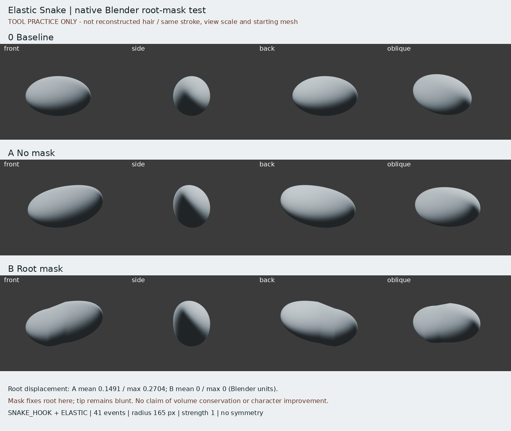
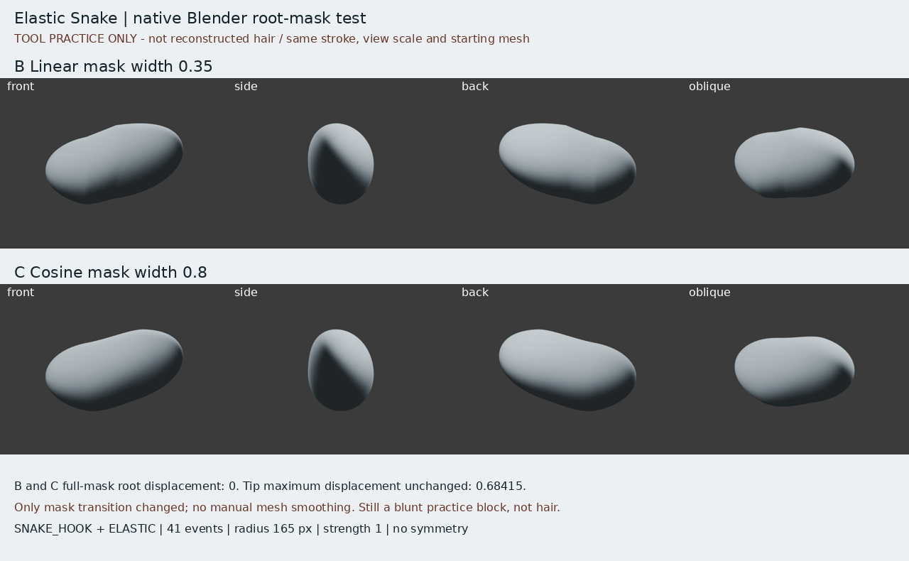

# Elastic Snake：根區遮罩控制實驗
2026-10-29 21:06 UTC 輪。只做工具局部試驗，**不是人物髮束完成，也沒有改善原角色的證據**。

## 實際看了什麼
讀前輪 grab-visible-demo-research/NOTES.md，並實看該資料夾 sources/snake-contact.jpg 官方影片逐秒取樣：球體先被大範圍拖成彎曲體，再以較小範圍延伸末端。來源 Blender 官方 2.92 發行頁 https://www.blender.org/download/releases/2-92/ ，原示範 https://www.blender.org/wp-content/uploads/2021/02/sculpt_snake-chopped.mp4 。本輪沒有把未看影片或作者髮束案例說成已看。

## 問題和有據適配
Elastic Snake 的大範圍連續變形是否會拖走髮根？對比同一有厚度草模、同一原生筆觸，只改根區遮罩。以球形塊測試變形原理是適配假設，不代表官方影片是尖髮教學，也不是人物還原。正式髮束仍須原圖剪影、分層、根流驗證。

## 真實方法
在 Blender 4.3.2 的 RNA 查證：sculpt_tool=SNAKE_HOOK、snake_hook_deform_type=ELASTIC。不是 GRAB，也不是 ELASTIC_DEFORM。新建本地 brush asset 啟用；在原生 GUI VIEW_3D WINDOW context 呼叫 bpy.ops.sculpt.brush_stroke 重播41事件，固定正交視窗974×705、radius165px、strength1、pressure1。見 replay_ui.py 及 report.json。這是原生 sculpt operator，不是自行移動頂點冒稱筆刷。

UV球160×96只作厚草模，先沿軸縮放為1.15/.65/.7。每次筆觸前復原同一座標及遮罩。遮罩1在 x<-0.35，-0.35到0線性過渡，x>=0為0。所有對稱關閉，不開Dyntopo。原始baseline及兩種實驗皆保存。A是無遮罩控制，不是刪除的失敗。

## 學到和沒學到
- 未遮罩根區位移證明大範圍形變會帶動根；遮罩固定區在本次測試保持不動。見 report.json 的平均/最大值。
- 這不保證體積守恆、良好拓撲、尖端或分層。端部仍圓鈍，不能當完成髮束。
- 遮罩過渡區可能留下形體折點；必須看側背和斜角，不能只有正面。
- 下一個不懂的問題：在不破壞根流的情況下，如何從這種連續量體建立原圖的尖端及分層，避免僅拉成勾狀？需找相近尖髮作者案例，再做小範圍練習。

## 比對邊界
四向為同尺度正/側/背/斜角真實Cycles渲染；黑尖髮原圖只作目標提醒，不能將本工具草模和角色假稱對齊驗收。iteration04完全未改。原圖遮擋顱頂後腦不補做精確推論。

## 四向實際檢視與失敗
親看 comparison-board.png：B遮罩過渡出現折點，斜角可見；A根整體跟著上移，B保持根但不等於好形體。兩者都沒有尖端。閉合網格體積 baseline2.1906269，A2.6433015（約+20.7%），B2.7773926（約+26.8%）；此測試不能主張體積守恆。非流形邊0只是技術診斷，不表示造型成功。

原實驗的Blender build不支援OpenImageDenoise；關閉去噪後，12張Cycles渲染完成。沒有為美化而後處理模型輪廓。

iteration04 SHA256再次確認未改：35cd1b71c9d288029d93d0fdb8d9741d62a5151bc3bc459ab48c789092b5aaa6。

## 小修正 C：遮罩過渡再比
發現B折點後搜尋官方Mask教學。實際讀到搜尋結果的官方段落：Smooth/Sharpen Mask改變遮罩邊緣銳度；Mask Filters作用全遮罩，Linear Gradient及brush Falloff可改漸層形狀。來源 https://docs.blender.org/UATEST/manual/en/dev/sculpt_paint/sculpting/editing/mask.html 及 https://docs.blender.org/manual/en/3.4/sculpt_paint/sculpting/editing/mask.html 。直接開4.3及3.4頁回402，因此只主張讀官方搜尋節錄，不聲稱看完整頁。版本不同，這些只作遮罩邊緣原理；4.3工具RNA與native stroke已本機確認。

有據適配假設：保留x<=-.35全遮罩根，將B的線性.35寬改為C的.8寬餘弦緩入緩出（到x=.45為0），希望減弱折點。程式只設定遮罩權重，**沒有**直接改變筆觸後頂點、沒有冒稱用Smooth Mask operator，也沒有假稱官方推薦這個函數。完全相同起點、終點、筆刷、事件數、壓力、視窗與原始網格。

C FINISHED；root_mean/root_max=0，all_max=.6841499與B相同。親看correction-board.png：B斜角根端肩部突起及過渡折點在C較弱，但仍是圓鈍草模。體積C2.7652359，仍比baseline約+26.2%，不宣稱保體積。寬度和過渡函數同時變，所以不能單獨歸因於其中一個。保存B未覆蓋，C是候選修正，不替換人物基線。下一步需要相近尖髮作者案例，驗證尖端與分層，而非再反覆拉這塊。

## 公開版範圍與復現限制

本文是既有實驗筆記的整理；「實讀／實看」與數值結果指當時紀錄，本次公開整理未獨立重跑。原始 `.blend`、實驗腳本、渲染圖、研究用三視圖及第三方教材圖片均未隨本文提供。文中檔名只用於說明歷史證據，不是可下載附件；不可僅憑此文字版宣稱已復現或驗收角色。

## 公開附圖

下列為當時保存的原始圖片檔，這次僅整理上傳，沒有重新建模或渲染。研究分析板與舊版渲染不代表新模型；實驗成功、失敗及限制以本文記錄為準。

[固定角色原始三視圖](../../images/reference/character-three-views.png)
