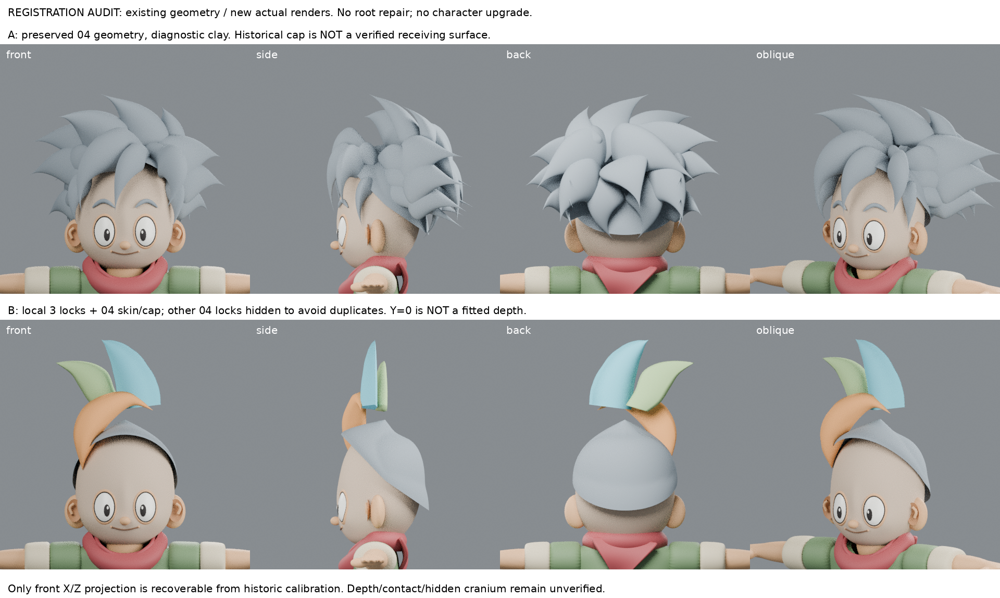
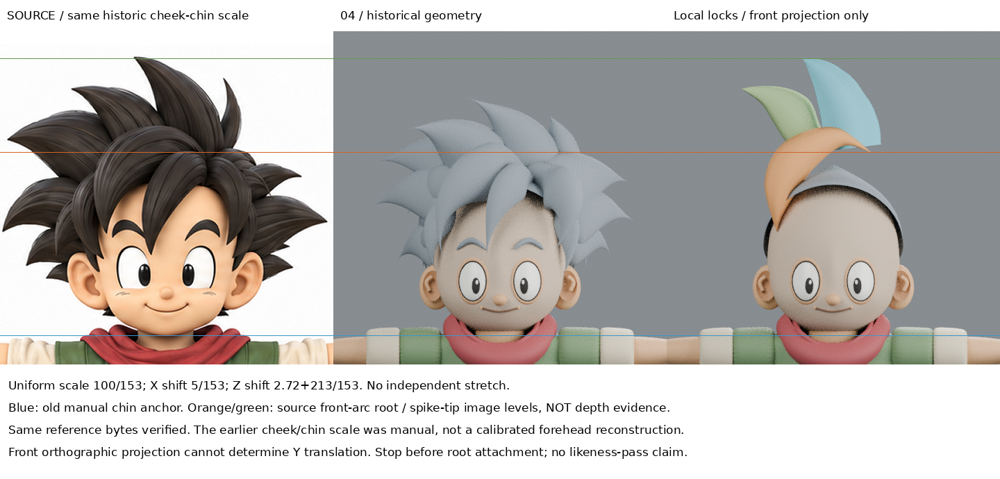

# 前弧註冊診斷：投影能換算，三維接根仍缺依據

2026-10-30 09:36 UTC 輪（Asia/Taipei 17:36）。**舊幾何的新診斷實渲，沒有新髮型、沒有根部修復、沒有提升人物基線。**

## 問題與回查
已讀 LEARNING_INDEX、forelock-support-research/NOTES與RECOVERY、forelock-root-flow、supported-hair-root、whole-profile-retest。前輪失敗不是再調根片長短能解決；先問局部三束能否以共同剛性＋等比變換，與保留的04頭部建立可信空間關係。沒有重做關cap露皮的已知問題，也沒有修改被遮顱深。

## 實際讀的來源
- Blender 4.3 Manual / Cameras 的 Orthographic、Orthographic Scale、Shift 段： https://docs.blender.org/manual/en/4.3/render/cameras.html 。web工具回402；公開HTTP取得完整HTML並實讀這些段落。正交投影中物體表觀大小不因相機距離改變，ortho scale控制表觀尺度。本文據此區別「前視投影校準」與「三維深度配準」，不是新雕刻筆法。未宣稱看官方示範影片。第三方HTML僅私人來源，不入公開庫/恢復包。
- 自製歷史證據：head-form-study/build.py 的report mapping與crop；front-hair-layer/build.py、revise.py；whole-profile-retest/build.py；iteration04/build.py cap生成段。它們是本案輸入追溯，不冒充外部作者教學。

## 核對同一原圖與原點
head-form-study、whole-profile-retest及本輪三份reference都為1774×887，SHA256完全相同（metrics.json），沒有把不同尺寸圖片混作地標。

早期頭部檢查用的**人工頰顎校準**：
- 原圖px = 345 + 153 X
- 原圖py = 333 − 153 (Z − 2.72)
- 原crop(195,100,495,400)，等比1.5倍；不是額部、頭皮的精確三維校準。

局部三束的歷史投影約定：
- px = 350 + 100 x；py = 120 − 100 z。
- 前弧原build使用(320,130)，後加入上下文時物件平移x−0.3、z−0.1，正好換成(350,120)。早期前弧C曾改Y+0.27；此深度假設保留，不當原圖量測。
- 原生主束尖端(-0.41,0,1.05)對應(309,15)，導向截面仍為歷史局部試驗，不保證全部曲線等於原圖邊緣。

因此共同前視換算是：s=100/153≈0.653595，tx=5/153≈0.032680，tz=2.72+213/153≈4.112157。沒有改旋轉或各軸不同倍率。**ty無法由此確定。** 本輪保留ty=0只作座標原點假設示範，絕不是找到真實髮根深度。

## 實作與四向結果
- A：04幾何，改診斷材質，實渲正側背斜。頭形與cap不動。
- B：04皮膚/cap＋歷史局部三束，對三束使用同一等比＋平移；其他04髮束僅在B隱藏，避免把兩套替代髮束疊在一起。**cap全程保留**，不是刪底座堵問題。來源完整04仍在A與source-input。
- 480×480、ortho2.5，同相機、燈與基準。原圖square window382.5×382.5等比映射480×480，負Y以白邊補齊，不拉伸。
- 實看四向：前面原圖尖端與弧端的投影位置可追溯；04原有髮尖與局部尖端不在同高度，顯示歷史頭部校準、04髮型設計與局部試驗不是已整合的同一髮型。不能把04舊髮型當新束的對準真值。
- ty=0示範的側/背仍顯示高束平帽、前弧與cap缺乏連續接收結構；沒有證據說這是原圖真正根深、或應向哪個Y移動多少。可見頰顎暫保也不等於整個額部/髮際已驗證。
- 官方投影原理再以當前相機驗算：沿Y平移1單位，前視投影差(0,−0.0000286)像素，僅浮點殘差。這是深度不可由本前視定位的證據，**不是建議移動1單位，也不是造型成果**。

## 結論與停止點
**可恢復的是共同前視坐標換算，不是可靠的三維接根註冊。** 缺少共同可信的額部/接收面地標與深度觀測；不縮放頭顱、不補中央束、不調隱藏Y去湊，不採用任何新基線。原04 SHA仍為35cd1b71c9d288029d93d0fdb8d9741d62a5151bc3bc459ab48c789092b5aaa6。

## 可重用方法、失敗與下一問題
- 匯入局部練習前，先追來源像素原點、單位尺度與歷史object平移。正面能對準不等於可用作接根。
- 額部接收面是否有可見證據、cap是否已驗證，須分開記；不要以它能蓋住皮膚便視為正確髮底。
- 恢復技術錯誤：第一次匯入未更新dependency graph就讀matrix_world，使歷史object平移漏入；另一次只匯主曲線未將bevel profile連入scene，求值密度/形狀不一致。已修正為全部link→update→共同變換，並連入隱藏profile；冷讀逐頂點比對通過。早期不合格輸出不是研究結果，.blend1只供私人技術追溯，不交付。
- 下一步不是再次掃ty。可先以作者有完整頭部上下文的案例，研究「可見髮際／中央瀏海邊界」如何標識接收面，並把原圖可見約束與遮擋假設分層記錄；在沒有新空間證據前，只能做獨立方法練習，不能宣稱整合成功。

## 恢復範圍
私人恢復保留原樣輸入、原生模型、建構／排版／冷讀腳本與驗證數據。本公開版只有本筆記及以下兩張原始比較板，不包含原生模型、建模腳本、八張單視圖或第三方來源HTML，不能獨立完整重建。冷讀核對三束求值頂點數相同，共同變換最大殘差小於5e−7；頭/cap求值頂點差0。這是恢復保真，不算美術進步，也未宣稱另一台機器解包重跑成功。GitHub尚待原核准，未寫入／重試。

## 公開附圖

[前輪支承研究](../forelock-support-research/NOTES.md) · [恢復限制](../../REPRODUCING.md)
