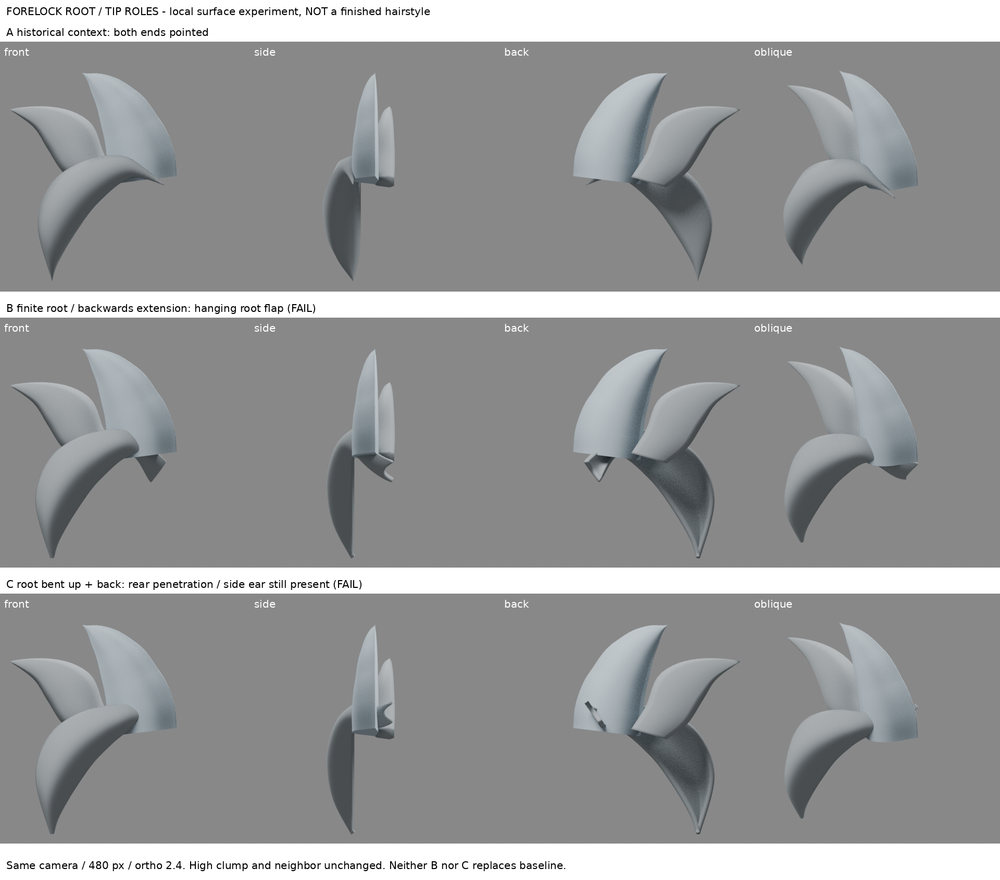
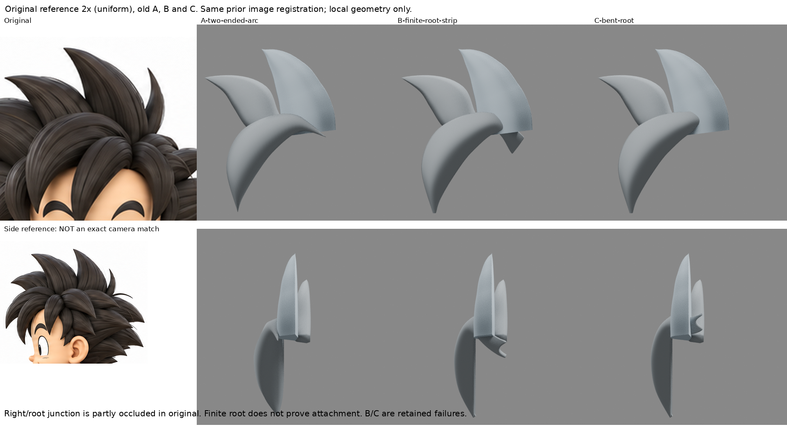

# 前弧髮束：根邊界與尖端不是同一種收口

2026-10-30 08:36 UTC 輪（Asia/Taipei 16:36）。本輪即時研究＋局部表面練習；非完整人物、非髮型驗收。

## 先回查的問題
已讀 LEARNING_INDEX、whole-profile-retest、hair-boundary-design、front-hair-layer、diagonal-clump-study。連續截面已有效回做，不重複中央脊；本次只針對舊前弧的兩端尖月牙和不自然側面。檢視舊 build.py：兩條邊界在首尾都匯合，同時用單點三角扇封口。因此右上根端被先驗寫成另一個尖端。原圖右上接點受中央瀏海遮擋，不能由目前邊界認定真實髮根形狀。

## 實際讀看來源及方法差異
1. [UCBUGG：Polygon Hair Modeling](https://www.ucbugg.com/labs/modeling/polygon-hair-modeling)，實讀 Front Hair、Side Hair、Notes and learnings。實看 picture_11（前額平面）、picture_17（向上延伸瀏海分線）、picture_20（後緣延至後髮）三張操作圖：前額面貼形後分線、加厚，後緣延續而非兩端皆尖。造型為長髮瀏海，非本例尖髮；只適配「表面根邊界與自由尖端分工」，不照抄作者網格、不將其視為固定原圖隱藏結構。
2. [UmityStudio：Split Bangs](https://note.com/umitystudio/n/n342fe68ce348?hl=en)，實讀 Split Bangs Step 2 與 Split Side Hair Steps 1–4 的文字；本文圖片沒有取得，因此只稱讀文。指出單純壓扁會如懸板，還需沿頭部彎曲，根端與尖端彎曲量可不同。其外掛操作未安裝、未執行；數值沒有照搬。
3. 與早期 Dan Eder 的大形分層/重疊概念不同，這次新增的是前額面、根後緣的具體建造順序；不是再將舊前弧整體平移。

## 小範圍實作與假設
- 恢復輸入：上一輪 B-aligned-arch；相機、後高束、鄰束固定。iteration04 完全不改。
- A：舊雙尖前弧。
- B：改成有寬度根邊界的四邊形表面，保留左下尖端方向；沿深度延續根區，Subdivision＋Solidify。不是完成品，亦不是作者直接網格。
- C：B 保留失敗後，依來源貼形方向條件把根區連續向上/後彎；不是整束平移。
- **根端位置、後延 0.40、上彎 0.35、厚度 0.045 均為本地測試假設**，不是從原圖精確量出。缺少可信接收面，不能說已貼合頭皮/其他髮束。
- 480×480 四向，正交尺度 2.4（200 px/unit），原圖正面同舊基準、等比 2x；側參考不是正側相機，僅定性看，沒有量精確距離。未拉伸原圖。

## 結果：沒有可替換基線的新髮根
- A 的兩端尖確為網格生成假設，不能當原圖證據。
- B 正面去掉右尖，但形成向後下方懸掛根片；側/背視失敗。
- C 去掉向下懸片的主要投影，正面較乾淨；**側面仍有外翻耳片、背面根片穿出高束**。不是靠前視隱藏就合格。
- B/C 左下尖端亦因均勻加厚與退化邊界留小鈍口；未解決尖端厚度，不進入細節雕刻。
- 因本局部只有三束，接收頭面/中央瀏海邊界尚不可靠，往隱藏區繼續調座標沒有新依據；停止。B/C 皆保留為失敗，不取代較好基線。

## 可重用方法與戒條
根是可延續的表面邊界，尖端是自由終止；先分類再建模。新根邊界仍必須四向驗證貼合、交叉與體量，不能只把單點換寬平帽或將根片藏到後方。貼形方法需要可信支承面；不可把猜測顱頂當精準 shrinkwrap 真值。不要添束堵洞、縮根或刪底座冒充附著成功。

## 下一個仍不懂的問題
原圖中央瀏海遮住前弧根端：如何先以可見重疊邊界建立足夠的局部接收面，而不推斷隱藏顱深？應研究作者如何在有前額/鄰束支承的情境中接續瀏海根區，先比較連續片與獨立束適用性，不重跑無支承根片座標猜測。

## 恢復及圖
- source-input/context.blend：A 完整恢復輸入；source-input/reference.png：原圖。
- build.py：重做 A/B；revise.py：在 B 上重做 C；boards.py：僅排版實渲與原圖。
- B-finite-root-strip.blend、C-bent-root.blend：失敗模型；parameters.json 記錄假設。
- comparison-board.png：A/B/C 真實四向；reference-comparison.png：等比原圖/正面及非精確側對照。
- private-source/：第三方教學圖僅私有研究，**禁止放公開 repo**。公開僅連結與筆記、自製腳本/實渲；模型/恢復輸入另私有保存。
- iteration04 SHA256 仍為 35cd1b71c9d288029d93d0fdb8d9741d62a5151bc3bc459ab48c789092b5aaa6。

## 公開範圍與對照

公開版只有本筆記及兩張比較板，未重複收錄12張單視圖。上述模型、來源輸入、重建腳本與第三方教學圖不在公開庫；恢復需私人備份。尚未驗證異地解壓完整重跑。本地待同步，不代表遠端已發布。
