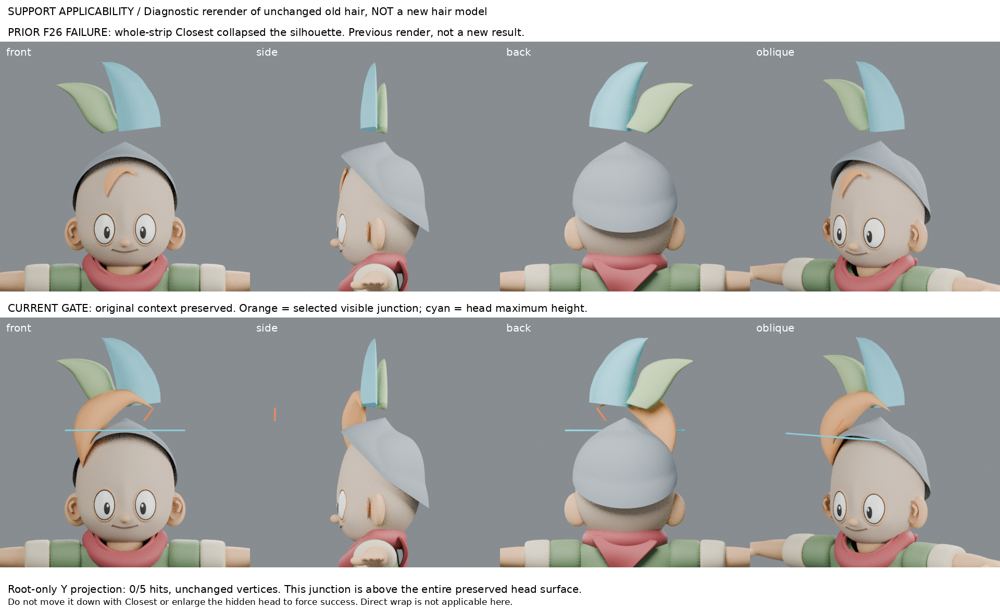
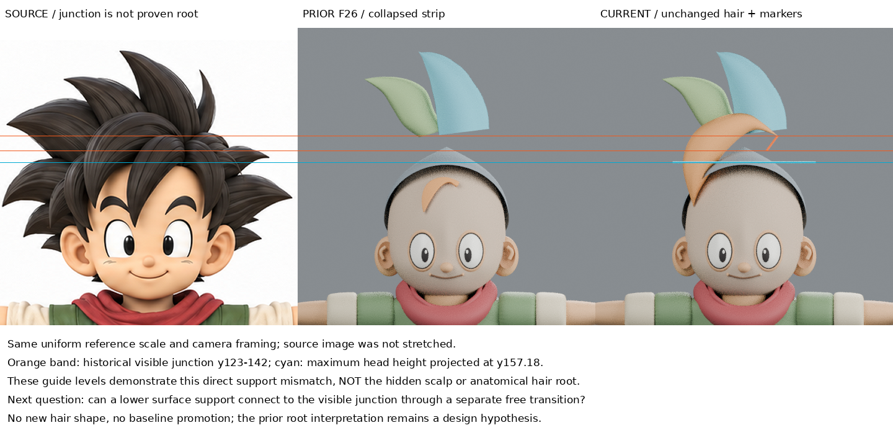

# 可見接點不等於頭皮支承：局部投影的適用性門檻

2026-10-30 11:36 UTC 輪（Asia/Taipei 19:36）。本輪為來源理解修正、局部工具適用性實測及舊幾何診斷重渲；**沒有新髮形，沒有改善基線或整合角色**。

## 回查與問題
已回讀 LEARNING_INDEX、forelock-surface-strip（F26整束Closest塌縮）、forelock-support-h1（輸入雙尖且無開邊，H1撤回）、forelock-root-flow（無接收面懸片/穿插失敗）、supported-hair-root（假設支承面擷取後形變失敗）。不再將遠平面整束投影、不掃Y距離、不偷偷採用失敗B/C。
問題：能否只約束根支持區，保留自由剪影？動手前先判斷目前被稱為「根」的影像邊界，是否真的可直接由04頭面承接。

## 實讀／實看來源及修正
- [UCBUGG Polygon Hair Modeling](https://www.ucbugg.com/labs/modeling/polygon-hair-modeling)：實讀 Front Hair 79–116 及 Notes 188–192；重看 picture_11近額平面、picture_13 Closest+offset貼額、picture_20後緣接後髮；**本輪新增實看picture_14上移後平面**。作者是長髮瀏海/馬尾，不是本案短尖髮。
- 方法順序不可省略：先近額面建立弧形→Closest與offset→整片縮放/移高（pivot近頭）→套用歷史、切分線→加厚→後緣接後髮。作者並不是要求成品每一個根點都永遠直接貼頭皮。因此「可見高位接點必須投到頭面」不是作者規則；需分開支承來源、自由髮量、可見交界。
- [Blender 4.3 Shrinkwrap官方手冊](https://docs.blender.org/manual/en/4.3/modeling/modifiers/deform/shrinkwrap.html)：web工具402；隨後以直接下載取得完整官方HTML，**實讀Options的Vertex Group、Wrap Methods的Nearest Surface Point與Project**。未入頂點群者不移動；Project沿所選局部軸投射，未命中者留原地，正負方向可限定。另讀本機4.3.2 RNA並實測，不將未命中零位移稱成貼合。
- 沒有看逐筆影片、沒有作者下載模型、沒有安裝外掛。第三方圖/HTML只私有研究，公開僅連結與摘要。

## 執行前輸入契約／工具次序
- 輸入 source-input/registered-context.blend（SHA256 afbd1e0db0524b56b22870d3690938c8ee0a27e92f41e6a0be0bd9a054ecdfea）。是原04頭+舊三束診斷context，Y0未驗證；不是F26塌縮模型，也非08:36失敗B/C。
- 原始前弧仍是雙尖舊物件，本輪不把它當有根開邊。另建**不渲染的10點四面工具探針**，選0–4作ROOT_ONLY邊界，其餘點不入群；這是門檻夾具，不是新髮束。
- 邊界取F26歷史可見接點(388,123)→(374,142)，5點等分。稱它為選定影像接點，不宣稱是真正解剖髮根。
- 目標 Head sculpt with orbital planes，evaluated surface；不是未驗證髮帽。
- 先取世界空間頭面高度及+Y射線相交，再原生Shrinkwrap PROJECT僅ROOT_ONLY、+Y、offset0.035。Y=-1只是射線起點，沒有掃描Y；局部軸與世界軸一致。結果未命中即停止，不執行自由區延伸/加厚。

## 實測結果與原圖／前版對照
- 頭面最大Z=3.869168；在既有等比正面註冊下對應原圖y=157.177。
- 選定接點Z=3.968366–4.092549（原圖y142–123），整條高於頭面；最低仍高0.099198。
- 5條+Y射線全部未命中。原生PROJECT的5個群內頂點位移全部0；5個群外也不變。**這是方法不適用於這條接點直接貼此頭面，不是已貼合。**
- 四向新渲保留舊幾何，橘線是選定接點、青線是頭面最大高度，非髮形裝飾；側視清楚顯示標記只是診斷深度。比較板上排為明標的前輪F26失敗渲染，下排本輪新診斷重渲。原圖板保持相同等比尺度，未拉伸；影像高度不等於隱藏頭皮真值。
- 未以Closest把接點拉低；未放大/拉高04頭；未拿髮帽當更方便的目標；沒有新髮形取代較佳基線。
- iteration04原檔SHA256仍為35cd1b71c9d288029d93d0fdb8d9741d62a5151bc3bc459ab48c789092b5aaa6。

## 學到與失敗戒條
新增理解：局部選區可保護不該變動的自由區，但不能創造不存在的接收表面。先驗證接點與支持面是否相交，再談約束。更關鍵是不能把可見髮束重疊接點直接命名為貼頭根。作者貼額後移高的步驟說明支承來源與最終可見位置可不同。
本輪沒有證明局部選區貼合成功，也未驗證新的自然髮流或髮量。工具零位移要區分群外保護、未命中，以及真的已貼合。

## 下一個問題／有據重試條件
應研究「較低的真實可用表面支承區→自由轉折→高位可見接點」的連續形體建造，或作者貼額後保形移高與後緣接後髮的實際步驟；明確區分設計假設和原圖證據。需要可恢復近額輸入、可確認支持邊界與不破壞可見主量的移動方法，不能由本結果自行猜一條後延根片。保持04，不反推/擴大不可見顱頂。本輪在適用性門檻停止，沒有硬套下一步。

## 恢復
build.py相對路徑讀入source-input/registered-context.blend，保留原圖與registration-metrics，產生RESULTS.json、support-gate-diagnostic.blend及四向。boards.py使用同包內前輪失敗圖，明標舊圖，不需外部工作區；comparison-board.png及reference-comparison.png為交付圖。forelock-support-gate-recovery.zip包含可恢復輸入、腳本、結果與圖，不含private-source第三方媒體。大型模型僅dot/Space，公開repo只筆記、自製腳本及兩板。公開版仍本地待同步，未宣稱GitHub已更新或異地完整重播通過。

## 公開附圖與恢復邊界

[原生門檻診斷腳本](build.py)及[比較板腳本](boards.py)為自製可審查方法。需要未公開的source-input模型、原圖副本、註冊數據及前輪渲染；公開庫不是獨立可恢復模型套件。沒有新髮形，不以舊圖或診斷標線冒充改良成果。
