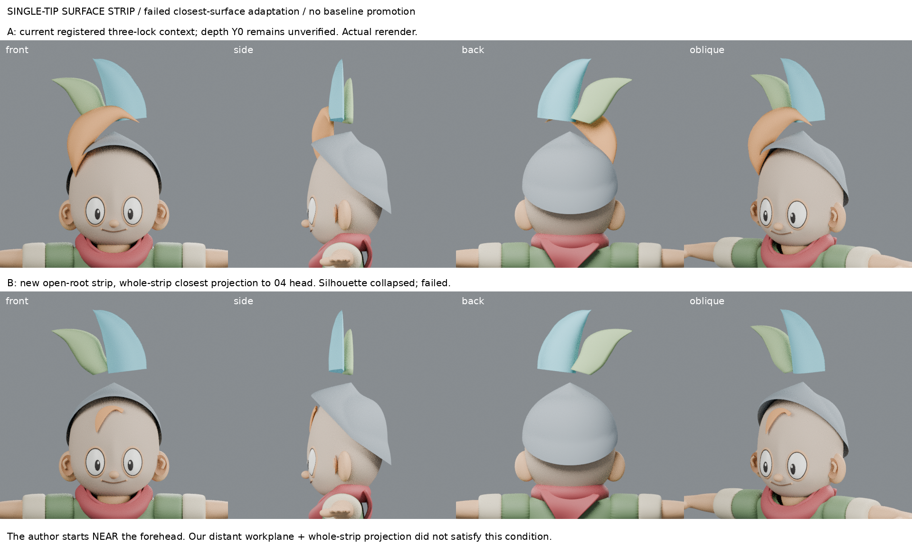
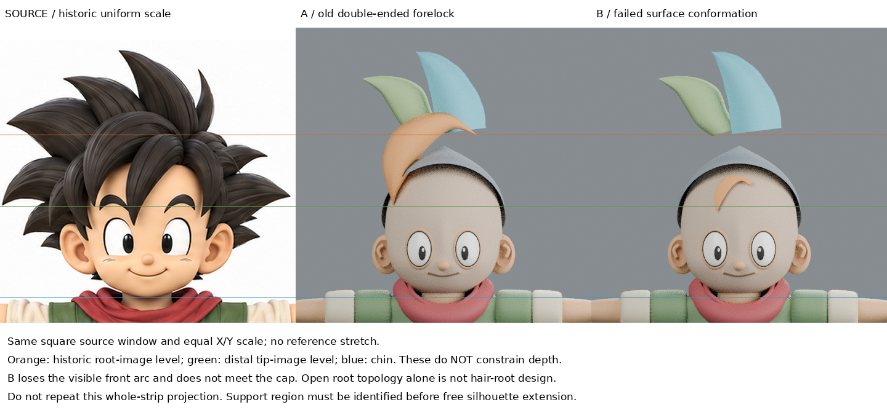

# 單尖可延續面片：最近表面適配的失敗練習

2026-10-30 19:06 排程（Asia/Taipei），本輪實作與紀錄；不是歷史補寫。

## 問題與來源

H1 已撤回：舊前髮是封閉雙尖網格，沒有可延續根邊界。本輪從新面片開始，不修改它、不把失敗 B/C 升基線。

實讀 [UCBUGG Polygon Hair Modeling](https://www.ucbugg.com/labs/modeling/polygon-hair-modeling) Front Hair 79–116、Notes and learnings 188–192；實際下載檢視 picture_13（Closest 與 offset 貼額頭）、16/17（分束切線連到上方區域）、19（厚度）、20（後邊向後髮延續）。13/16/19 是本輪新增觀看，17/20 是重看。作者為動漫長瀏海/馬尾，不是本案例尖短髮。來源圖留 private-source，不公開、不放恢復 ZIP。

作者順序：面片先接近額頭→最近表面貼合並偏移→整理分束→增加厚度→後邊銜接後髮。關鍵前提是開始面片接近目標額面；不是把任意距離整束投影都會合理。

## 輸入與工具次序（在投影前保存 INPUT_GATE.json）

- 場景：source-input/registered-context.blend，SHA256 `afbd1e0db0524b56b22870d3690938c8ee0a27e92f41e6a0be0bd9a054ecdfea`。來自 registration audit B，保留 04 頭/歷史髮帽以及三束局部髮；Y0 仍是假設。
- 固定04 SHA256 `35cd1b71c9d288029d93d0fdb8d9741d62a5151bc3bc459ab48c789092b5aaa6`，本輪沒有改寫。
- 原圖 SHA256 `7a5a8c202ca8ffb29bb965f6f5767423d18b0f298dc058c26a1f464905a284ac`。
- 新網格26點20面，根0–4是4條真實邊界；遠端只有頂點25，非雙尖封閉輸入。全邊界列表已保存。
- 使用前次可見輪廓點只是設定新面片X/Z，沒有載入 B-finite-root-strip 或 C-bent-root 的網格。
- 原生 Shrinkwrap：NEAREST_SURFACEPOINT、ON_SURFACE、offset .035，目標 `Head sculpt with orbital planes`；apply後保存控制籠，再Subdivision2及Solidify .02，厚度頂點群組遠端漸為0。
- .035/.02與Y=-1起始工作平面是實驗假設，不是原圖量測。04頭與髮帽都是歷史代理，遮擋區未驗證。

## 實際結果：失敗，不採用

新面片可編輯且確實只有一個遠端尖端、保留有限根邊界；但這只是拓撲前提，不代表髮根造型完成。

正面：整個前髮弧收成額頭上的小彎片；側斜面：薄片貼額頭而非進入髮帽支持量；背面：沒有形成根連接證據。尖髮剪影與位置比前版退步，不能整合。三束其餘兩束、頭、髮帽未改。

控制籠根邊總長 .154254→.062158；最大X/Z位移 .527111（世界單位）。根第0點Z約4.09255→3.69843。數字解釋失敗，不是進步指標。

## 失敗原因與可重用戒條

**不是作者的最近表面方法失效。** 我把初始面片放在Y=-1而非幾乎貼額頭，又把自由尖端/弧輪廓整束投影，沒有滿足作者的近表面前提。Closest同時改X/Z，吸到較低額面，破壞了應保留的輪廓；另外頭表面不等於髮帽/主髮量支持面，兩者不能混稱。

與08:36失敗有何新依據：以前只手工猜後延/上彎，這次確實實施作者的支持表面貼合工具順序；但適配前提選錯。保留失敗能排除「整束投影＝根部設計」這條錯路，不能說已學會自然髮根。

下一問題：先在支持區辨識可信面片及其邊界，再從那個邊界建立自由尖髮，如何維持可見X/Z、又形成有意義的側面弧？需實際選定局部支持區和起始貼合位置，不能再掃根深/角度，也不能假定未知原圖深度已解。

## 對照與恢復

- comparison-board.png：本輪 A/B 各正側背斜真渲，同相機480²、ortho2.5。
- reference-comparison.png：原圖、A、B，沿用歷史頰顎手工標尺的相同正方裁窗，X/Y等比例，非額頭校準真值。
- pre-shrinkwrap-cage.blend：投影前新面片（隱藏渲染，保留對照）。
- B-conformed-single-tip.blend：失敗後獨立場景，不取代04。
- build.py、boards.py、INPUT_GATE.json、RESULTS.json：可重做及核對。
- 恢復ZIP排除private-source第三方圖片，模型不公開GitHub。恢復包已含相對路徑source-input/iteration04.blend及registration-metrics.json，腳本已改讀包內輸入；公開腳本須說明模型輸入不隨GitHub公開。

## 公開附圖與重現限制

[實作腳本](build.py)與[比較板腳本](boards.py)公開供審查失敗方法，不是建議照用的造型流程。腳本依賴未公開的source-input模型、註冊量測及原圖副本；本庫單獨不能重播。私人恢復包另保存，未宣稱異地完整重播通過。這是構造與工具順序的多因素方法比較，不是單變量改善。
