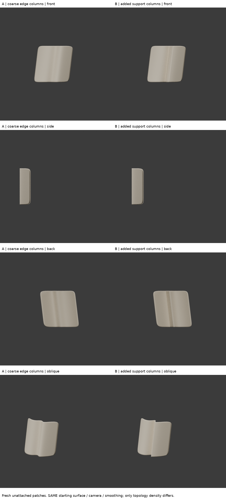
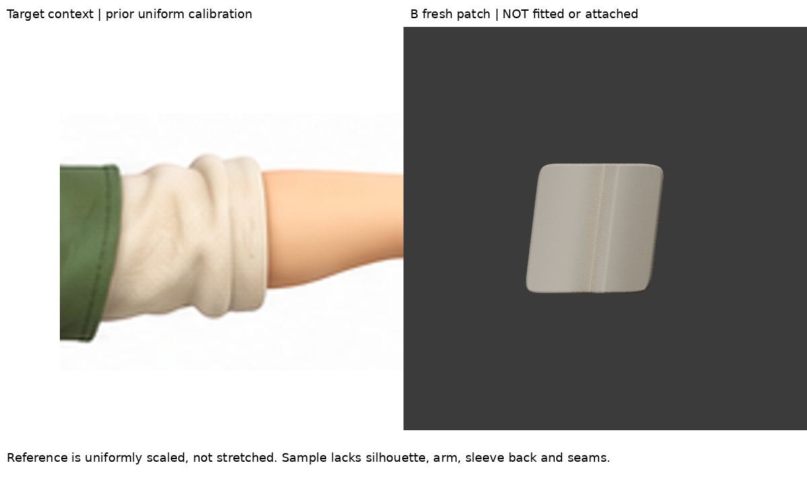
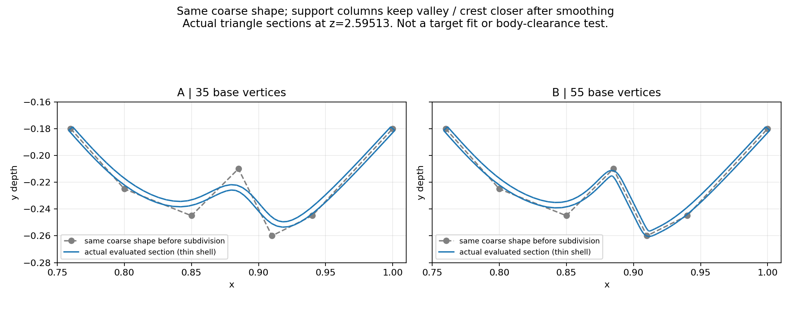

# 新面片：邊緣擠出與支撐列的獨立方法驗證
2026-10-29 06:36 UTC；DOTS。這是通用建模練習，不是袖子新版或人物相似度進展。

## 找到可真正觀看的來源
沒有重試前輪黑畫面影片／失效圖。
本輪找到出版社 No Starch Press 官方公開試讀：Ben Simonds《Blender Master Class》第5章。
https://nostarch.com/download/samples/Blender_ch5.pdf

實讀印刷頁56–57的支撐邊說明；實際下載公開PDF並用本機PDF轉圖，**看了第57頁的圖5-14與5-15**：
- 圖5-14上方原始折面被Subdivision平滑；中間靠近折角的支撐列保留較窄轉折；下方另示範crease方法。
- 圖5-15展示邊列接近角落時保留更多原形。
這支持一個可隔離驗證的機制：相同粗面形，局部邊列間距影響細分後轉折寬度。
這是雕刻飾板／通用Subdivision示範，**不是衣袖教學**，沒有聲稱完整復刻作者作品。試讀圖文未打包轉發。

補充：前輪已讀Mongrelman的第一手局部面片擠出方法，本輪只採用「從截面邊鏈向外擠出」；未聲稱看到了其失效圖片。
https://polycount.com/discussion/65159/modeling-folds-wrinkles

## 與前幾輪不同的起點
`build.py`建立全新空場景，沒有開啟或修改任何舊袖面。
先明確定義寬肩、窄谷、相鄰隆起的7點截面，再以Blender真正的`bmesh.ops.extrude_edge_only`逐段擠出4次，形成短面片。
不是把深度疊在原來的圓管褶上，也不是把控制點數值當作觀察所得真實深度。
截面和輕微斜向路徑是本次方法練習的設計假設，並未依目標影像精確配準。

## A/B控制
A：7列、35個基礎頂點、24四邊面。
B：在窄谷與相鄰隆起兩側加入4個列，55個頂點、40四邊面。
新增列位置在A原本線性面上，**兩者細分前的面形相同**；不同的是邊列密度，不是任意增加褶高度。
兩者都Catmull-Clark3級、顯示厚度.004、相同材質光源、正側背斜角相機。這個薄殼只是面片可見厚度，不是縫好的衣物。
詳細profile、stations、x-columns保存在construction.json。

## 實際看到的結果
- A細分後變成寬緩波形，原始窄谷與隆起被平均掉。
- B在斜角／側面明確保留較緊的轉折，寬面仍比較平順；與圖5-14的通用機制一致。
- `section_method_comparison.png`是實際evaluated三角面在z=2.59513的剖切，不是手畫猜測；疊上原始粗截面，可以看出A/B平滑的差別。
- `B_coarse_cage_oblique.png`是實際低模面片與基礎邊線渲染，可檢查支撐列位置，而不只展示光滑成品。

因此這輪可以說：**完成一個可重做的邊緣擠出＋支撐列方法驗證。** 不能說：已學會把指定袖子做像，或頂點增加代表美感進步。

## 與原圖的界線
`reference_context.png`保留同一原圖裁切與等比校準（173/45，原圖(528,364.5)→render(389,299.5)），不拉伸。
旁邊放B正面只為交代這個方法未來要用在哪裡。B沒有手臂、綠袖、後方包覆、內貼邊或接縫，也沒有符合原圖上下剪影。不能拿這張圖當前後改進證據，故不做相似度分數。
完整iteration04及preferred lower-contour候選均未動。

## 限制與下一個未知
1. 現在像一張有固定折線的薄片，不像鬆厚堆褶。
2. 峰谷沿路徑延伸到底，沒有像目標那樣漸消、交接寬布量；這是下一個形體問題。
3. 所有列同時延伸，還沒學會讓局部支撐列終止而不造成夾痕；不能盲目把密列貫穿全袖。
4. 目前是獨立面片，未接到角色；無人體間隙／動作驗證。沒有以「沒放人體所以不碰撞」冒充通過。
5. 本書2013年，這輪僅採用可在4.3.2實測的幾何原理，不依賴舊介面快捷鍵。

下一次應在這個可理解的小片上學習折線端部如何放寬／漸消，並驗證相鄰寬面是否保留；通過小區域的形體觀察後再考慮對應角色，而非立刻黏回去。

## 公開版範圍與復現限制

本文是既有實驗筆記的整理；「實讀／實看」與數值結果指當時紀錄，本次公開整理未獨立重跑。原始 `.blend`、實驗腳本、渲染圖、研究用三視圖及第三方教材圖片均未隨本文提供。文中檔名只用於說明歷史證據，不是可下載附件；不可僅憑此文字版宣稱已復現或驗收角色。

## 公開附圖

下列為當時保存的原始圖片檔，這次僅整理上傳，沒有重新建模或渲染。研究分析板與舊版渲染不代表新模型；實驗成功、失敗及限制以本文記錄為準。

[固定角色原始三視圖](../../images/reference/character-three-views.png)
