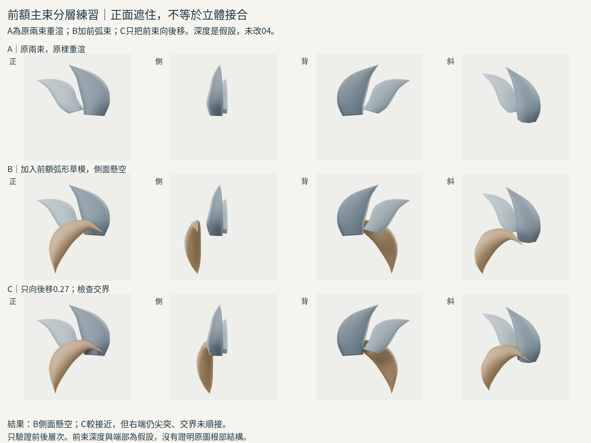
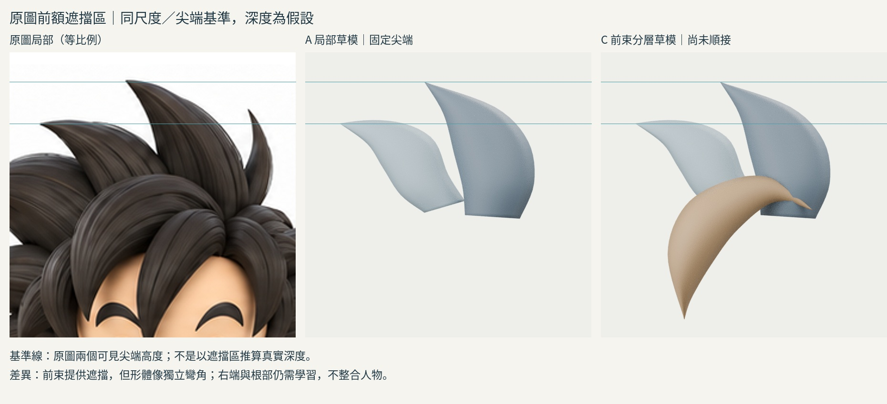

# 18:36 前額弧形主束的局部分層

## 實際來源
Dan Eder 本人訪談 https://80.lv/articles/guide-sculpting-stylized-hair-in-zbrush ：本輪實讀 General Workflow、Hair Blockout、General Mistakes。先拆主髮塊、檢查剪影，再在暫時形體上安排束；避免碎尖穿插。重新實看已保存的 overlay GIF 20個取樣及 clipping 兩張正反例：前額弧束置於主形表面，調整末端；錯誤相交產生細碎尖端。不是新找到影片，也沒有看完完整五部教程。

比較方式：作者用球體塑形/Dynamesh建立主塊，再放表面束；前輪閉合截面方法方便控制我們這個局部輪廓。因此本輪用自己的連續閉合環構形承載主塊，不照搬ZBrush刷具、不執行外來腳本。是有據適配的草模，非作者完整工作流。

## 原圖定位與假設
前額弧束上緣參考可見約(388,123)、(353,96)、(316,98)、(281,119)、(266,160)到下方尖端(280,215)。內側以可見弧走向估計，部分受其他前髮遮擋，不能當精確真值。深度、截面背凸及右端收束都是練習假設。原圖是空手Tpose三視圖，不用側圖反推不可見深度。
原兩束原樣保留，不再調切線。所有A/B/C統一正交2.4，中心映射原圖(330,110)，對照裁切x210..450、y-10..230，上方補白、等比例。為容納前束下尖端，本輪視野較上一輪擴大，但A也重新渲染，沒有變更對照比例。

## 實驗與修改
A僅前輪兩束，重新四向渲染。B新增獨立封閉前弧束：40列七點拱背截面，沿上下可見導線逐段變化，尖端收束。不是以球體互穿當完成品，仍只稱草模。
實看B：正面可遮住上方束下段，但側面有明顯空隙、像懸空彎角。保存失敗。C僅將新前束Y向後0.27，其他x/z控制點、截面形狀、材料相機不變，再渲染四角。
實看C：側面較接近，正面投影幾乎不變；但斜角右端仍呈多餘尖突，與上束交界不自然。這不證明根部接合改善，更不證明深度正確。前束自身仍像單一彎角，缺少原圖主髮量的連續走向及末端銜接。不能為了遮住平截根部就稱成功。

## 學會與未解
學會：前方主束存在與否會改變讀到的下段邊界；同一正面遮擋在側面可能懸空。獨立束可作分層，但必須驗證交界，不是全部焊接也不是任意相交。
未解：前額束右端應如何過渡進主髮量、沿頭部的深度走向如何安排。下一步需要相近弧束根部/末端處理的實際案例，不能繼續只前後平移或加小物件堵縫。原04不整合。

## 公開版範圍與復現限制

本文是既有實驗筆記的整理；「實讀／實看」與數值結果指當時紀錄，本次公開整理未獨立重跑。原始 `.blend`、實驗腳本、渲染圖、研究用三視圖及第三方教材圖片均未隨本文提供。文中檔名只用於說明歷史證據，不是可下載附件；不可僅憑此文字版宣稱已復現或驗收角色。

## 公開附圖

下列為當時保存的原始圖片檔，這次僅整理上傳，沒有重新建模或渲染。研究分析板與舊版渲染不代表新模型；實驗成功、失敗及限制以本文記錄為準。

[固定角色原始三視圖](../../images/reference/character-three-views.png)
