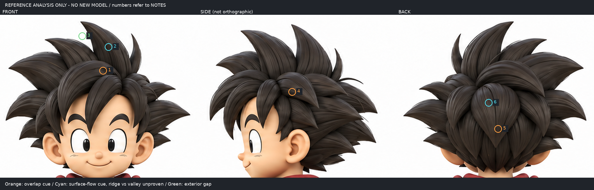

# 先分類髮束交界，再選塑面方法

2026-10-30 14:06（Asia/Taipei）輪。**研究與原圖標註，沒有新模型、沒有新渲染，也沒有宣稱已掌握雕塑。** iteration04及前三輪模型不變。

## 問題與舊失敗
開工讀LEARNING_INDEX、root-entry-direction、root-taper-scope、root-surface-flatten、diagonal-clump-study。彎根只去浮帽，縮根造成梨形，Flatten只改小範圍；移除整個底量則會漏皮。這些試驗把接界當作一種問題，但沒有先區分「同一塊表面的面向轉折」和「前束蓋住後束」。本輪停止同一孤立束接球的參數或筆刷掃描。

## 實讀實看來源
### 1. 連續面：Scott Spencer，ZBrush Character Creation: Advanced Digital Sculpting，第2版，Wiley公開節錄
https://catalogimages.wiley.com/images/db/pdf/9780470572573.excerpt.pdf
實讀印刷頁25–27（PDF第26–28頁），並將三頁渲染後實看Fig1.31–1.37；未看書附DVD。書目ISBN9780470572573以英國國家書目核對作者/書名。這是2011年ZBrush獅頭門環雕刻，不是本案尖髮，也不是Blender操作教學。

作者把連續獅鬃組織成從頭頂往下的長弧。Pinch的正/負Brush Modifier分別產生凸脊/凹谷，Fig1.32有剖面；Fig1.34可見寬面與長折線共同轉向。窄凹處正面夾捏會連帶拉兩側，因此p27從網格內側定位處理。**此來源提供「同一表面可有硬轉折」的實作依據，不代表任意物件接縫都該用Pinch。** 不移植舊版強度數字，不把內側操作當本案已驗方法。

### 2. 分層面：Alina / Adaline 的 Jinx，Character Class作者訪談
https://www.characterclass.com/newsletters/character-notes/posts/ArcaneBreakdown
實讀Blocking及Hair段；實看該段灰模三角度圖（image3）、分色線框圖（image2）、Curve Modifiers圖（image1）。不是逐筆錄影。作者按概念的重疊瀏海選擇獨立束，分頭部主量、瀏海、辮子；主量球體Dynamesh塑形，束由CurveTube開始再整理。線框圖呈現寬片沿頭流動，前後束搭疊，並非所有邊緣熔成一塊。圖片不能給出每支筆刷的壓力/位置。

兩造型差異：獅鬃是連續裝飾浮雕的長弧折面；Jinx是側分下垂且有辮子的分離束。只借前者的面向/脊谷區分與後者的遮擋分工，不把任一完整髮型或參數直接套成本案。

### 3. 舊來源回查（不計新掌握）
https://www.pablander.academy/tutorials/sculpting-stylised-hair-in-zbrush
再讀主量→大束→Surface Blocking→細節段，支持先寬面流向後細溝。嘗試打開其YouTube示範時瀏覽器AX/DOM讀取逾時，**沒有看到影片操作**，因此不把影片列為已學證據，也不以靜圖冒逐筆示範。

第三方媒體只私下閱讀，不放進此資料夾、公開稿、恢復包；本輪提供的圖完全來自已授權固定原圖。

## 固定原圖的具體判讀

三個區域同為原圖等比例2倍裁切；沒有AI改造、拉伸或把側圖改成正側。數字圈是區域提示，**不是宣稱已量出精確邊線/深度**。

|標記|實際可見|本輪判讀與不能推論之處|
|---|---|---|
|1 正面前弧與高尖髮下段|前弧上緣遮去後方高束下段；後束紋理在前弧處中斷|有前後遮擋依據；不能量出高束藏在後面的根深、根寬或焊接方式。此處不應先以「消除所有分層線」驗收。|
|2 高尖髮可見寬面內|多條順長軸彎曲的明暗帶，外輪廓仍連續|可判面內方向線索；單一著色圖不足區別每條是凸脊、凹谷或材質筆觸。可提出一個主要轉向假設，不能按所有黑線逐條開槽。|
|3 高束與鄰束外緣白區|背景白色侵入兩尖束之間|可見負形/外輪廓要保留；不是把兩尖束熔合成整片頭盔。白區以下的根仍不可見。|
|4 側圖前側短束蓋後側束|上層尖片邊界與下層紋理有遮擋關係|支持分層；此圖非標準正側，不能拿它精算正面束深或一一對點。|
|5 背面中央下垂片與底層|中央片外緣終止於下方尖端，底層紋理在其兩側延續|有搭疊判讀依據；不能將此片當前面高束同一根的直接證明。|
|6 背面中央片內|寬面上長向亮暗帶，與外緣不同|和2一樣是表面流向線索，不是已知拓撲或精確脊谷高度。|

**結論是分類信心，不是已解模型：**1/4/5優先保留遮擋分層；3保護負形；2/6可研究單束內部面向，但凸凹符號仍是假設。隱藏根和頭深保持未知。

## 可重用決策與下一次可執行的小樣
1. 先問邊界屬於：背景負形、前後遮擋、同一面內折線，或未知。未知不以Smooth/融合自動消除。
2. 下一小樣只選正面**高尖束可見上段寬面**（2），保留外輪廓與前弧遮擋（1），不再把裸露接球根當原圖驗收目標。使用前後兩塊真實相關髮量作上下文，不加束遮失敗。
3. 先在A上畫主要長向面轉向假設，B只處理一條寬脊兩側的面向；不刻所有細線。可採原生雕塑或少量多邊形控制，但須先查實際工具如何定目標平面，不能把自製座標推移稱作者筆觸。
4. 同鏡頭/材質/尺度比較正側背斜；正面比較可見外緣、白隙、分層，側斜檢查是否仍鼓成管或形成硬斷台，背面只檢查改動影響，不能用不可見處「乾淨」證成功。若只多了刻線而寬面未改，判無效，保留A。
5. 下一個未懂問題：**如何在不破壞高束剪影與層次下，具體控制兩側寬面法線，而不把一條窄槽誤當整塊大面？** 本輪來源可改驗收目標，尚未提供本案完整答案。

## 本輪結果與恢復
新增的是來源支持的交界分類、六處原圖判讀與下一小樣的範圍，非建模進步證明。沒有重試舊失敗、沒有新.blend、沒有拿舊圖充新渲染。
`annotate.py`由原圖產出`reference-boundary-analysis.png`，同尺度可重做。原圖及模型留原有恢復入口。GitHub未寫入/重試；由既有待同步機制收錄本研究。

公開版僅含本筆記及授權原圖標註；annotate.py不在本公開repo附檔。仍是本地待同步，不代表遠端已發布。
