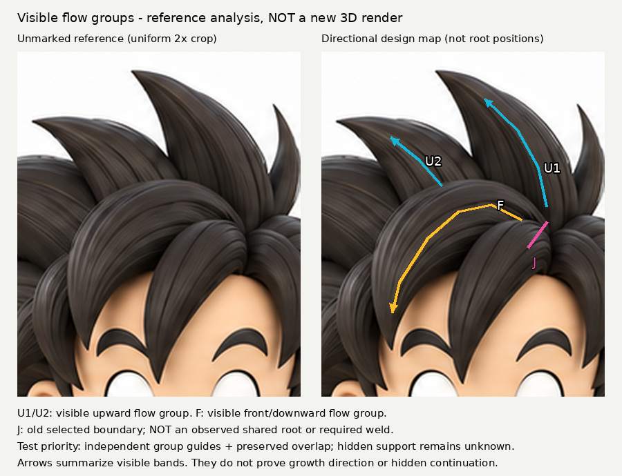

# 可見流群先分工，不把舊選邊當共同髮根

2026-10-31 03:36（Asia/Taipei）觸發輪；於03:44整理。**參考分析與標註練習，沒有新模型、沒有新渲染。** iteration04及所有舊模型不變。

## 問題與回讀
開工讀遠端README、LEARNING_INDEX、STORAGE_POLICY（73065de）及本地索引；回查forelock-layer-junction、oblique-reference-limits、root-entry-direction、whole-profile-retest、hair-boundary-design、hair-occlusion-analysis與registration腳本。舊記錄早已知道前弧遮高束、白隙不同於暗縫；本輪不把這些再次列新知。

具體缺口是施工組織：先前把前弧高端選邊J當成待接到頭/高束的根，導致連續問投影接收面、後伸tab、根厚度。原圖只給J附近可見交會，沒有給共根證據。原擬薄/厚主量A/B經回查撤回：只是已做截面/深度問題的改名，並無新的施工變因，未執行。

## 實讀／實看來源
1. Iida-Maria Pennala，2023，*Creating Stylized 3D Characters for Video Games*，§4.5印刷p27–29：
https://www.theseus.fi/bitstream/10024/799638/2/Iida-Maria_Pennala.pdf
實讀PDF文字，包括先以分層群組粗塑剪影，再沿暫時主量鋪曲線，主量不當最終網格。**Figure18–20未實看**：截圖Cache miss，HTTP取得的是403 HTML而非PDF；不以搜尋圖描述冒稱看圖。此來源支持分群順序，不提供本案分區線、筆刷軌跡或厚度數值。

2. Louis Squara，2023-06-19，*Curly Hair*，Sculpt、Blockout、Flow、Silhouette與Placement：
https://gamesartist.co.uk/curly-hair-ls/
實讀上述段落，實看22-2.png（粗塑／細髮對照）、6-4.png（後腦作者流向箭頭）、4-1.jpg（正面及黑剪影）。前者大形先確定髮際與方向；後者以髮冠／髮際作組織端點、考慮相鄰群的節奏，再安排卡片。案例是短捲髮cards，**不是本案上翹尖髮**；本輪只移用可見流群先行，不移植捲曲、卡片、飛髮或推定本案髮冠位置。第三方媒體僅私下查看，不公開。

## 新局部練習

同一原圖crop=(225,0,430,250)，左右皆等比2倍。箭頭是人工可追溯採樣，無AI改造；不是精確曲線擬合。

- U1、U2：高尖與左鄰尖的可見長向明暗帶，組為上行的視覺流群；圖中箭頭只在可見段停留，不續畫隱藏根。
- F：前弧明暗帶由右側轉往左下的另一個視覺流群。這裡「上行／下行」指圖像閱讀方向，不是已證毛髮生長方向。
- J：保留舊投影/接收面測試所選的(388,123)–(374,142)線，指出它位於多群交會，不是觀察到的共同根，更不是要求焊接的邊。

新增不是「遮擋存在」，而是將它寫成施工分工：**先分別給U與F可編輯的導向與主量意圖，不要求在J共享一條導向或同一連續面；隱藏支承是否共用留為獨立設計假設。** 這不證明它們必定是不同拓撲物件，也不否定日後共同支承。不能用「先分群」當作任意新增量塊的理由。

## 舊方法對照／失敗戒條
- root-entry曾改單束根入射、加相位補償，能埋端帽但根仍鼓；沒有回答兩流群如何分工。
- whole-profile曾回做完整拱面柄，保留正剪影、改善窄折帶；不代表可以把F高端接進U。
- registration只建立正面均勻尺度與X/Z對應，Y仍未知；J在圖上的位置不能變成共同3D根座標。
- 不重試tab延長、投影無接收面、帽殼、圓筒收尖、厚度掃描；不把黑線當必須刻的槽。

## 結果、未懂與下一步
實際結果為一張參考流群圖及撤回一項重複厚度測試。尚未證明任何新模型更接近原圖，也沒有學到作者未展示的逐筆操作。

下一最小3D練習須先明定F、U各自的大形構造方法，再比較「各群獨立導向、交會只保留遮擋」與舊雙端前弧上下文；看前視流群閱讀是否清楚、白隙是否保留、側斜是否多出板狀根或突兀階差。背面只驗改動副作用，不當隱藏真值。**本輪沒有執行此模型方案；也不以圖中箭頭直接生成幾何。**

## 恢復
- annotate.py：自製PIL標註腳本。
- annotation-data.json：原圖裁切、倍率、箭頭與J採樣位置。
- reference-flow-groups.png：本輪新分析圖，非模型渲染。
- 固定原圖仍用既有授權參考；所有模型保持原恢復入口。公開腳本只用相對路徑，不包含第三方媒體、私訊或憑證。
