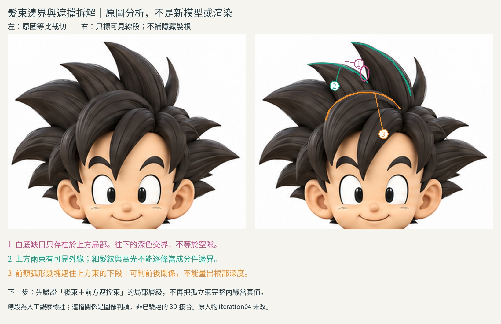

# 18:06 髮束邊界與遮擋分析

本輪有新的參考拆解練習圖，**沒有新模型、沒有新渲染，也沒有角色改善版**。04及所有前輪blend未改。停止對孤立兩束繼續猜位移。

## 實際讀與看
- Leah McEwen（Realtime Hair Artist）本人〈Breaking Down References for 3D Hair Creation〉：https://leahmcewen.artstation.com/blog/dzzZR/breaking-down-references-for-3d-hair-creation 。讀全文。實際在瀏覽器放大 HairBreakdown1.jpg 五欄描圖：紅整體輪廓、綠主束走向/量體、藍負空間與明暗、黃次束、紫散髮。作者由大到小拆解，先掌握主形與負空間再加細節。這是寫實長髮cards的參考拆解，不是本例尖髮建模錄影；移用的是觀察順序，不是貼片材質流程。
- Dan Eder 本人訪談 https://80.lv/articles/guide-sculpting-stylized-hair-in-zbrush ：本輪重新讀 General Workflow、Hair Blockout，先拆對應髮塊再看剪影。未新增觀看影片；前輪GIF閱讀不冒稱本輪新看。與cards的比較：立體髮塊更符合本例寬尖束，但兩者都先拆大形。
- BelleIllumina https://tips.clip-studio.com/en-us/articles/6002 ：讀 Overall Form / Layers and Sections。區分總體量、層次與局部走向；該頁圖未實看，不能列為實看圖證據。

## 原圖實看與可追溯標註
研究用三視圖為1774×887（本公開文字版未附）。crop=(150,0,540,320)，兩側皆等比2倍，沒有改色、拉伸或生成。annotate.py保留每條人工標註的原圖pixel位置。標線是示意觀察而非精確輪廓擬合。

1. 上方大束尖端約(307,14)，小束約(237,50)。外側與白底相鄰的線可作投影剪影線。
2. 二者上方有局部白底楔形缺口（約329,65）；往下轉成髮束之間深色交界，不能把整條深線都當背景空隙。
3. 前額大弧束的上緣約(265,142)經(320,96)到(388,123)，連續遮住上方束下段。這是圖像上前後層級的高信心判讀，不提供隱藏根部深度或接合拓撲。
4. 密集細條高光/髮紋不是每條都獨立物件；只能先建立主要可見束/層。
5. 圖中綠線到可見段就停止，不把被遮擋髮束閉合成完整輪廓；沒有補畫它的根部。

## 新理解與對先前實驗的修正
先前孤立兩束有完整白底負空間和截平根部，這個場景缺少參考中的前方大弧束，因此拿完整內緣去對照原圖本就不充分。這不是證明前幾輪截面、切線練習無用，而是它們只驗證局部控制，未驗證層次。小束上緣微調的收益已很有限。

這輪不直接補前髮掩蓋差異。新增遮擋物可能讓正面看似接近卻在斜角穿插；未先清楚約束範圍，不能稱根部改善。背景缺口、髮束交界、表面刻紋必須分開判讀。

## 下一個可驗證局部實驗（尚未做）
僅選上方兩束與前額大弧束相遇的區域，先建立前束的可見輪廓導引。保留前兩束尖端/已驗截面。將根區延伸作明示的未知假設，不用新可見尖片填洞。A無前束、B有獨立前束；同機位四向檢查接合處是否有突片、穿插、輪廓突變。這只能驗證遮擋策略，不宣稱深度正確；若來源未能支持前束構形，繼續學而不猜。整頭仍不整合04。

## 公開版範圍與復現限制

本文是既有實驗筆記的整理；「實讀／實看」與數值結果指當時紀錄，本次公開整理未獨立重跑。原始 `.blend`、實驗腳本、渲染圖、研究用三視圖及第三方教材圖片均未隨本文提供。文中檔名只用於說明歷史證據，不是可下載附件；不可僅憑此文字版宣稱已復現或驗收角色。

## 公開附圖

下列為當時保存的原始圖片檔，這次僅整理上傳，沒有重新建模或渲染。研究分析板與舊版渲染不代表新模型；實驗成功、失敗及限制以本文記錄為準。

[固定角色原始三視圖](../../images/reference/character-three-views.png)
