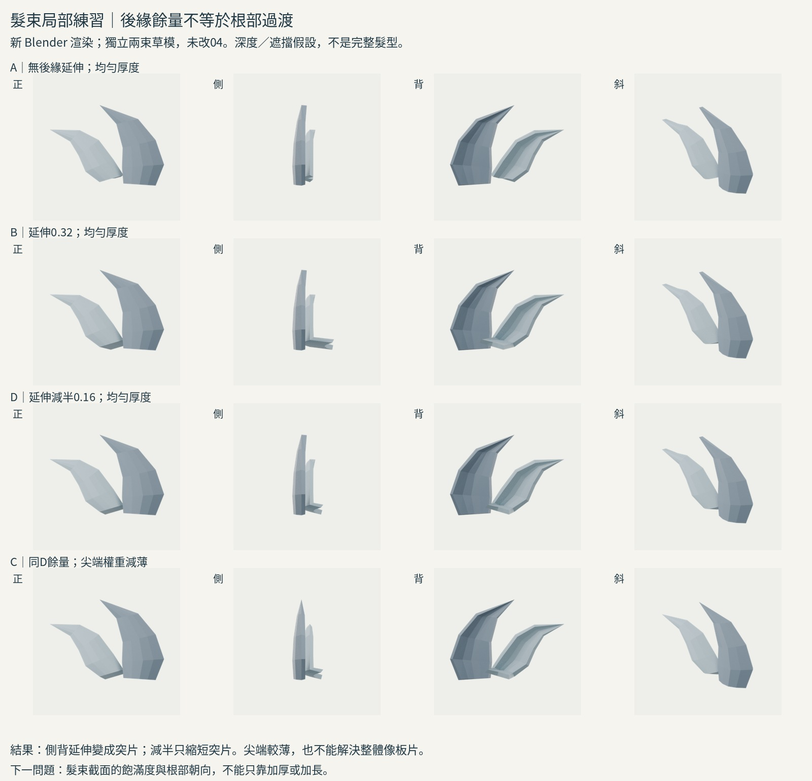
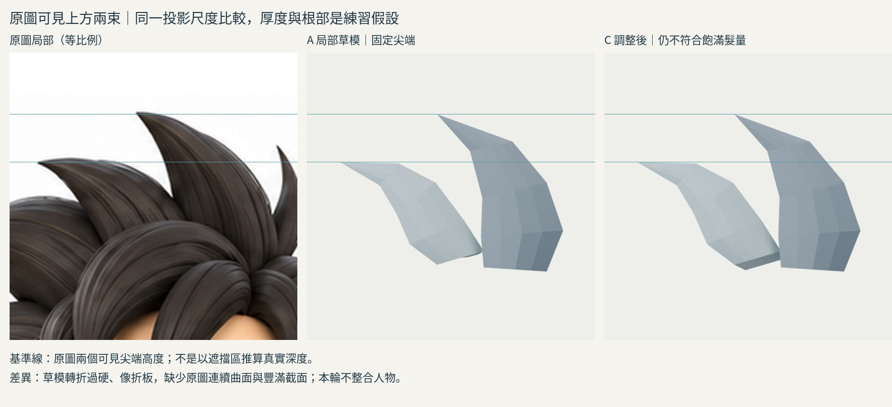

# 16:06 髮束覆蓋／厚度的局部練習

## 問題與結論
目標仍是原圖短寬尖髮。本輪只做上方兩束的獨立草模，不改 iteration04，不稱為完成髮型。
**結果失敗：後緣延伸沒有建立合理根部過渡，側背出現折板突片；縮短只減輕突片。** 減薄尖端能減少側視鈍厚，但不會把薄片變成飽滿髮束。

## 來源實際讀／看
- 六色《前髪のモデリング 前編》 https://note.com/rikuhayasaka/n/n0ca6ed441394 ：重讀⑥–⑨，並重新實看⑦ Ey 延伸操作圖。可見部分先定形，被上層遮擋的後緣留餘量。
- 作者頁與搜尋未找到「前髮後篇」。沒有聲稱已讀後篇。
- 改讀同作者《髪の毛のモデリング》 https://note.com/rikuhayasaka/n/n5ab4a25233d1 ：第2/4/5/6/7節。實看兩張圖：梯形／菱形截面對比、未調整厚度的髮片網格。作者區別表面片與有截面髮束，指出 Solidify 可加厚，尖端可用權重減薄，截面仍需依視角調整。
- Blender 4.3／4.5 官方手冊頁返回工具402，未聲稱已讀。操作參數以本機4.3.2實際執行確認，不借未讀手冊作證據。

## 實作與適配假設
1. 以原圖正面兩個可見尖端及邊界手工建低模面片，5條橫列，每列5點。不是作者網格下載，也不是精確描摹。
2. 固定 x=(px-320)/100、z=(130-py)/100，正交相機投影範圍210px對應600px。原圖裁切x215..425、y-30..180，缺上方用白底，不拉伸。原圖側面非標準側視，沒有拿來推厚度。
3. 深度、遮擋區根部、凸起截面均為本次練習假設。來源示範順垂瀏海，移用到短斜尖髮需要驗證。
4. A：原局部片、均厚0.065。B：只新增下層後緣，向後0.32，順橫流0.16，z降0.04。這個方向是適配假設，不是作者的固定數值。
5. 實看B側背突片後，D：後移減半0.16、橫移0.08，其他相同。D仍像折板。
6. C：保留D餘量，僅把厚度以距尖端距離加權，端點權重0.015，避免零厚度退化。原表面尖端未動，背面厚度改變。A/B比較餘量；B/D比較延伸量；D/C比較尖端厚度，不能跨組混稱單變因。
7. 所有組相機、燈光、材質、比例相同，Cycles真實渲染正側背斜角。平面沒有用相交基本幾何冒充完成品；它就是源自面片流程的早期草模。

## 與原圖及前版差異
- 可見尖端的座標／高度保留，但新增後緣在下方仍改變輪廓，**未通過「整個可見剪影不變」條件**。
- A/B/D的正面mask差分為變化量，不是進步分數；C與D正面mask一致，側視厚度有變化。
- 本輪兩束未做頭皮覆蓋，不能把「沒露頭皮」當成功；A本來正斜視沒有明顯通透縫隙，這也暴露測試設計的限制。
- 比原圖：輪廓折角過硬、體積薄、缺少根部圓滑主髮量。沒有證據新練習比04角色更好，不整合。

## 學會／仍不懂
學會：面片後緣餘量與尖端厚度可獨立控制；可見剪影、背面突片要各方向驗證。來源的遮擋餘量必須有合理上層髮量包住，孤立地向後延伸會製造新問題。
仍不懂：短寬斜束的飽滿截面如何沿髮流變化，以及根部應朝哪個主髮量銜接。下一輪應學真正閉合寬髮束／截面構形，不再靠後緣長度調整假裝解決。

## 公開版範圍與復現限制

本文是既有實驗筆記的整理；「實讀／實看」與數值結果指當時紀錄，本次公開整理未獨立重跑。原始 `.blend`、實驗腳本、渲染圖、研究用三視圖及第三方教材圖片均未隨本文提供。文中檔名只用於說明歷史證據，不是可下載附件；不可僅憑此文字版宣稱已復現或驗收角色。

## 公開附圖

下列為當時保存的原始圖片檔，這次僅整理上傳，沒有重新建模或渲染。研究分析板與舊版渲染不代表新模型；實驗成功、失敗及限制以本文記錄為準。

[固定角色原始三視圖](../../images/reference/character-three-views.png)
