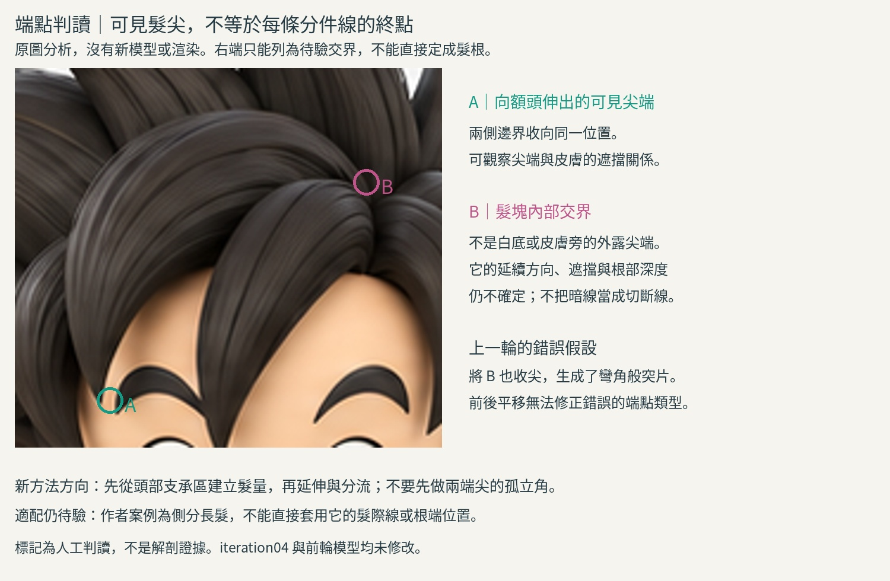

# 19:06 髮尖與內部交界的區分

本輪為研究與原圖標註練習，沒有新模型或渲染。保留前輪失敗，不猜新的根部座標。

## 新來源與實看
Boehmy 本人〈How to: Sculpted Hair〉，2020-06-11：
https://www.zbrushcentral.com/t/how-to-sculpted-hair/373187
實看Step1、Step2、Step3、Step4及Q&A辮子接合圖，共5張5000px原始圖。Step3從頭皮遮罩擷取有厚度的基底；Step4用Move/拉出形體，流向轉折依需要另分髮塊。Q&A圖能看到髮量導向辮子，只有接合成果與簡述，不是逐步焊接操作。此為側分長髮，不能拿髮際線造型當本例規則；圖中性別髮際線簡化不採用。未下載筆刷、未購買、未執行外部程式。

Pablo Muñoz Gómez：https://www.pablander.academy/tutorials/sculpting-stylised-hair-in-zbrush
本輪僅讀文字摘要的主量→分區→表面髮流流程，沒有新看其圖或影片。它支持先有支承髮量再做表面束，不能當作本例根端接合操作已學會。

## 原圖觀察（我們的判讀，不是來源的結論）
原圖裁切(240,75,420,235)，4倍等比例顯示。A約(280,215)是指向額頭的可見髮尖，兩側輪廓收束，旁邊有皮膚可辨。B約(388,123)位於多束交會的深色區，不是白底或皮膚旁的外露尖端；可見線索不足以把它定為第二髮尖，也不足以指定生理髮根的確切位置、深度。
上一輪把B收成第二尖端，結果多出彎角尖突。這個模型決策缺乏原圖支持。僅前後平移並不會更正端點類型。

## 方法比較及選擇
過去使用獨立封閉環，可控制截面，卻在兩端都合點，先假設了兩頭尖。新讀的基底擷取→主量推拉方法，從支承面開始，再形成可見延伸端，較能保留一側接入主髮量的意義。這是候選方法，不是已完成本例的證據。需要連續表面時可從共同主量塑形；分層獨立束也可行，但不應為了分件把內部交界一律切尖。

## 本輪學會與還不懂
學會先將可見尖端、遮擋交界、隱藏根部分類，再選拓撲端點；不能把每條暗線結束處當髮尖。
仍缺：B區延續方向與支承面位置；作者Step3/4是階段圖，沒有對應本例的根端具體筆觸。尚未有足夠證據做局部根端修改，因此不硬產生新版本。
下一個可驗證練習：在獨立低模頭部表面，試從一片有厚度的支承區擷取並沿已知前弧形成單一可見髮尖；把B端保留在支承區而不是任意合點。先學清擷取/推拉實際操作，再做四向檢查。這只能驗證根尖非對稱構形，不等於原圖深度真值。

## 公開版範圍與復現限制

本文是既有實驗筆記的整理；「實讀／實看」與數值結果指當時紀錄，本次公開整理未獨立重跑。原始 `.blend`、實驗腳本、渲染圖、研究用三視圖及第三方教材圖片均未隨本文提供。文中檔名只用於說明歷史證據，不是可下載附件；不可僅憑此文字版宣稱已復現或驗收角色。

## 公開附圖

下列為當時保存的原始圖片檔，這次僅整理上傳，沒有重新建模或渲染。研究分析板與舊版渲染不代表新模型；實驗成功、失敗及限制以本文記錄為準。

[固定角色原始三視圖](../../images/reference/character-three-views.png)
