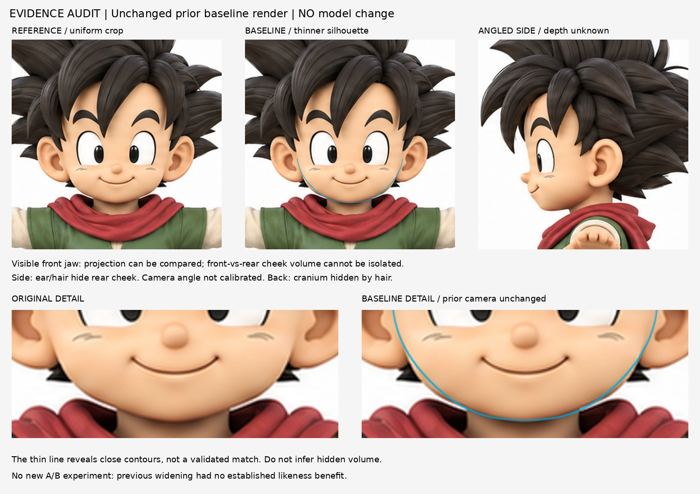

# 頭部差距證據審查｜2026-10-29 14:06

## 本輪結論
沒有可核實依據，把差距歸因於「前頰太寬」或「後頰太厚」。停止外推幅度試驗，不以假設堆假設。本輪沒有新模型、沒有新四向渲染、沒有宣稱新造型方法已學會。保留 iteration04，不進頭髮五官。

## 實際做了什麼
重新查看固定完整原圖、上一輪 A/B/C 四向與疊線；將基線的輪廓疊線變細，原圖同樣等比裁切放大，沒有移動基準或拉伸原圖以配合模型。獨立複核相同三張圖，未能可靠排序 ABC 相似度。

evidence-audit.jpg 是新的診斷排版，**模型影像重用上一輪 A 真實渲染**；不是本輪新渲染或新 A/B。青線來自透明度輪廓，只顯示原圖可見頰顎帶。

## 可見與不可見
1. 正面兩側頰—下巴投影可觀察；薄線下已很接近，未看到足以可靠指示外推/內收的差距。這不是完美或已驗收，只是證據不足以指定此修改。
2. 正面剪影不能隔離前頰寬度與後方體積的貢獻。
3. 側圖耳朵、髮束遮住後頰及下顎後端；側圖並非已校準正交側視，不能精量前後深度。
4. 背圖顱部被頭髮遮住；顱頂也不可當精確真值。移除模型頭髮後看到的後腦，不能與原圖髮型外輪廓混比。
5. 明暗受原圖材質／光源／五官影響，不可把裸頭灰模的陰影差直接歸因於頭部體積。

## 來源查核狀態
試圖用 Blender 官方 Cameras 文件核對參考相機方法；搜尋結果有正交／背景影像摘要，但 4.1 與 2.90 內文讀取均回 402、官方文件倉庫回 403。沒有讀到完整頁面，不能算實讀教學或新方法成果；沒有進付費或繞過限制。
- https://docs.blender.org/manual/en/4.1/render/cameras.html
- https://docs.blender.org/manual/en/2.90/render/cameras.html

本次診斷依原圖、既有真實渲染與顯式遮擋觀察，不借未讀來源替結論背書。上一輪局部 Move/過渡資料可供未來方法參考，但它不能替本角色決定必須外推哪裡。

## 下一輪入口
仍在頭部階段。先建立可見輪廓地標及人工配準的不確定範圍，再選超過該不確定性的可見差距；沒有這種差距時，不繼續猜後頰。多造型方法練習可以獨立做，但必須與此角色修正分開命名，不能冒充相似度提升。

## 頭部階段暫存判斷（不是使用者驗收）
- 足以暫保基線的可見項：正面頰顎外輪廓、下巴基準、左右對稱投影。目前差異不足以選定明確優於基線的修改方向。
- 未驗證項：髮下顱頂與後腦、後頰深度、顎後端，以及原圖非校準側圖的三維對應。灰模表面明暗也不可作為原圖材質下的體積真值。
- 下一個不同且可驗證的頭部量體缺口：本輪未能可靠指定。不要因此無限停在被遮擋的部位。
- 階段判斷：以「頭形暫保基線、未驗證部分持續記錄」進入下一階段頭髮學習；髮型外輪廓有更完整的原圖可見證據。這不等於頭部完美、最終完成或使用者已驗收。此項審查沒有進行頭髮實作。

## 公開文字版範圍

本頁整理既有實驗筆記，未在本次公開整理中重新執行或獨立重現。原始 `.blend`、參考圖、渲染、量測 JSON 與實驗腳本未包含在此文字版；文中檔名只描述當時的證據，不是下載連結。第三方教學內容僅保留公開來源連結與閱讀／觀看範圍，未重散布圖片或程式。歷史階段與下一步以當時紀錄為準，最新方向請見根目錄索引。

## 公開附圖

下列為當時保存的原始圖片檔，這次僅整理上傳，沒有重新建模或渲染。研究分析板與舊版渲染不代表新模型；實驗成功、失敗及限制以本文記錄為準。

[固定角色原始三視圖](../../images/reference/character-three-views.png)
