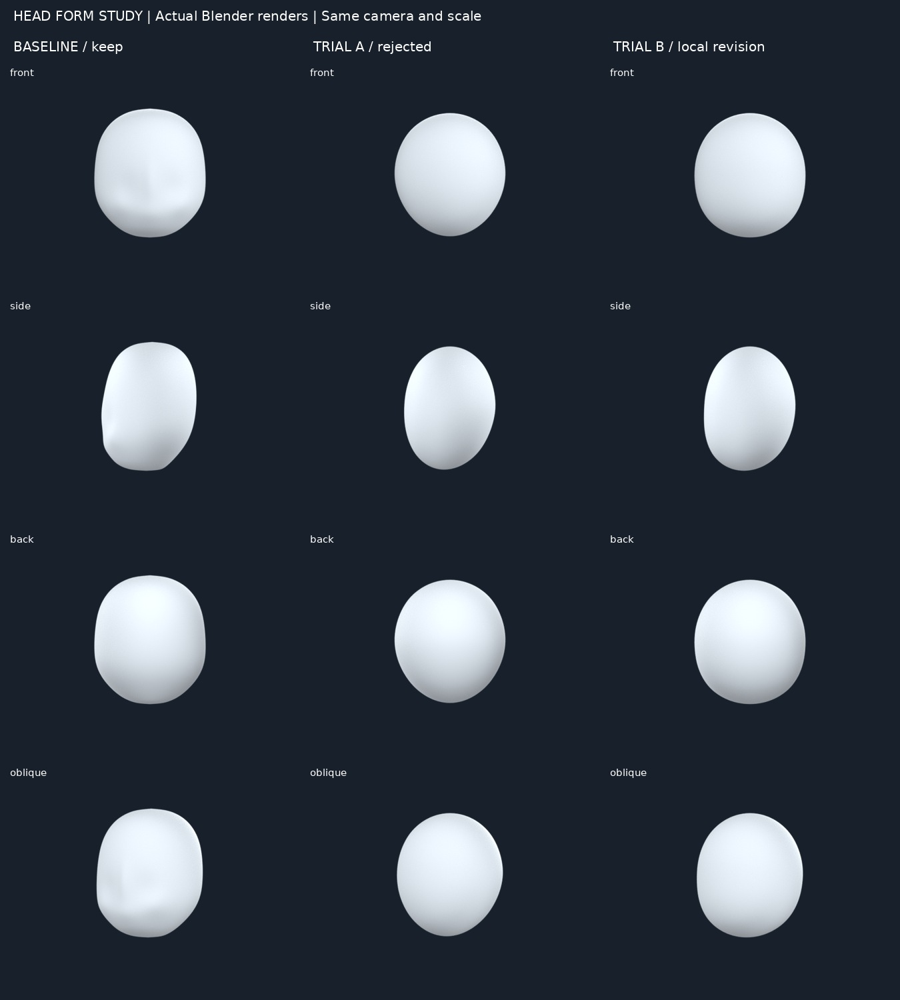
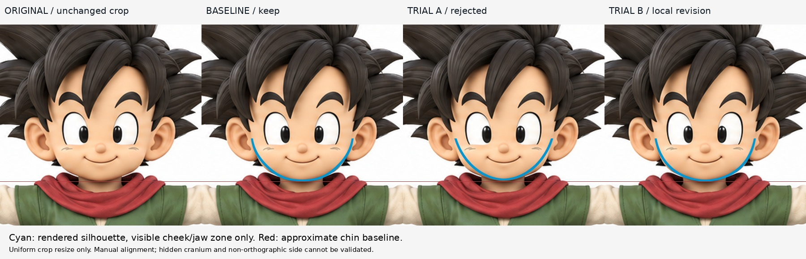
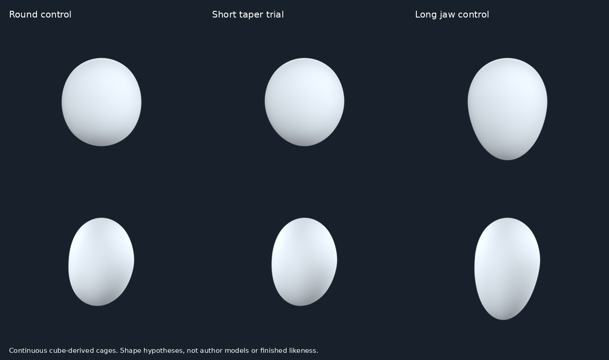

# 頭部整體形體：先分清造型，再驗證方法

2026-10-29 12:06 研究紀錄；遵照「頭 → 頭髮 → 五官 → 身體四肢 → 穿著」。本輪停留頭部，沒有把練習整合替換 iteration04。

## 實際結果先說
- **短收束試驗 A 失敗**：相同相機下，下顎比原圖可見輪廓窄，不能因為光滑、網格規整就稱進步。
- 重新分配下半部控制點的試驗 B，恢復了 A 缺少的下頰寬度及較平緩下巴；只相對 A 改善。**沒有證據優於 iteration04**。側面還像卵形，缺少額面—臉面—下顎—後顱的方向轉折；保留基線。
- 成果是學習控制籠與辨認錯誤，不是完成角色頭。圓形、短收束、長下顎三組是方法控制試驗，不是三種成品，也不是作者提供的模型。

## 真的讀了／看了什麼
1. Karan Shah，*Creating A Low Poly Ninja Game Character Using Blender: Part 1*，步驟36–43。
   https://design.tutsplus.com/tutorials/creating-a-low-poly-ninja-game-character-using-blender-part-1--cg-16132
   實讀建立頭部立方體、細分、球化、鏡像及多視圖調整；實看 step38 圖：立方體規則四邊面成球形控制籠。採用連續 cube-derived cage；沒有採用忍者面罩開口或後續脖子步驟。作者教程兩次細分；此練習用8段面網格，額外密度及輪廓位移是自己的實驗，不冒充教程參數。
2. CLIP STUDIO Art Rocket，*Easy Steps to Creating Chibi Characters*，頭部段落。
   https://www.clipstudio.net/how-to-draw/archives/155423
   實讀頭作球體、顎線圓滑、後腦也要有體積；實看0026_004en-us.jpg，觀察短圓下頰輪廓。這是繪畫造型參考，不提供3D拓撲。另看到0026_010en-us.jpg實為表情圖，不將它冒稱側面教學。
3. Carlos Gomes Cabral，*Cartoon Fundamentals: How to Draw a Cartoon Face Correctly*，圓/橢圓起形、Step3下顎、Older Character Step2與較細下巴變體段落。
   https://design.tutsplus.com/articles/cartoon-fundamentals-how-to-draw-a-cartoon-face-correctly--vector-15792
   實讀同一基本頭形可藉下顎長短/收束改變設計；實看cartoonfaces-charact2-jaw.jpg，眼線以下明顯拉長的顎部。年輕版jaw圖的直接下載403/timeout，未宣稱看過該圖。文字裡較細下巴設計只作變體參考，並非性別解剖規律。

## 比較與選擇
- 圓滑短顎（chibi指南）：適合原圖年幼、飽滿下頰的設計方向，但單一橢球仍不足。
- 較收束下顎（Cabral文字變體）：可測試不同剪影；原圖沒有這麼尖窄，A顯示選得過頭。
- 較長下顎（Cabral實看圖片）：改變整體年齡感/頭比例，本案不採；保留控制組供下次比較。
- 這些不是完整造型分類，也不能僅由前視決定深度。連續控制籠適合目前頭部整體階段；五官邊流/逐面擠出要留到後面，不能用球體宣稱完成拓撲。

## 實作與對照
獨立載入原頭副本並渲染四向，生成三組球化立方體連續封閉控制籠；針對 A 下顎過窄重新分配下半部控制點，而非增加相交頰球。對照使用真實渲染輪廓，原圖等比縮放。
- 前圖手動對齊：x=345+153X；y=333−153(Z−2.72)。這是方便比較的人工基準，有像素/軟陰影誤差，不是客觀擬合或精確測量。原圖下巴約333–334；所有試驗同相機，**長顎控制組沒有偷偷重對齊下巴**。
- 青色線只顯示原圖270–337附近可見的頰/顎範圍。頭頂被頭髮遮擋，不對其做成功判定。側圖略3/4，背圖頭部被髮遮住，不作精確深度／後顱驗收。
- 所有形體仍是**頭形草模練習**；不是眼眶、鼻口、耳、頭髮的完成品，未做UV、綁定或變形驗收。單一連續封閉網格只是方法要求，不等於造型成功。

## 失敗與下一缺口
A的失敗：把下顎收束當成普遍變好，忽略原圖下頰飽滿。B相對A有改善，但前面對了也不能證明側面對。
下一輪仍留在頭部：找實際示範卡通頭的顱部—面部平面分區/側面下顎轉折的作者教學，先學怎麼把橢球變成有前後方向的頭形，再作少量控制點練習。暫不前進頭髮。

## 公開文字版範圍

本頁整理既有實驗筆記，未在本次公開整理中重新執行或獨立重現。原始 `.blend`、參考圖、渲染、量測 JSON 與實驗腳本未包含在此文字版；文中檔名只描述當時的證據，不是下載連結。第三方教學內容僅保留公開來源連結與閱讀／觀看範圍，未重散布圖片或程式。歷史階段與下一步以當時紀錄為準，最新方向請見根目錄索引。

## 公開附圖

下列為當時保存的原始圖片檔，這次僅整理上傳，沒有重新建模或渲染。研究分析板與舊版渲染不代表新模型；實驗成功、失敗及限制以本文記錄為準。

[固定角色原始三視圖](../../images/reference/character-three-views.png)
