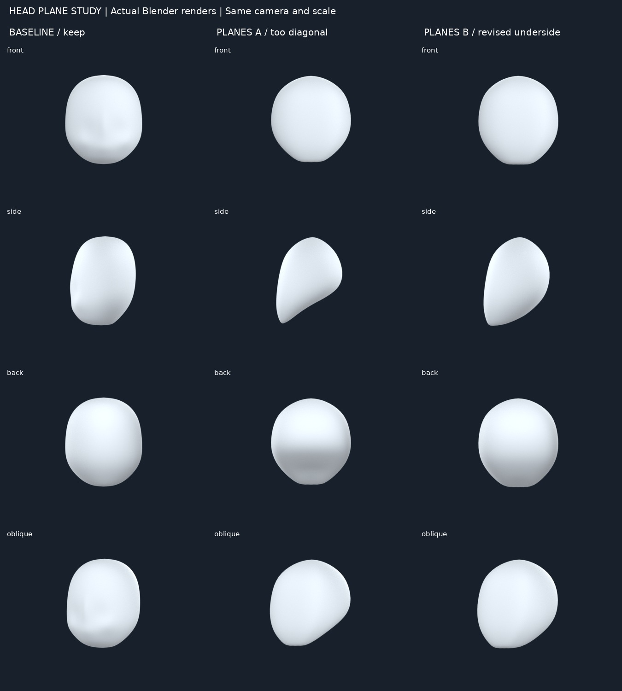
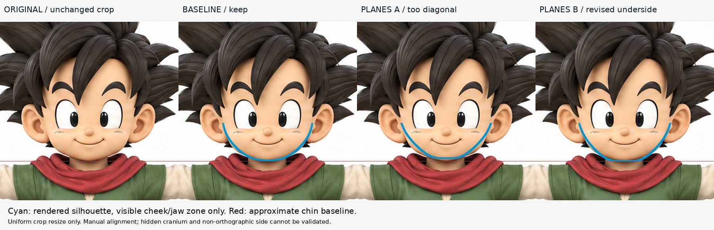
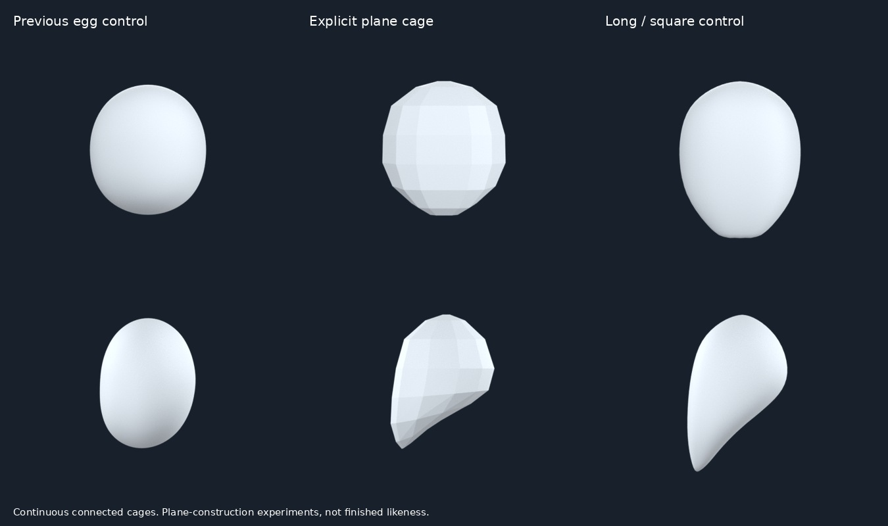

# 頭部平面與下顎方向：12:36 學習紀錄

## 結果
這輪不再把整個頭當成同心橢球。做了能分辨前、側、底面的單一連續控制籠，保留前輪卵形作對照。
A 的底部從下巴一路斜升到後腦，側面變成尖楔，不是合理的下顎轉折。B 降低後下顎角、增加底部前後距離，減輕了尖楔；它相對 A 的前後方向更清楚，但前面下巴偏平、面頰轉折仍機械。**沒有證明比 iteration04 更像原圖，因此不整合、不替換。**
這是頭部整體草模練習，不是頭部完成品；沒有做頭髮、五官、耳、脖子、UV 或綁定。

## 實際來源與閱讀範圍
### Stan Prokopenko：How to Draw the Head from Any Angle Part 1
https://stanprokopenko.com/2012/08/video-draw-head-angle-1/
實讀 Basic Forms、Sphere as Cranium、Block as Jaw and Cheek Bones、Add the Jaw。實看 basic-forms-thumb.jpg（顱球/顎塊與頭骨）、jaw.jpg（前側面）、add-jaw-thumb.jpg（四角度下顎）。學到下顎是有前、側、底面的體積，顱側有平面，不能把正面輪廓當整個頭。此篇是繪畫建構，沒有提供本實驗頂點座標；成人三等分不直接套入Q版。

### Kenny Praise：Planes of the Face
https://kennysarts.gumroad.com/p/planes-of-the-head
實讀5步概述，**本輪只實看並採用步驟1、2**：卵形起點→切平側面、分出下顎與顱部。第二張圖的側視顯示後上顱與前下顎不是同一個卵形。只看圖解，不聲稱看過影片；沒執行步驟3–5的五官。

### 與圓幼型的比較
沿用前輪實看 CLIP STUDIO Art Rocket 的圓滑Q版頭形圖：
https://www.clipstudio.net/how-to-draw/archives/155423
短圓下顎不等於沒有側面/底面，只是交界較柔和、下臉較短。Prokopenko與Kenny的圖偏長、平面清楚，適合學方向，不應照搬比例。本輪另設長/方顎控制組，觀察顎部延長與較硬方向；不把它當目標。這是幾種實驗對照，不是完整頭型分類。

## 方法、假設、失敗
- 手動定義前面、前側轉角、側面、後顱控制列，連接成封閉網格；不是把兩個相交原始物體叫完成。
- 用較少控制點表達面向，再以Subdivision柔化轉折。來源教的是形體觀念；座標、控制列、幼型幅度是本實驗的假設。
- A抬高後下方控制點過多，底面變成長斜坡。B重新配置底部深度及後下顎角，保留A失敗版本。
- B仍沒有可靠的下顎角—下頰連續轉折，也未驗證顱頂和後腦。細分使一些面向過度融掉，不能只看灰色光滑程度。
- `plane-zone-diagnostic.png` 為B控制籠實際渲染：藍色前面、橙色側面、紫色下側，灰色其他。按面法線分類只用來看方向，不是解剖區域標註，不是成品材質。

## 對照界限
所有A/B/基線使用同相機、燈光、材質、解析度。原圖只裁切且等比縮放；映射沿用前輪 x=345+153X、y=333−153(Z−2.72)，人工基準不是精確配準。長顎控制不另行縮短或重新對齊。
前圖僅把原圖可見頰/下顎區與渲染輪廓疊圖。顱頂被髮遮蔽，側圖非嚴格正側，背面也被髮覆蓋，因此不宣稱側深/後顱匹配。前後四向渲染是形體檢查，不是四方向都已符合原圖。

## 下一缺口（仍停頭部）
找作者對「下頰飽滿體積如何柔和銜接下顎角與底面」的具體雕塑示範，尤其短圓幼型，避免成人顎塊過硬或一柔化又退回卵形。仍不進頭髮或五官。

## 公開文字版範圍

本頁整理既有實驗筆記，未在本次公開整理中重新執行或獨立重現。原始 `.blend`、參考圖、渲染、量測 JSON 與實驗腳本未包含在此文字版；文中檔名只描述當時的證據，不是下載連結。第三方教學內容僅保留公開來源連結與閱讀／觀看範圍，未重散布圖片或程式。歷史階段與下一步以當時紀錄為準，最新方向請見根目錄索引。

## 公開附圖

下列為當時保存的原始圖片檔，這次僅整理上傳，沒有重新建模或渲染。研究分析板與舊版渲染不代表新模型；實驗成功、失敗及限制以本文記錄為準。

[固定角色原始三視圖](../../images/reference/character-three-views.png)
