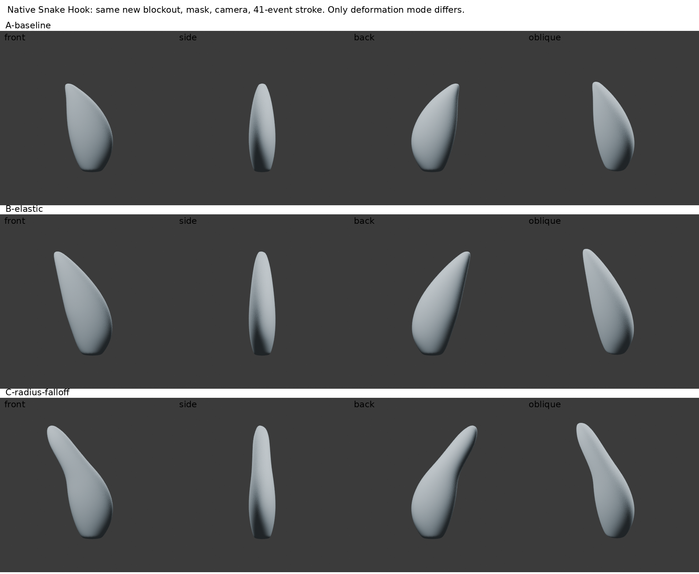
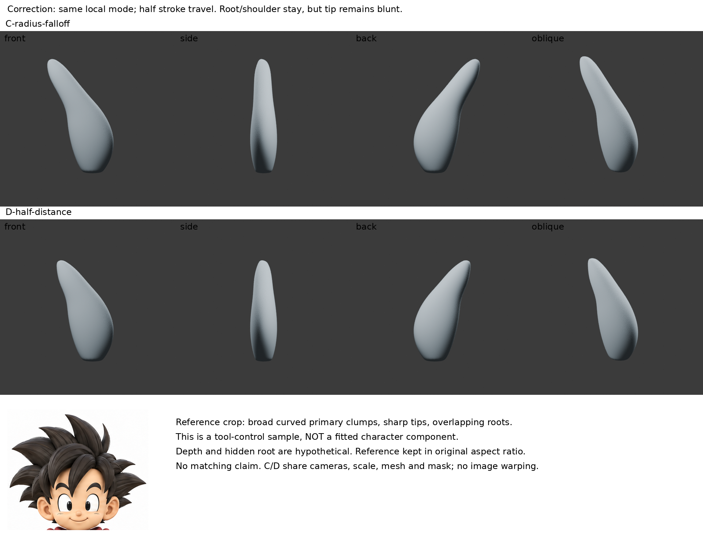

# Snake Hook 局部衰減與 Elastic：寬肩保留測試

2026-10-30 07:06（Asia/Taipei）。**本輪有真實局部草模及四向渲染；沒有整合人物，也沒有證明人物更像原圖。** iteration04 不改。

## 問題與來源實讀範圍

先讀 GitHub 最新 README、LEARNING_INDEX、STORAGE_POLICY，本地索引，以及 `hair-tip-method-research`、`elastic-snake-root-mask` 記錄。前輪根遮罩可固定根，但圓鈍球塊無法回答寬肩尖束的問題；本輪不用舊球塊。

本輪在雲端瀏覽器重讀 [Blender 4.3 Snake Hook 官方正文](https://docs.blender.org/manual/en/4.3/sculpt_paint/sculpting/brushes/snake_hook.html)：筆觸過程會拾取／放開幾何；Radius Falloff 在筆尖局部套用衰減，Elastic 為整體彈性形變；Magnify 與 Rake 各有不同作用。官方模式定義也由本機4.3.2 RNA確認為 `FALLOFF`、`ELASTIC`。未改 Magnify 或 Rake。搜尋讀取器402，雲端正文可讀，不能混成未讀或網站永久不可用。

作者造型參考沿用前輪實看的 [moco GroomSpike](https://mononoco.com/?p=13894) 四張靜態前後圖與設定，**本輪沒有重新看作者操作動畫，也不仿稱 GroomSpike**。ZBrush 梳尖與 Blender 拉束不等價。這次測的是官方通用工具在新寬肩草模上的適配，不能說作者示範了本角色或本筆觸。

## 新草模與假設

親看固定角色三視圖，上方主束是寬肩、彎曲側緣、收尖，根部多被遮擋。建立全新連續多邊形環截面控制籠：9圈、每圈16頂點，閉合兩端，Subdivision3後8706頂點／8704面。寬肩與彎曲軸線只作工具草模；厚度、後側與遮擋根位置是自訂假設，沒有精確反推原圖深度。不是相交基本幾何完成品，也不是把自製頂點變形冒稱作者筆刷。

腳本中的截面座標僅建立共同起始網格。原生筆觸後未用公式修頂點、未重拓撲、未重網格、未平滑。原圖不拉伸，參考裁圖只作可見造型差異提示，**不是精確對齊驗收**。

## 受控比較 A／B／C

在 dot 雲端 Blender4.3.2 GUI的VIEW_3D WINDOW上下文呼叫原生 `bpy.ops.sculpt.brush_stroke`。

- A：共同未拉伸草模。
- B：Snake Hook，Elastic。
- C：Snake Hook，Radius Falloff。
- 網格、遮罩、相機／視窗974×705、起點終點、41個事件、pressure1、strength1、radius125px完全相同。對稱全關，無Dyntopo。
- 根 `z<=-.65` 全遮罩，至 `z=0` 以餘弦平滑退到0。這是自訂遮罩適配，不稱官方指定函數。
- Magnify對應 `crease_pinch_factor=.5`、Rake0、falloff_shape SPHERE、use_frontface false。筆刷實際設定與檔案雜湊保存在 restore-check.json。
- B／C均回傳FINISHED；這只是操作執行證據，造型仍待檢視。

[同尺度四向比較](../../images/local-snake-falloff/comparison-board.png)

親看正／側／背／斜四向：B整體上半段跟著延伸，肩部也被拉動；C保留較下方主量，但上段與寬肩之間形成明顯細頸，末端仍圓鈍。側面沒有證明原圖的厚度，斜角仍是簡化葉形量體。**C不是造型成功，也沒有解決髮根層序。**

數據只作機制診斷：B肩部平均位移約0.11415，C約0.0001603（共同基準 `-.25<=z<=.3`）；兩者全遮罩根最大位移0。B最大位移約0.51892，C約0.88814。這些是本小樣座標單位，不是角色毫米。

## 修改一次，再比：D 半距離

C可見細頸且被拉得過長，與原圖的寬肩彎尖不符。提出有限修正假設：局部模式不變，只將筆觸起終點距離減半，是否減少狹頸？由相同截面重新建立相同A網格，保留41事件、遮罩、radius、strength與所有其他設定。不是在C上疊第二筆。

[修正與參考圖對照](../../images/local-snake-falloff/correction-reference-board.png)

實看D四向：細頸較C不明顯、整體更短，仍是圓鈍末端和單獨葉形量體，沒有原圖尖銳的邊緣節奏與交疊。D肩部平均位移約0.0001465，根最大0；最大位移0.44407。減少旅行距離也使同41事件的每事件步長減半，這是此次筆觸路徑改動的一部分，不能另宣稱已驗證事件密度效果。

體積A0.881919；B1.053793（約+19.5%）；C1.057038（約+19.9%）；D0.977978（約+10.9%）。均無非流形邊，但**沒有體積守恆，也沒有拓撲或造型驗收**。

## 實際學會、失敗與下一步

- 可重用理解：當要局部延長而不牽動主量時，Radius Falloff與Elastic的影響範圍確實不同；根遮罩不是唯一控制方式。但局部影響也可能製造細頸。
- 失敗：縮短筆觸減少狹頸，不會自動梳尖；獨立葉形束仍未有整體根流與分層。不能把此小樣貼回人物當完成髮束。
- 停止：不再連續調此草模的半徑／行程追求數值；本輪工具差異已得到有限答案。
- 下一個缺口：在相近作者可見的主髮量建構過程中確認「寬肩在哪、尖端如何接、兩束如何交疊」。若找不到逐步證據，保留研究限制，不靠多束疊加掩蓋。

## 恢復與執行限制

A/B/C/D `.blend` 保存冷凍幾何與brush；各 `-render.blend` 保存相機燈光。replay_ui.py在GUI Console重建A/B/C；correct_ui.py重建相同草模並執行D。render.py、render_correction.py可背景渲染，Cycles24samples，關閉本build不支援的去噪。board.py與correction_board.py只排版實渲和等比例參考裁圖，不修改輪廓。

第一次D腳本在Console中先open_mainfile，開檔後未完成後續計時器流程，未輸出D。保留 failed-open-context.py 作失敗紀錄；改為同一確定性截面重建，成功完成。不是對拒絕或權限換路徑，亦未在背景重跑sculpt。

8份blend皆冷啟動重新開啟、確認8706頂點／8704面，詳restore-check.json。恢復包另存 dot／Space，不公開原始模型。圖與筆記可公開；不附第三方教學圖片。iteration04 SHA256再核對：35cd1b71c9d288029d93d0fdb8d9741d62a5151bc3bc459ab48c789092b5aaa6。

## 公開附圖與恢復範圍

以下圖片是本輪真實渲染的排版；不是完整角色成果。原始模型、重播與渲染腳本未包含於公開庫。

