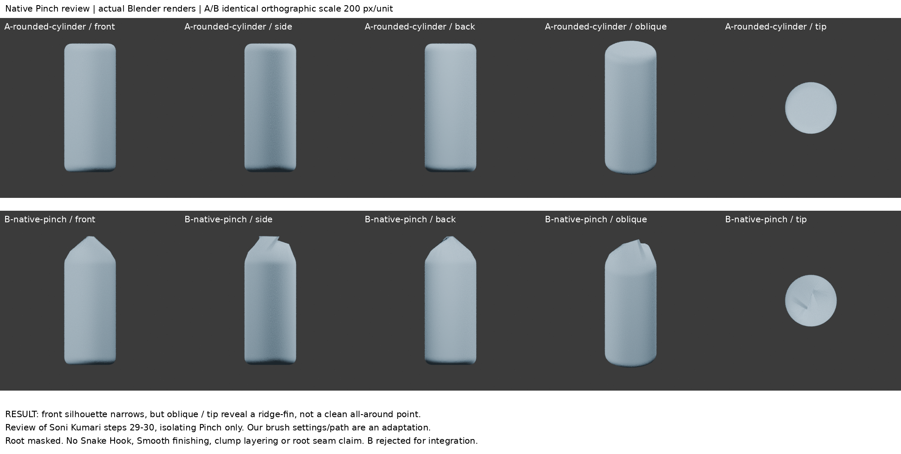
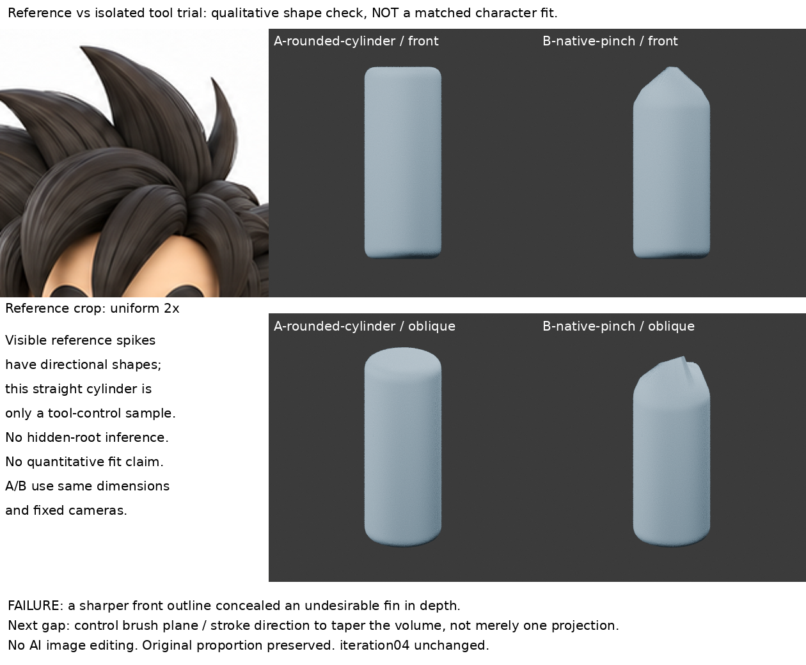

# 原生 Pinch 收尖復習：正面尖、斜角卻成脊

2026-10-30 22:06 輪（Asia/Taipei），本輪實作；非補建歷史。**失敗小樣保留，B 不採用、不整合角色。**

## 問題與範圍

原來問題是連續底量與獨立尖束/負形如何分工。本輪找到的對照案例沒有足夠中間操作證據，不能據此重建根接界。因此退到尚未真正實作的已讀方法：Soni Kumari 圓柱髮束的原生 Pinch 局部收尖。這是舊方法復習及跨工具隔離練習，不是新技能已掌握，也沒有解決底量/束根分工。

## 實際讀看來源

1. Soni Kumari，Creating Dragon Ball’s Goku in ZBrush and Maya: Part 1：
   https://design.tutsplus.com/tutorials/creating-dragon-balls-goku-in-z-brush-and-maya-part-1--cms-33816
   本輪重讀步27–39文字，並在瀏覽器實看 A_29、A_30 原文中間圖。29 是放在前額的圓柱、有圓形平端；30 已成向眉間收尖的曲線淚滴束。文字依次提 Smooth 柔化圓柱邊、Pinch 令末端變細、Snake Hook 拉出形狀。兩張靜圖**不能拆出每個工具各自的變形量**，也沒有筆壓、半徑、筆畫路徑。沒有觀看完整操作影片。第三方圖不收入公開repo或恢復包。
2. Leti M. Vila，Stylized Character Breakdown: Sculpting in ZBrush & Anisotropic Hair：
   https://80.lv/articles/stylized-character-breakdown-sculpting-in-zbrush-anisotropic-hair
   實讀 Sculpting Hair 段第一人稱文字：整塊髮量雕刻不滿意且費時，改大波浪分束、CurveTubes，重視重量/髮流/多角度而不是過早細節。只讀文字；沒有取得可檢查的操作中間圖。其 Yennefer 頁只讀介紹，直接讀取403後停止。此反例只說明分工取決於造型與工作方法，**不足以替我們決定根接界做法**。

## 方法與明確適配

- A：64邊圓柱，半徑0.30、高1.50；共同準備用 bevel 0.08/4 segments 與 voxel remesh 0.018。這不是作者的 Smooth 手工筆觸重現，基本幾何僅測試坯。
- A/B 同一12680頂點網格；根區 z<0.02 完全遮罩，至z0.20線性淡出。對稱全關。
- Blender 4.3.2 **原生 Sculpt PINCH**，不是曲線半徑修改。brush strength0.7、110px、pressure1、frontface only=false。
- 在端部軸向正交視角做41事件的小圓筆畫：z0.75，xy半徑0.012；執行視窗974×705、view_distance2.8、view_location(0,0,0.60)、identity quaternion。這是自己的隔離試驗設定，不宣稱作者設定。
- 本輪不接著做 Snake Hook、Smooth 或疊更多筆畫，否則無法清楚辨認這次結果。

## 真渲染與比較

A/B使用同樣420×420正交相機、ortho_scale2.1（200px/unit），同材質與照明，正、側、背、斜角及額外端視。原圖crop僅等比2倍，不拉伸。**小樣沒有對位角色，因此與原圖僅定性比較尖束形態，不能讀成比例擬合或誤差量測。**

可見結果：正面上端輪廓確實收尖；斜角與端視卻暴露突出脊/薄鰭狀結構，不是四周收攏的乾淨尖端。單一正面剪影會掩蓋深度問題。直柱的主量及朝向也不符合原圖的多方向髮束。此結果**不足以採用**。

`report.json`確認工具原生執行、根區位移0。頂點數/位移只作固定變因與恢復檢查，**不是造型進步指標**。本輪沒有改角色iteration04。

## 學會、失敗與未知

- 實作確認：Pinch 的局部結果不能等同曲線radius縮小；需要截面/端視檢查，而非只看前視尖不尖。
- 失敗：這組軸向視角/筆畫把末端形成脊狀結構。尚未定位成因是筆刷平面、stroke方向或影響範圍，不能把猜測當已驗證原因。
- 未懂：如何讓原生Pinch在保持體積連續的條件下控制末端截面？作者後續Snake Hook/Smooth在最終圖中修掉了什麼？本輪靜圖不能回答。
- 下一步：找能看見筆刷平面與末端轉向的操作證據；有新依據才重試。不要盲目疊筆畫或把薄鰭整合進角色。

## 恢復

- `A-rounded-cylinder.blend`：遮罩與筆刷已設好的未雕基線。
- `B-native-pinch.blend`：失敗原生筆畫後原始模型。
- `*-render-scene.blend`：同尺度攝影/照明場景；模型仍是上述A/B。
- `replay_ui.py`：在Blender GUI Python Console執行，會刪除當前場景，**請只在新檔執行**；需相同974×705 3D區域以盡量重現像素半徑。GUI/版本改變可能影響筆畫，直接開A/B可精確恢復本次結果。不要背景模式跑native brush_stroke。
- `render.py`：背景渲染A/B及四向/端視。`boards.py`：等比編排；公開版可用同目錄reference.png，否則讀取倉庫images/reference/character-three-views.png。
- 原始模型只放dot雲端/Space恢復包，不在公開repo。
