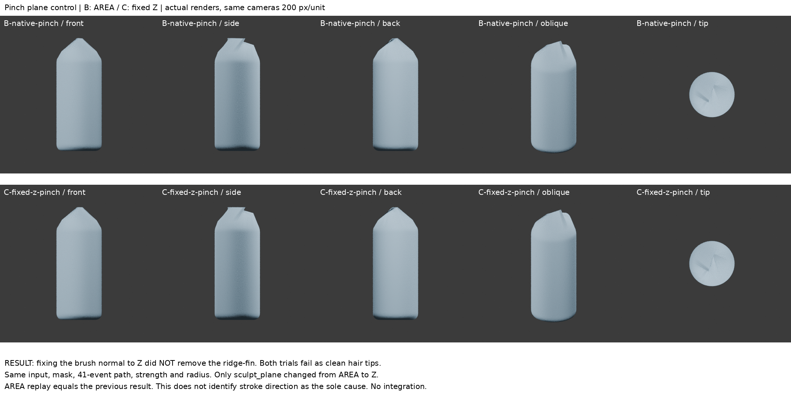
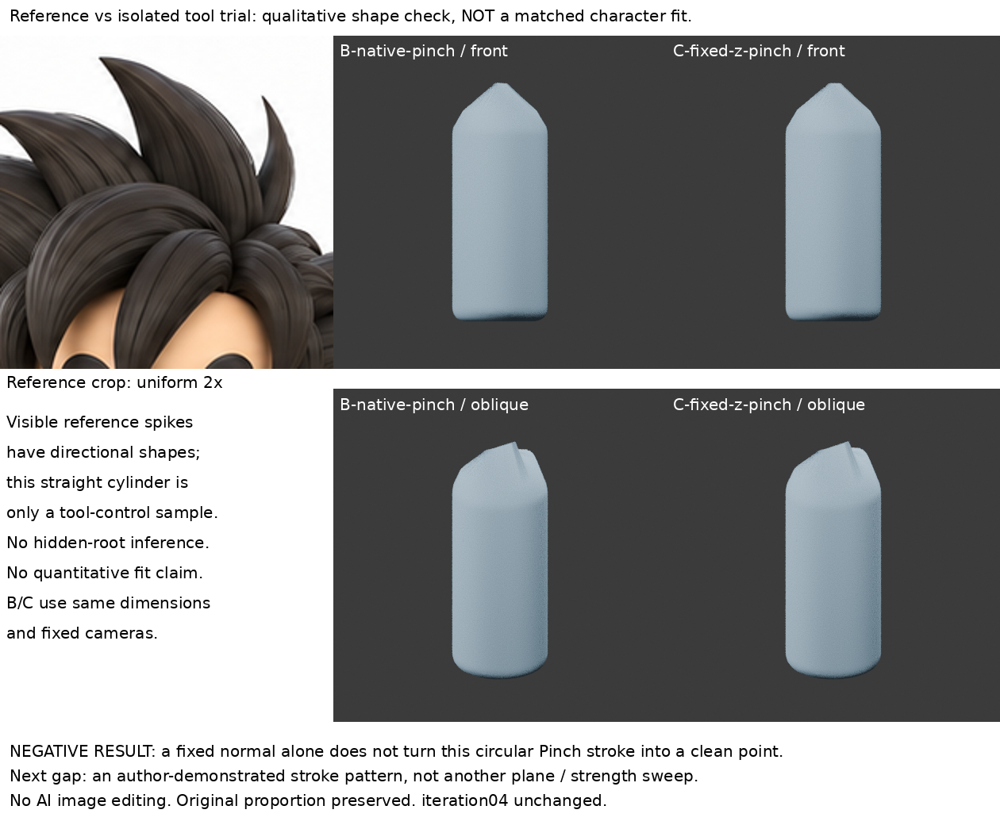

# Pinch筆刷平面單變因：固定法線仍成薄鰭

2026-10-30 22:36（Asia/Taipei）本輪實作，非補建。**局部失敗，不整合iteration04，不宣稱學會髮尖。**

## 問題與讀回

讀最新GitHub README、LEARNING_INDEX、STORAGE_POLICY、本地累積索引，以及mass-layer-separation、hair-tip-method-research、root-taper-scope。上輪Pinch小樣正面似尖、斜角/端視成薄鰭；05:06改curve radius並非原生Pinch，不能拿來當相同方法。此輪只查筆刷平面是否足以解釋薄鰭，不再找無操作內容的成圖、不改根接界。

## 新依據：實讀官方原始碼，不是作者操作影片

- Blender v4.3.2 [pinch.cc](https://github.com/blender/blender/blob/v4.3.2/source/blender/editors/sculpt_paint/brushes/pinch.cc)：實讀calc_translations、calc_faces與do_pinch_brush。它取筆刷中心到頂點位移，投影到由筆畫方向與筆刷法線構成的兩個軸，沒有把完整三軸位移直接向中心縮小。首筆與零grab_delta會提前返回。對本例，不能把Pinch理解為全向等比縮半徑。
- Blender v4.3.2 [sculpt.cc的calc_brush_plane](https://github.com/blender/blender/blob/v4.3.2/source/blender/editors/sculpt_paint/sculpt.cc#L2789)：實讀AREA採樣法線、固定Z設定回傳(0,0,1)、original normal條件。do_pinch_brush明確呼叫它，因此這不是只改一個無效UI選項。
- 4.3 Pinch/Brush Settings手冊此次web讀取402，未讀到新的手冊正文；不把上輪已讀手冊當本輪重新成功取得。

兩份官方原碼由普通公開raw網址取得，只閱讀，未編譯執行，不把第三方程式複製進公開repo。原碼解釋的是機制，**不是Soni的髮束筆畫，也不證明造型方法已掌握**。

## 單一假設與實作

假設：上輪AREA局部法線隨表面更新，可能參與造成薄鰭；固定與柱軸一致的Z法線能否避免？這是基於原碼提出的待驗假設，不是既定原因。

1. 在相同Blender4.3.2 GUI與974×705區域，重播上輪原生Pinch，生成B-native-pinch。冷讀逐點比對與上輪B完全相同（max0）。
2. 從同一未雕柱重新開始，只改brush.sculpt_plane='Z'，生成C-fixed-z-pinch。不是在B上繼續雕。
3. 同12680點輸入、mask、軸向視角、110px半徑、strength0.7、41事件小圓筆畫、pressure1、frontface=false，對稱關閉；無SnakeHook/Smooth/Remesh新增處理。兩未雕輸入逐頂點差0，根區位移0。

## 真渲染結果

B/C均重新真渲420×420、ortho_scale2.1、相同燈光材質與正側背斜/端視。原圖crop等比2倍；小柱並未註冊角色，僅定性比較末端，不宣稱比例擬合。

**C仍然形成脊/薄鰭，沒有得到四周連續收攏的尖束。** 因此本例中固定Z法線不是足夠的修正，不能將AREA法線更新說成唯一成因。兩者局部形體略異，不以位移數字冒稱改善。程式也依賴筆畫方向，但此輪沒有隔離筆畫方向，不能就說已證實它是唯一成因。

## 學會／失敗／下一個未知

- 學到Pinch並非等比縮半徑，其筆畫與平面共同參與作用；正面尖輪廓仍需端視驗證。
- 失敗：只固定法線沒有修好薄鰭，B/C皆不採用。這是單次機制假設的否證，不是角色造型提升。
- 不再輪流掃X/Y/View/strength或追加圈數。下一步需要可見筆刷行進方向的作者收尖操作證據，或重新選擇適合既定體積的造型方法；不能以更多工具測試代替主量學習。
- iteration04 SHA保持35cd1b71c9d288029d93d0fdb8d9741d62a5151bc3bc459ab48c789092b5aaa6。

## 恢復

replay_area.py與replay_ui.py分別在Blender GUI Python Console的新檔執行（**會清空當前場景，禁止在角色檔執行**）。後者僅增加Z平面設定。不要背景執行brush_stroke。像素半徑受視窗與版本影響；直接開保存A/B/C才是精確恢復。render.py重新渲染，boards.py等比排板，verify.py冷讀輸入與重播一致性。report.json、area-report.json、verify.json為機制紀錄，非造型分數。原始blend僅私存，公開只筆記/自製腳本/兩板。

公開恢復限制：verify.py另讀相鄰mass-layer-separation資料夾的A/B原模型，這些未公開；可從前篇公開replay_ui.py另行產生，但未聲稱異機重新執行會逐點相同。boards.py需Pillow／字型與本庫固定原圖。
