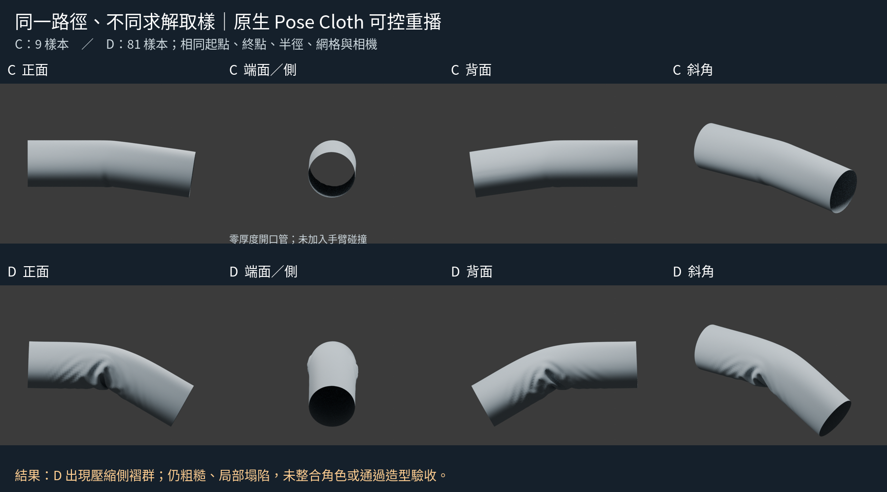
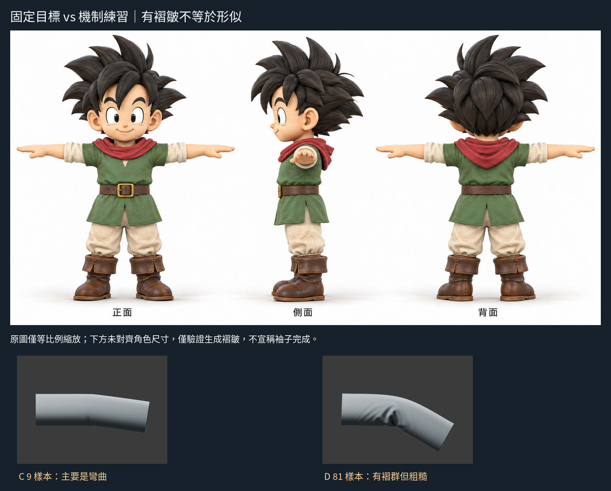

# 08:36 — Pose Cloth 只彎不皺：先查路徑，再做受控重播

## 結論（有限範圍）
本輪找出一個可驗證因素：**在同樣網格、筆刷、起終點與路徑下，原生筆觸重播的樣本數會大幅影響結果。** 9 樣本主要是彎曲；81 樣本出現壓縮側集中褶群。這不是證明前輪全部差異都由事件數造成；前輪實際接受多少滑鼠事件沒有可用紀錄。

能產生皺褶不等於做對角色袖子。81 樣本版粗糙、局部塌陷、沒有手臂支撐和厚度；並未通過造型驗收，沒有整合角色或替換較好基線。

## 先確認不是錯誤設定
從前輪 `after-ui-stroke.blend` 實際讀取 active brush：
- `sculpt_tool=POSE`；`deform_target=CLOTH_SIM`。
- `pose_deform_type=ROTATE_TWIST`、`pose_origin_type=TOPOLOGY`。
- Smooth Iterations 4；IK Segments 1；Keep Anchor Point True；Strength .5。
- Unified Size 240 px（brush自身210，但統一尺寸啟用，實際UI顯示240）。
- stroke_method SPACE、spacing10、smooth_stroke False。
因此不是「不小心仍用 Geometry」；也不能只看到 SPACE 就推定 spacing 有效。

## 本輪實讀來源與推理
官方 v4.3.2 原始碼，只下載閱讀，沒有編譯或執行陌生程式：
- https://raw.githubusercontent.com/blender/blender/v4.3.2/source/blender/editors/sculpt_paint/sculpt.cc
  - 2754–2767：Pose 需要全部 PBVH 節點。
  - 3134 起：Cloth target 建立模擬、儲存狀態與約束。
  - 3327–3331：每次主對稱筆刷步驟執行模擬步。
- https://raw.githubusercontent.com/blender/blender/v4.3.2/source/blender/editors/sculpt_paint/sculpt_pose.cc
  - 196–205：Geometry 直接改形，Cloth target 寫入 deformation_pos，走的是不同路徑。
  - 649–695、809–840：拓撲區域與半徑參與姿態原點／權重，半徑不是單純「局部模擬區大小」。
  - 1975–2000：Rotate 使用 IK 目標；反轉輸入才進 Twist。
- https://raw.githubusercontent.com/blender/blender/v4.3.2/source/blender/editors/sculpt_paint/sculpt_cloth.cc
  - 207–226：非 Cloth brush 的 CLOTH_SIM 使用形變約束，且不使用 Cloth brush 的模擬區衰減。
  - 267、1174–1202：固定時間步及位置／速度更新。
  - 1379 起：求解約束後更新模擬頂點。
- https://raw.githubusercontent.com/blender/blender/v4.3.2/source/blender/editors/sculpt_paint/paint_stroke.cc
  - 1047–1115：spacing 啟用最後依賴 dynamic_size；Pose 被列為 grab 類，因此不走 spacing 路徑。這推翻了本輪最初「改 spacing」的念頭，**沒有做無依據 spacing 比較**。
  - 1610–1635：非 spacing 路徑由接受的移動事件加入筆刷步。
  - 1664–1691：原生 EXEC 重播依 stroke 集合逐項 update_step；因此明確傳入樣本序列可避開 OS/UI 移動事件合併的不確定性。

輔助讀取官方4.3手冊搜尋回傳的Stroke段落：
https://docs.blender.org/manual/vi/4.3/sculpt_paint/brush/stroke.html
其中英文段落解釋 Dots 依 mouse move、Space 依 spacing。未將一般手冊說法直接套到 Pose；以相應版本程式實際分支判斷。英文手冊直接 fetch 報402，沒有聲稱實開全文。

上輪已實看 Pablo Dobarro 官方示範（本輪未新增觀看範圍）：
https://code.blender.org/2020/10/cloth-sculpting-improvements-in-blender-2-91/
作者是2.91示範，並未交代我們全部測試參數。受控重播是我為理解求解步驟設計的實驗，不是聲稱作者這樣操作。

## 實驗1：原生 UI 真正滑鼠輸入（保留負結果）
A 是前輪9個 UI 路徑控制點結果，原檔複製保留。B 從相同 pre-ui-stroke 載入；相同9控制點每段線性細分10份，總81點，四捨五入至整數像素。起點(795,495)、終點(760,605)，其餘點見 `ui_paths.json`。
- B 與 A 幾乎相同，仍沒有主褶群。最大對應頂點差約0.000648，這只記錄形體差，不是品質指標。
- GUI 的 wm.operators 回空清單；operator_properties_last 的 stroke 集合為0，無法取得實際接受事件數。
- **不能把 輸入 81 點說成 Blender 81個求解步，也不能說「增加求解步數無效」。**
- A／B正側背斜渲染已保留，`render_comparison.py` 可恢復。

## 實驗2：可見 Blender 中的原生筆觸可控重播
為隔離真正樣本數，使用 `controlled_replay_ui.py` 在 原生 Blender 控制台執行。不是背景投影，不是新裝軟體。控制台切回 VIEW_3D 後透過 timer 等待真實 region，再用內建 `bpy.ops.sculpt.brush_stroke` 原生 EXEC 重播。

C／D每次先還原完全同樣的64周向×81軸向開口管（長3、半徑.42；只恢復起始網格，沒有用公式製造皺褶），再進 Sculpt。
- C：9個樣本；D：81個樣本。
- 相同線性世界路徑 (1.2,-.42,0) → (1.0,-.42,-.65)。
- 相同 time 範圍0→1、pressure1、size240、is_start第一筆True。
- 同一個 active Pose Cloth brush；沒有改半徑、解析度、材質、strength、IK或求解器設定。
- 均回傳 FINISHED；保存 `controlled-9.blend`、`controlled-81.blend` 與 `controlled_report.json`。
- C／D與實驗1路徑並非精確同一組離散輸入，所以**只在 C 與 D 間做單變數推論**，不把 D 與 A 的全部差異歸於樣本數。

## 實際四向觀察
C：正／背主要下彎，壓縮側僅輕微凹陷；端面仍大開口；斜角沒有清晰主折群。
D：正／背壓縮側集中出現數道折峰，寬直段連入折區；斜角確認不是單一正面浮雕。但折峰表面有細碎波紋、轉折很深，局部布量塌陷，仍不是目標短翻袖。端視因彎折改變可見內壁，並不表示加了厚度。

原圖只等比例縮放；機制試驗未對齊角色尺寸，不做剪影相似度分數。未模擬手臂碰撞、未建立袖口布厚或衣身接縫，也沒證實伸直後可保留適合T-pose的折痕。

## 學會／尚未知／下一步
已理解並以實驗支持：Pose 的 cloth target 是把姿態變形交給約束求解；只看拖曳終點不夠，接受的筆刷步數會改變結果。不能把普通 Cloth brush 模擬區或 generic spacing 設定盲套到 Pose。
尚未知：前輪真實接受事件數、作者網格與筆觸；D的粗糙/塌陷各有多少來自求解、網格形狀、支撐缺失，尚未分離。
下一個造型問題應回到固定目標：短翻袖在水平手臂上需要局部堆布而非整段彎曲。先查作者如何回正且保留受控折痕／建立支撐，做單一小範圍測試，不把這條彎管套上角色。

## 公開文字版範圍

本頁整理既有實驗筆記，未在本次公開整理中重新執行或獨立重現。原始 `.blend`、參考圖、渲染、量測 JSON 與實驗腳本未包含在此文字版；文中檔名只描述當時的證據，不是下載連結。第三方教學內容僅保留公開來源連結與閱讀／觀看範圍，未重散布圖片或程式。歷史階段與下一步以當時紀錄為準，最新方向請見根目錄索引。

## 公開附圖

下列為當時保存的原始圖片檔，這次僅整理上傳，沒有重新建模或渲染。研究分析板與舊版渲染不代表新模型；實驗成功、失敗及限制以本文記錄為準。

[固定角色原始三視圖](../../images/reference/character-three-views.png)
