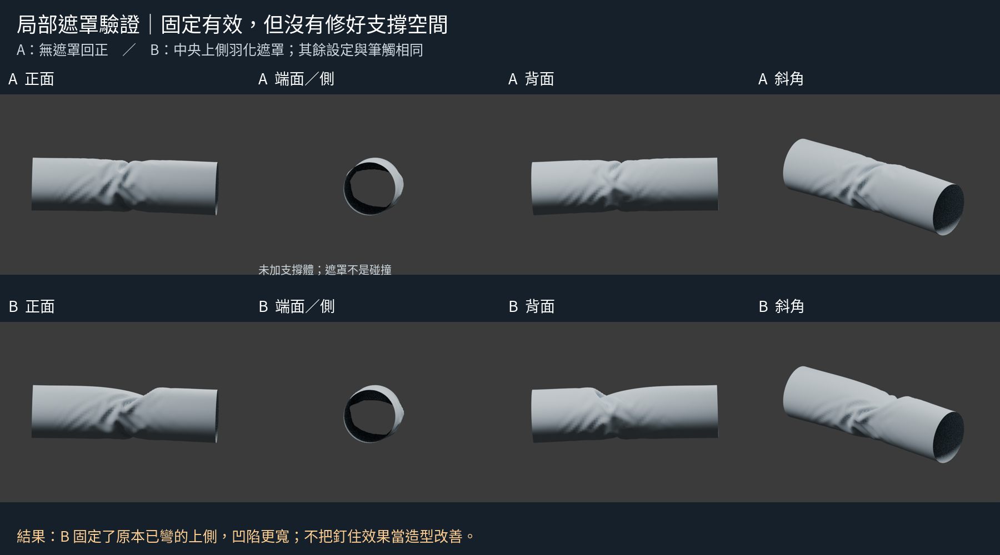
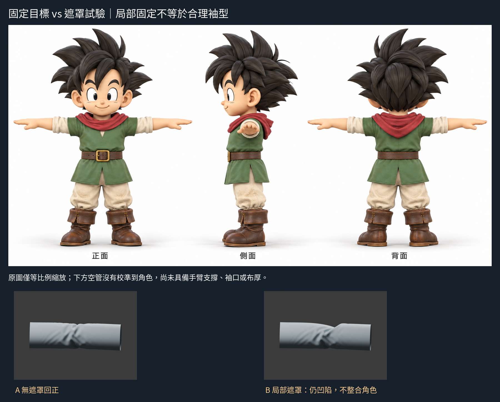

# 09:36 — Pose Cloth 的遮罩限制：固定有效，支撐造型失敗

## 結論
只增加一個中央上側羽化遮罩、重播相同回正筆觸。完全遮罩部分確實保持原位，但釘住的是已經彎曲的表面，回正後形成更寬的上緣凹陷。**本輪驗證了限制變形的機制，沒有修好支撐空間或袖子造型。** 停在這個負結果，不繼續調遮罩範圍、半徑或刷更多筆。

## 實讀的可靠來源
1. 官方 Blender 4.3 Cloth Sculpting 手冊（搜尋回傳完整相關段落，未假稱觀看新影片）：
https://docs.blender.org/manual/id/4.3/sculpt_paint/sculpting/introduction/cloth_sculpting.html
讀到：簡化布料雕塑支持遮罩固定；Pose與Boundary也支持cloth sculpting；拓撲分布影響折痕解析度。本文並未提供我們的遮罩形狀配方。
2. 官方4.3 Visibility, Masking & Face Sets手冊：
https://docs.blender.org/manual/en/4.3/sculpt_paint/sculpting/introduction/visibility_masking_face_sets.html
讀到：遮罩控制哪些頂點可被影響；Face Sets用於分組及可見性，也可輔助建立遮罩。本輪只選遮罩，不同時測Face Sets。
3. 實讀前輪保存的官方v4.3.2程式：
https://raw.githubusercontent.com/blender/blender/v4.3.2/source/blender/editors/sculpt_paint/sculpt.cc
3134–3140行，Pose/Boundary等CLOTH_SIM目標的模擬建立呼叫，use_collisions參數固定false。
https://raw.githubusercontent.com/blender/blender/v4.3.2/source/blender/editors/sculpt_paint/sculpt_cloth.cc
1706起，brush_simulation_create參數順序確認此false為use_collisions；只有true才建立碰撞快取。1390起的求解路徑也讀取hide/mask factors。
https://raw.githubusercontent.com/blender/blender/v4.3.2/source/blender/editors/sculpt_paint/sculpt_pose.cc
174–194行，Pose先由hide/mask取得因素，再乘到變形；Cloth target使用此結果。

**適用邊界**：因此不把普通Cloth brush的collision選項猜套到Pose，也沒有塞入一個支撐體就宣稱有效。這只描述4.3.2這條Pose Cloth程式路徑，不代表Blender全部布料工具沒有碰撞功能。Face Sets的Pose分支未完整驗證，本輪不作超出證據的聲稱。

## 單因素設計
起點為上一輪回正之前的已彎管：`pose-cloth-return/A-bent.blend`，複製為 `input-bent.blend`。不是在已回正失敗形體上再疊一筆。
- A：上一輪無遮罩回正結果，逐byte複製為 `A-unmasked-return.blend`。
- B：從同一彎管起點，只新增遮罩，執行與上一輪完全相同的普通Rotate回正筆觸。
- 遮罩位置是我的測試設計，不是作者配方：原網格軸向32–48環、周向12–20點（中央上側）全遮罩，兩軸各羽化4個採樣，權重相乘。保存 `mask_values.json`；`mask_region.png`橙色顯示遮罩。
- 用原生`.sculpt_mask`點屬性建立可重現遮罩，只設權重，不改頂點位置。
- 不改網格、半徑240px、strength.5、IK、Cloth target、81樣本、起終點、壓力或時間序列。
- 載入原生 Blender UI，在可見VIEW_3D以內建brush_stroke重播。回傳FINISHED並另存 `B-masked-return.blend`。沒有碰撞物、沒有幾何後修。

`return_report.json`與上一輪相同欄位已逐項核對：世界／螢幕起終點、樣本數、mode、target完全一致。遮罩是本輪唯一有意介入。

## 實際結果與失敗原因
同相機正側背斜渲染：
- 正面：B中央上緣的凹口較A更寬，底部擠壓與碎皺仍在。
- 背面：可見同樣較寬的缺口，沒有只在正面改善的假象。
- 斜角：B被固定的上側保留原本彎下形態，右段回正時在周圍產生不良銜接。
- 端側：開口大形接近A，不能證明內部支撐或防穿透。

機制檢查：153個全遮罩頂點，相對彎管起點最大位移為0；A相同頂點集合最大移動約.24795。這證明遮罩有固定作用，**不是品質分數**。

合理解釋：遮罩不能創造不存在的支撐空間，也不能把原本彎曲表面變成合理水平支撐面。此處把不理想的起始上側釘死，限制了回正需要的形變，故形成較寬凹陷。這是此遮罩設計的失敗，不推論所有遮罩方法都無效。

## 學會與下一個未理解處
已學會：先核對工具的實際路徑；Pose Cloth遮罩有效，但普通Cloth碰撞選項不能直接套用；限制頂點不等於建立符合手臂的衣物體積。
仍不懂：在正確支撐大形上如何安排可動折區與固定區，才能保留袖子寬面而不產生新的銜接問題。
下一步應查有實際支撐／碰撞流程的作者袖子示範，或先建立正確衣物外殼再限制區域；不要在已彎錯的大形上無限換遮罩參數。

## 公開文字版範圍

本頁整理既有實驗筆記，未在本次公開整理中重新執行或獨立重現。原始 `.blend`、參考圖、渲染、量測 JSON 與實驗腳本未包含在此文字版；文中檔名只描述當時的證據，不是下載連結。第三方教學內容僅保留公開來源連結與閱讀／觀看範圍，未重散布圖片或程式。歷史階段與下一步以當時紀錄為準，最新方向請見根目錄索引。

## 公開附圖

下列為當時保存的原始圖片檔，這次僅整理上傳，沒有重新建模或渲染。研究分析板與舊版渲染不代表新模型；實驗成功、失敗及限制以本文記錄為準。

[固定角色原始三視圖](../../images/reference/character-three-views.png)
