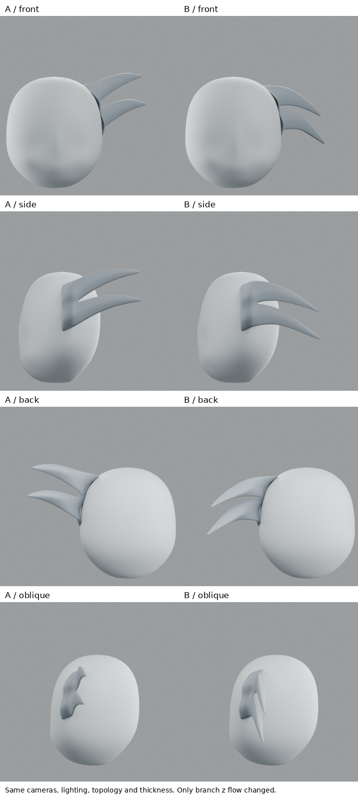
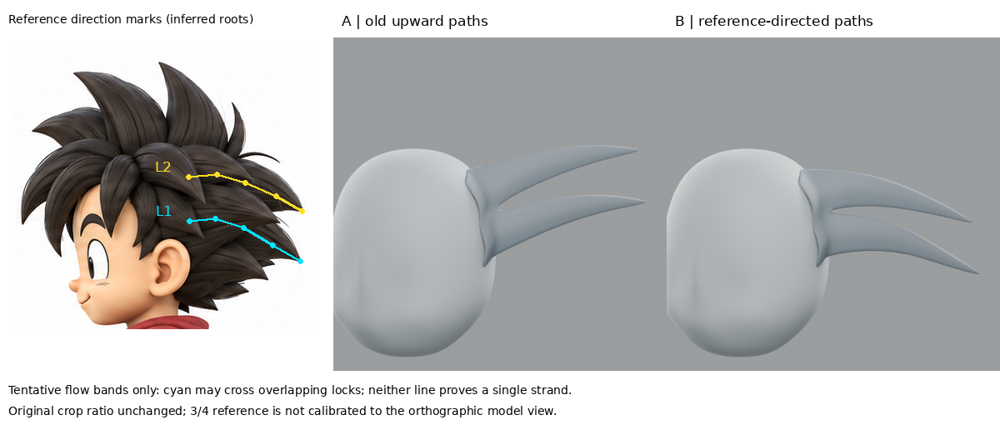

# 小練習：先把髮流方向讀對，再調造型

2026-10-28 17:06 UTC 研究紀錄。結論：**耳後兩束的向後下彎方向比前版接近參考，但仍是分叉板，不能算完整髮束成功。** 不整合到全人物；iteration04及前輪不變。

## 問題不是只缺厚度

上輪把底側補厚，截面有體積，外觀仍像板。這次回看原圖，先發現了更基本的閱讀錯誤：練習的兩束中心線一直向後上方直伸，原圖所選兩束則從前上方拱起，再向後下方收束。先前根本還沒驗證這個方向，就在微調厚度。

## 實際讀了什麼，採用什麼

- [Dan Eder 本人訪談／教學：Guide: Sculpting Stylized Hair in ZBrush](https://80.lv/articles/guide-sculpting-stylized-hair-in-zbrush)，實讀 General Workflow、Hair Blockout、General Mistakes。作者先把參考拆成大塊，調形、驗剪影，再做細節；也提醒不要機械複製髮束。本輪採用的是「先讀參考塊形」的工作順序，沒有聲稱使用 ZBrush 或其筆刷。
- [Pablo Muñoz Gómez：Sculpting Stylised Hair in ZBrush](https://www.pablander.academy/tutorials/sculpting-stylised-hair-in-zbrush)，實讀書面步驟：標記主髮塊，先給大體積方向，再做次級形與細節。本輪轉譯成對低模控制列的整列位移，保留截面形狀；不是完整重現雕塑操作，也未觀看影片。
- 重新讀 Tohawork 及 Ascalon 的摘要，但它們未提供此次路徑數值，未把摘要當作新學會的軟體操作。

## 原圖拆解與實驗

原圖尺寸1774×887。只研究右側面圖耳後兩個向後伸出的髮塊，並非頂部向上的大尖髮。

- L1 青線：可見路徑樣點 (925,210)、(956,207)、(990,218)、(1025,239)、(1058,258)。
- L2 黃線：(924,157)、(958,154)、(992,164)、(1029,180)、(1060,198)。
- 起點是遮擋後可見／推定的中心線位置，不是真正皮膚髮根。兩條皆為人工近似解讀；不是精準分割標註。尤其青線可能跨過相互遮擋的不同髮束邊界，起點到尖端未證明屬於同一束。這次只能視為暫定大塊髮流帶，不能稱單束精準描線。
- A＝上輪厚封閉網格原樣；B＝同網格，只依上述路徑調整分支控制列的Z中心位置。使用前後Y跨度按比例換算圖上高差；X、Y、拓撲、根區36×2點、上下表面同列差、材質、燈光、鏡頭不變。
- 因此只測「側面路徑方向／彎曲」，沒有重做根、改寬度或增加髮束。維持垂直截面列，沒有沿新切線重新旋轉截面，所以法向有效截面厚度不保證完全相同。
- 參考本身有3/4角度，不是校準正投影。原圖裁切不拉伸；右方局部模型不是全頭尺度配準，圖板只驗方向和形態，不能冒充像素誤差量測。看不到的深度仍未求解。

## 實際渲染結果

正、側、背、後斜、前斜各做A/B，完全相同鏡頭和光線。

1. 側及前斜的尖端由上揚改為後下彎，這一局部方向修正可見，不再只在背面加看不見的厚度。
2. 原根部仍是直立寬邊，兩束仍像同一片分叉板，沒有得到原圖的層疊髮塊。不能把「方向較對」說成「髮型做好」。
3. 後斜仍受端向觀看縮短影響；沒有用新角度遮掩失敗。
4. 此輪沒有全曲面碰撞驗證，也沒有綁定／UV。移動控制列後，不宣稱厚度在曲線法平面保持原值。

## 學到／下一個不懂

學到先確認髮塊對應與根到尖方向，能揭露比厚度更大的誤差。上一輪在尚未讀對髮流時反覆調截面，優先順序不對。

下一個缺口是**原圖兩個有層次的獨立髮塊，為何被做成同一條直邊上分叉的平板**。需要研究根部交疊／接合與不同深度的實際建模方法；先畫清遮擋關係，再測局部結構。不要在這個分叉板上繼續加細紋或複製全頭。

## 公開文字版範圍

本頁整理既有實驗筆記，未在本次公開整理中重新執行或獨立重現。原始 `.blend`、參考圖、渲染、量測 JSON 與實驗腳本未包含在此文字版；文中檔名只描述當時的證據，不是下載連結。第三方教學內容僅保留公開來源連結與閱讀／觀看範圍，未重散布圖片或程式。歷史階段與下一步以當時紀錄為準，最新方向請見根目錄索引。

## 公開附圖

下列為當時保存的原始圖片檔，這次僅整理上傳，沒有重新建模或渲染。研究分析板與舊版渲染不代表新模型；實驗成功、失敗及限制以本文記錄為準。

[固定角色原始三視圖](../../images/reference/character-three-views.png)
