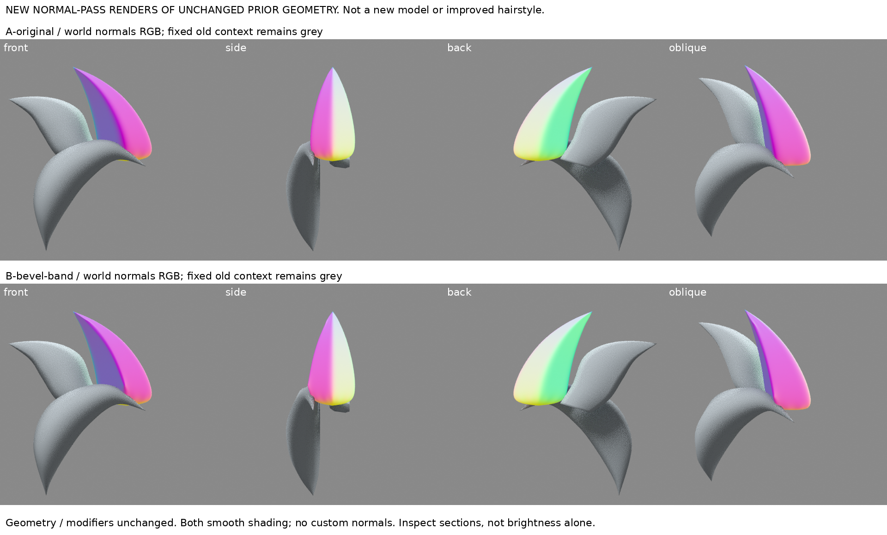
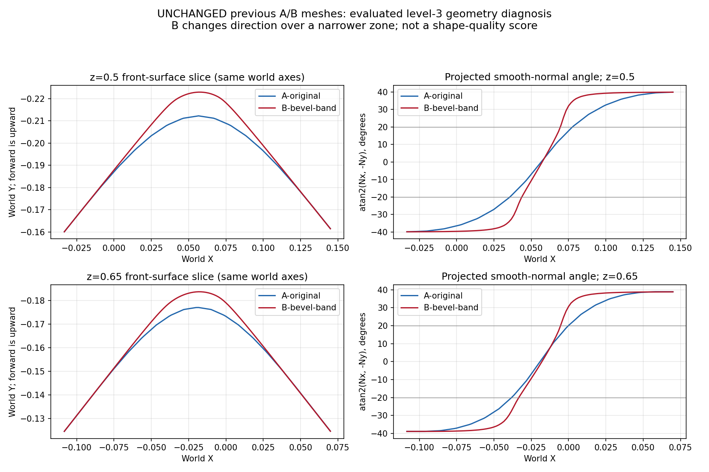

# 窄亮帶診斷：轉向集中在更窄區域，不是忘記平滑

2026-10-30 15:36（Asia/Taipei）。**研究與既有A/B的幾何診斷，沒有新造型候選、沒有改善模型。** 本輪新輸出的是未改幾何的法線四向重渲與截面圖，不用舊渲染冒充新成果。iteration04不變。

## 問題、舊資料與來源實讀程度
已讀LEARNING_INDEX、ridge-transition-band、visible-plane-balance、bevel-profile-handles、spike-support-edges。舊Bezier共線柄讓指定截面切線連續，但多邊形主脊倒角後再Catmull卻成窄亮帶。這次不再改寬度/段數/支撐距離，而查最後表面究竟怎麼轉向。

實讀OpenSubdiv官方3.8頁面：
- https://opensubdiv.org/docs/subdivision_surfaces.html ：Overview、Parametric Patches、Piecewise Surfaces、Regular versus Irregular Features、Subdivision versus Tessellation、Separating Data from Topology。
- https://opensubdiv.org/docs/mod_notes.html ：Topology、Use Fewer Spans、Avoid High Valence、Edge-Loop Transitions、Triangles and N-Gons相關正文。

有限摘要：控制籠與其定義的曲面不是同一物；位置和連接關係共同決定形狀，規則網格與特殊頂點區的表現不同。官方提醒細分建模通常不需用密集控制點逼近圓面，任意看似圓順的多邊形也未必是好控制籠。這是通用細分機制，不是尖髮作者配方。未移植頁面中其他版本/硬體限制。

舊graphics.pixar網址重導首頁，改官方opensubdiv.org成功讀到正文；少跨度示意圖片在web及公開HTTP取圖失敗，**未看該圖、未看嵌入影片**。不把文字閱讀冒稱觀看。髮型上下文沿既有六色截面與Maria流程，只讀回舊NOTES，本輪無新髮型作者觀看。

## 診斷方法，不改原始幾何
輸入為前輪A-original與B-bevel-band原樣副本，沒有保存新的雕塑/拓撲。兩者都全Smooth Shading、無custom normals、同Catmull三級。截面分析直接取Blender評估後網格，世界Z固定為.5與.65，沿X每1/600單位從前方射線取得最前表面。

- 幾何圖畫實際交點Y，而非控制籠剖線。
- 法線圖以三角面上的重心座標插值頂點法線，再正規化，畫atan2(Nx,-Ny)。它是有限評估網格的投影法線方向，**不是精確微分曲率或證明C2連續**。
- 用-20°至+20°作共同觀察窗口。此角度只是比較兩版轉向分布，不是原圖目標或美術評分。
- 另以相同幾何臨時評估四級作解析度敏感性檢查，不把高細分當新候選；原檔不寫回。
- 新法線材質以世界法線映成RGB並Emission輸出；主束不靠燈光高光判轉向，前弧與鄰束保留灰色上下文。四鏡頭與前輪相同。RGB顏色不是最終髮色，也不是UV法線貼圖。

## 結果與證據限度

在z=.5，A的轉向窗口寬約.04195，B約.02576；z=.65為.03805對.02794。兩高度皆顯示B方向轉換集中在較窄區域。B截面峰點分別比A向前突出約.01068與.00667。四級診斷仍是相同趨勢（.04159對.02572、.03769對.02792），但這不是完整收斂證明。

法線重渲中B的色彩交界較緊；截面圖能看到B兩側更接近直段，中央轉向更集中。原控制籠上的圓弧帶在目前鄰接分布與細分下沒有形成較寬柔的最後轉折。**新增密集邊改變控制分布與此結果一致，尚未因果隔離各邊、端點拓撲或每項插值因素，因此不稱唯一原因，也不概括所有Bevel都變硬。**

排除的是「忘記Smooth或偷偷改custom normal」這個簡單解釋；不能因此說材質/光線對視覺沒有影響。診斷只涵蓋這兩個可見高度及原四視圖，不把數字當整頭或原圖相似度。原圖沒有可直接量取的曲率真值，本輪不作新原圖精度主張。

## 對下一次造型的決策
- 先保持A，B仍不採用。停止倒角寬度/段數/主脊偏移掃描。
- 下一次不要以「控制籠看起來圓」當操作目標；先在完整可見截面畫出兩側寬面與中間轉向帶的假設，分開判斷脊位置、脊高、轉向區寬度、沿長度變化。
- 少跨度的均勻拱面與原來近稜密集支撐是不同設計；**尚未指定刪哪條邊或新截面數值**，需相近作者完整截面建構證據後才改。不能把本輪診斷轉成無據的新公式推點。
- 曾有效的Bezier中央共線柄可作連續性對照，不可直接宣稱可移植至目前多邊形。曲線半徑橫帶、框架與原型厚度的舊問題仍未解。

本輪學到的是如何識別轉向集中與控制籠誤判，尚未學會把此髮束塑成原圖的柔和寬面。沒有新角色版、沒有新造型進步證明。

## 恢復與未完成事項
source-input保留兩個原樣blend；diagnose.py產生sections.json，check_resolution.py產生四級採樣，render_normals.py產生8張真實法線重渲，boards.py組圖。measurements.json與resolution-check.json留數值。執行需Blender4.3.2、Python的numpy/matplotlib/Pillow；沒有安裝新軟體。
兩個輸入已實際冷讀計算並渲染；source-hashes.json核對原檔副本與iteration04不變。尚未實測解壓到別處完整重播，不宣稱已驗。第三方來源圖未下載成功且未入包。GitHub原核准未決，未寫入/重試。

公開版僅含本筆記與兩張新診斷圖；輸入模型、診斷腳本及JSON未隨附，私人恢復包另存。本地待同步，不代表遠端已發布。
