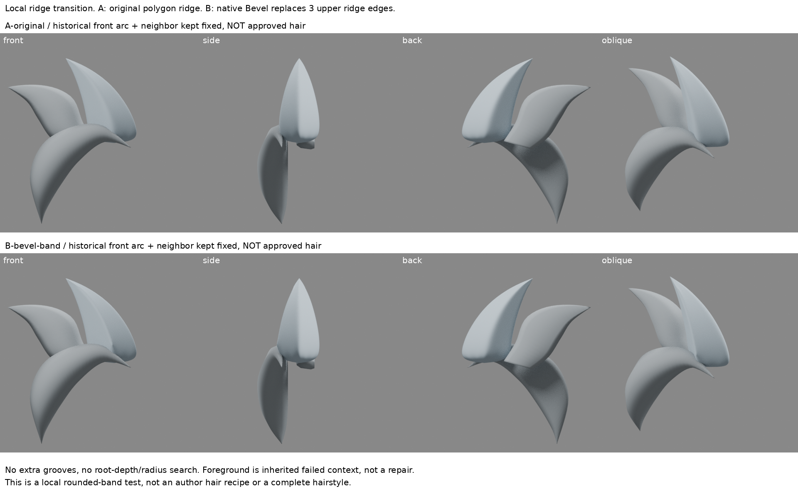
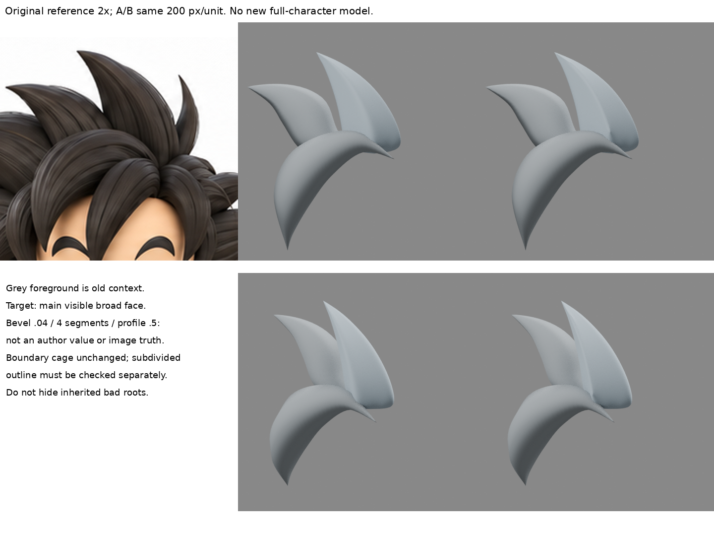

# 局部主脊倒角：圓弧面帶不保證細分後更柔和

2026-10-30 15:06（Asia/Taipei）輪。局部方法比較，有新四向渲染；**B不採用、不整合、不取代iteration04。**

## 讀回與差異
已讀LEARNING_INDEX、visible-plane-balance、hair-boundary-design、closed-hair-sections、spike-support-edges、bevel-profile-handles。舊試驗已回答支撐距離、曲線截面切線及主脊位置；本輪不掃那些數值。

舊bevel-profile-handles是原生Bezier截面中央兩柄共線，讓整條掃掠截面的切線連續；closed-hair-sections比較整體菱形/拱形。此次是**現存多邊形控制籠上，僅把可見上段三條主脊邊替換成有限寬的圓弧面帶**，再保留原Catmull三級。不是又宣稱發現圓截面，也不是把支撐線移近/移遠。

髮型方向沿用先前已實讀實看的[六色截面](https://note.com/rikuhayasaka/n/n5ab4a25233d1)及[Maria Moreno曲線後塑面流程](https://www.therookies.co/entries/22505)；本輪回查筆記，**未重新觀看作者圖，不新增作者實看次數**。下面官方來源只是通用工具依據，不能稱其方塊示意為相近髮型教學。

## 本輪實讀實看新依據
[Blender 4.3 Bevel Edges](https://docs.blender.org/manual/en/4.3/modeling/meshes/editing/edge/bevel.html)：完整讀Usage、Width Type、Segments、Shape、Clamp、Loop Slide及Profile相關正文。web讀取402；公開HTTP首次403，正常瀏覽器User-Agent讀取200後解析全文。另實看官方example-2單段與example-4四段兩張圖：一個斜面與多段弧形面帶不同。沒有影片。

工具機制：選定兩面共有邊，可由新面取代；分段數和輪廓控制轉角帶。0.5輪廓於直角面間為圓弧，但不代表任意髮束上的最後曲率；Clamp限制重疊，不能保證美術形體。官方多邊同時倒角可能妥協寬度，所以不宣稱各處實際帶寬都精確相同。

第三方圖只閱讀，不含於此目錄、恢復包或公開圖。原生Edit Mode mesh.bevel不是作者筆刷重播，也不是自製雕刻位移。

## 可控小樣
- source.blend為前輪A-centered，含固定舊前弧及鄰束。前輪B偏脊沒有採用，本輪不用它當較佳基線。
- A保留61點61面控制籠；B只選可見上段主脊三條邊(15–27、27–39、39–51)，原生Bevel Offset .04、4段、Profile .5、Clamp開、Loop Slide關、Harden Normals關。B為79點81面。
- .04為一次預定測試值，不是作者髮型數字或原圖量測。沒有掃寬度、段數、支撐距離。根環、尖端、外緣、背側原控制位置仍存在且不移動。拓撲新增，不能稱只移一個座標。
- 兩版相同Catmull三級、原尖端crease、smooth shading、材料燈光、480×480及200px/unit。前弧與鄰束完全相同，仍有舊平帽/側面缺陷，不為遮新失敗而調動。

## 實際結果與對照

原圖只等比例2倍，未拉伸或AI改造。A/B正側背斜共8張新渲染；另2張透明主束診斷檢查外緣，不替代上下文比較。

- 正/斜視：B不是更柔軟的大轉折；中央明暗交界反而收成更窄的硬亮帶，帶的起訖附近也有局部轉折。較多弧面控制點在同細分下加強了局部形狀維持，**這是對本例結果的解釋，非所有Bevel都變硬的定律**。
- 側視：沒有解決舊根帽或主束厚度；背視差異很小，不能以看不見變化證成功。
- 原控制外緣位置不變，但評估後alpha>=128仍差1像素，最大逐列邊界差1px。IoU .99994只是A/B投影診斷，不是原圖精度分數，也不是主量已正確。
- 尖形、白隙、前弧遮擋大致保留，寬面曲率仍不自然，**未證比A更像，因此B不採用**。不靠更亮材質掩蓋結果。

## 學到、失敗與下一問題
圓弧面帶是拓撲構造；Bezier切線連續是另一層控制；再疊Catmull後的最終面形必須另看。不能以「四段倒角」或「邊界控制點不動」代替渲染判讀。

本輪失敗：局部倒角新增密度，沒有取得所需的寬而柔的轉折，反而強化窄亮帶。停止掃Bevel寬度/段數，不能連續用同一控制籠小改代替學形。

下一步應回到**整個可見截面的寬轉折區設計與沿長度連續變化**：先比較已保存的Bezier共線柄有效例和此倒角負例，找相近作者如何在保寬面時分配曲率的完整操作。若只得到同一套支撐/倒角參數，不再做新版本。隱藏根、頭深與分層仍保持未知，不搶先往細溝或五官走。

## 恢復
source.blend、A-original.blend、B-bevel-band.blend、build.py、boards.py、verify.py、metrics.json、restore-check.json、outline-check.json及reference.png齊備。build.py用同目錄source重建兩版；boards.py用本包授權原圖；verify.py重開兩檔，若外部iteration04存在再核對其hash。
兩模型冷讀成功、上下文相同、iteration04 SHA256仍35cd1b71c9d288029d93d0fdb8d9741d62a5151bc3bc459ab48c789092b5aaa6。未實測解壓到另一目錄完整重播，不宣稱已測。GitHub原批准未決，未寫入/重試。

公開版僅含本筆記及兩張比較板；文中模型、建模腳本和診斷JSON未隨附，私人恢復包另存。本地待同步，不代表遠端已發布。
