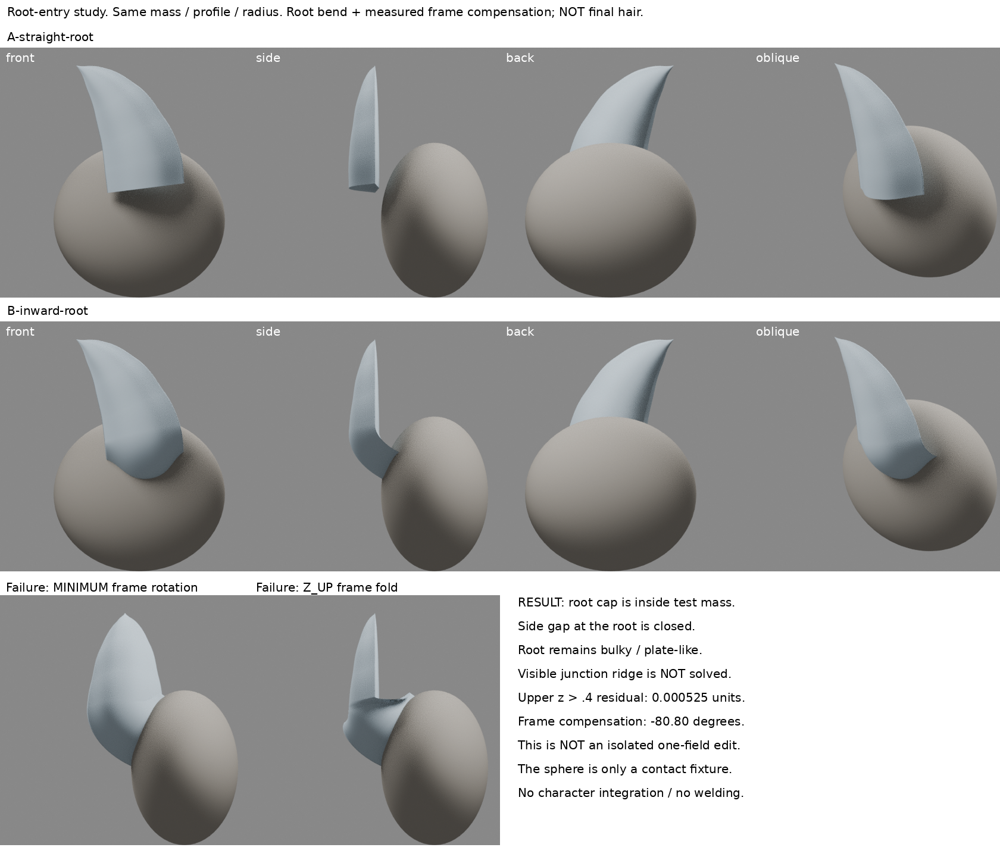
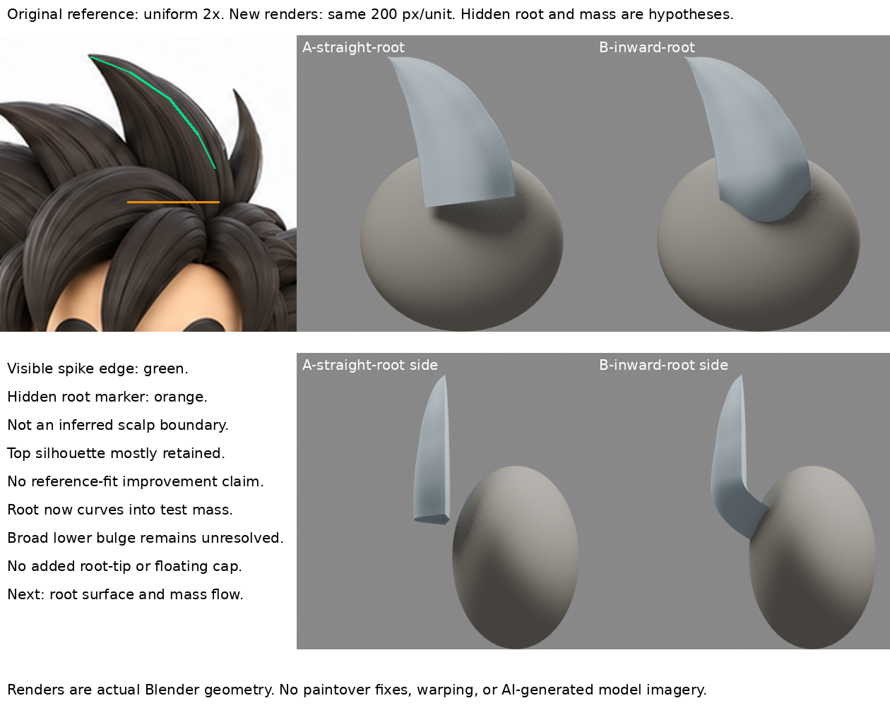

# 髮根彎入主量：接觸成立，表面過渡仍未解

2026-10-30 12:36（Asia/Taipei）輪。**局部方法實作，未整合人物，未通過造型驗收。** 頭部iteration04與前輪模型保持不動。

## 問題與舊失敗

已讀LEARNING_INDEX、hair-root-contact-source-screen、hair-root-layering-research、front-hair-layer及curve-speed-continuity。先前整束前後平移只降低懸浮，未回答根部入射方向；刪底量會漏皮，不能再重做這個結論。本輪改問：保留尖端與上段導向，讓根端轉向並彎入主量，是否能消掉可見直切端帽與根間空隙？

## 實讀實看來源

James Hyun，本人作品流程〈Complete Workflow for creating a Stylized 3D Female Action Character〉，2020-06-10，Hair & Groom System：
https://www.therookies.co/blog/breakdowns/complete-workflow-for-creating-a-stylized-3d-female-action-character

實讀該節全文，實看兩張原圖：06-hair-1-1.JPG與06-hair-2-1.JPG。第二張近斜上視可見彩色束在根處轉彎進入灰色主髮量；第一張側視顯示中心量仍在、表面束循其外形。這是靜態構造證據，不是逐筆影片，不知道作者每次轉角數值。第三方圖僅私下閱讀，不放公開資產或恢復包。

作者的有限方法摘要：保留平滑主量，於其上安排束；頂部根端旋轉、彎向內部並埋入；根保持比尖端厚。其角色為長髮，本案向上尖髮不同，**僅適配根的入射方向，不複製髮型、不假稱作者教過本案幾何或Blender參數**。

## 本輪假設與控制

- 保留前輪B-equal-speed原生Bezier束為獨立baseline-clump.blend。尖端與前視可見邊沿仍沿原圖先前定位。
- 新增橢球「主量測試治具」，固定中心(0.12,0.50,-0.25)、三半徑(0.72,0.45,0.65)。**不是角色頭、不是已定稿髮底，不是原圖隱藏深度測量。** 基本幾何僅測試支承，不能當完成髮型。
- A保持直根。B只改第一根控制點及其兩柄的空間導向；所有上段控制點/柄、半徑、截面、主量、材料及四向鏡頭不變。B根端往內，與整束平移不同。
- 六個控制點不等於六束；單一連續曲線帶封閉截面及端帽。沒有新增第二尖端或用小物件堵縫。

## 先失敗，再校準一次

初次MINIMUM框架會由新3D根方向傳遞截面旋轉，上段表面也轉動，最大約0.42單位。因此不能把那組當成只改根的證據，已完整保存在failed-minimum-frame。

共同改用Z_UP試圖固定方向，卻在根轉折造成明顯扭折、平片切口，保存在failed-zup-frame。不是根部接合成功。

最後回MINIMUM，根改動後以相同上段截面兩點及切向計算相位差，對B所有Tilt加同一補償（-1.41030rad，約-80.80度）。這是曲線框架校準，不是來源作者操作。Blender4.3.2本地RNA實讀：MINIMUM為整束最小扭轉，Z_UP依Z軸計算，各不是固定截面朝向保證。未把官方網頁讀取失敗當成讀過全文。

**因此最終A/B不是嚴格單欄位改動：根空間導向＋截面相位補償。** 控制點/半徑/截面未被全局重塑；對z>0.4的共同可見上段，評估網格最大殘差0.000525單位，約0.105像素（200px/unit），非數學完全不變。靠近根的框架差異仍存在，不宣稱所有上段表面零變動。此次只校準一次，沒有展開無限角度搜尋。

## 實際四向結果與限制

真實渲染A/B正、側、背、斜共8張，再以原圖等比例2倍裁切和相同200px/unit鏡頭比較。對照沒有拉伸、AI改造或畫掉模型錯誤。

- A側視能看見根端平切帽與主量之間的空隙；B側視根轉入主量，不再是浮離平帽。
- B根環66個評估取樣全部落在同一橢球內，A為0/66。這只證明此治具的埋入關係，不是造型分數或真實髮根位置。
- B正/斜視下段變成較寬的圓鼓面，右側接界仍有明顯轉折。沒有新增游離第二尖端，但**接觸不等於自然表面過渡**。背視由主量遮住根，不能拿此遮擋當正面品質保證。
- 原圖主要尖端輪廓大致保留；下段隱藏、深度假設不能宣稱比原圖更準。這個孤立束／球不是整頭髮成果，也不取代iteration04。

## 學會、失敗與下一問題

學會：作者的「根部彎入」可被拆成一項與整束平移不同的機制；方法能解此小樣浮根，但曲線框架會暗中改變上段，必須核對評估後表面而非只查控制點。

失敗：直接MINIMUM傳遞旋轉；Z_UP產生局部扭折；校準後的根仍鼓、接界有稜。不得把端帽藏進量塊就寫成完成根造型。

下一步應檢查**主量到根上表面的方向是否一致、交界是合理分層還是突兀階差**，優先作者寬束根表面與主量的平面/曲率處理。不要繼續掃根深度、Tilt角度或加小束遮接縫；也不要求來源跟固定原圖一模一樣才容許有據局部適配。

## 恢復

- baseline-clump.blend：前輪原樣複本。
- A-straight-root.blend、B-inward-root.blend：原生可編輯曲線、截面與主量。
- build.py：重建並渲染；boards.py：僅排版真實圖與授權原圖；verify.py：冷讀驗證。
- failed-minimum-frame、failed-zup-frame：失敗模型/渲染/腳本/指標完整保留。
- metrics.json、restore-check.json：方法診斷，不是藝術通過。
- comparison-board.png、reference-comparison.png：本輪兩張自製對照。

兩個最終模型已冷讀，曲線/截面/主量存在；iteration04 SHA256仍為35cd1b71c9d288029d93d0fdb8d9741d62a5151bc3bc459ab48c789092b5aaa6。GitHub寫入核准仍未決，本輪只保存本地與待同步資料，未重試寫入。

## 公開附圖與恢復邊界

本公開稿僅含筆記與兩板。上列模型、建模/校準腳本、失敗模型與數據不是此repo附檔，另存私人可恢復備份；不是完整模型重播包。GitHub仍本地待同步，未發布。
