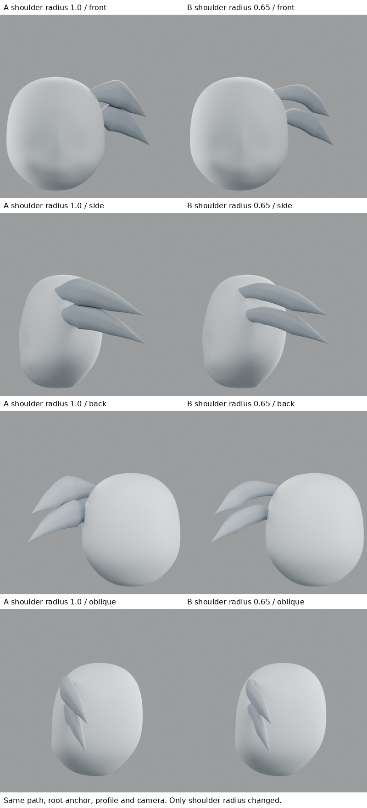
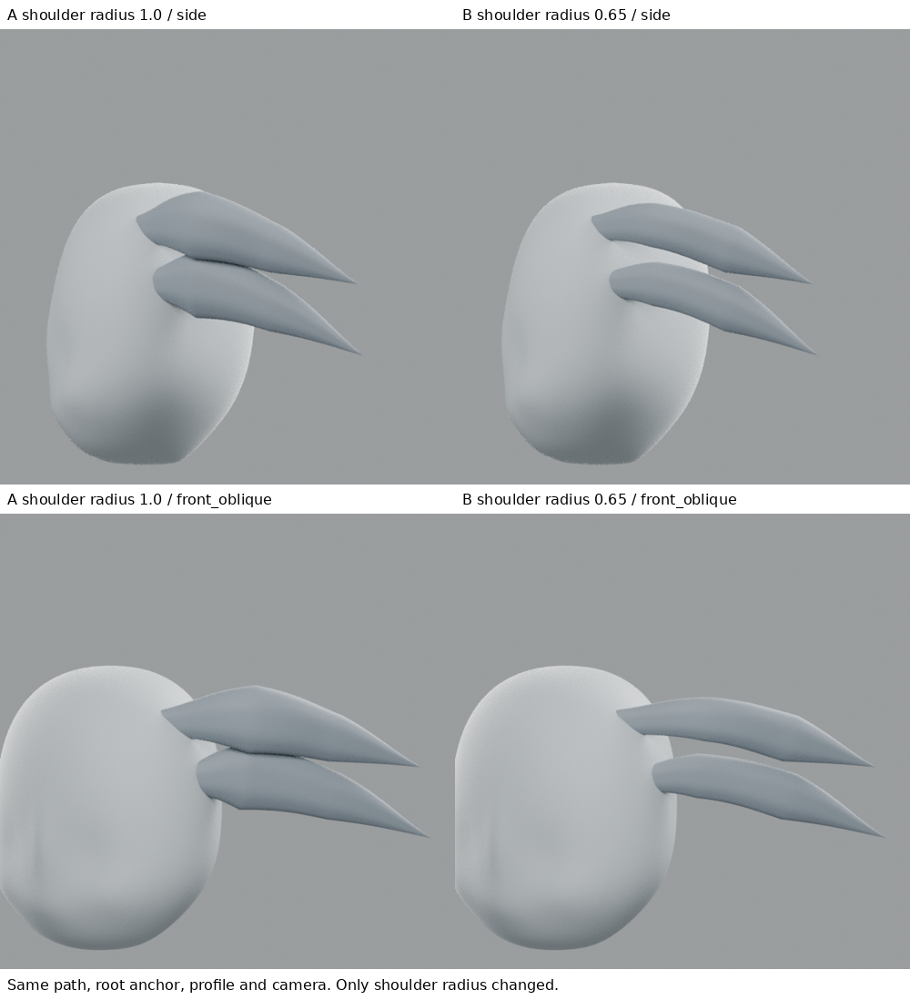

# 小練習：根後半徑過渡，不等於根部接合

2026-10-28 18:06 UTC 研究紀錄。**縮小根後第一肩部後，鼓包較少、兩束間谷更開；但切斷插接感仍存在，沒有解決根部結構，不整合全頭。**

## 實際學習來源
- Danny Mac，https://blog.cgcookie.com/posts/how-to-model-hair-in-blender/ ，本輪實際讀 Step 3–4：沿曲線逐點調整半徑、調整截面、以另一視窗及各角度確認。本輪採用其可編輯曲線半徑方法；0.65 是試驗值，不是作者推薦比例。示範為馬尾，不能說是本角色的直接造型解答。
- Tohawork，https://tohawork.com/hairmodeling ，本輪實際讀第②–④及⑰–⑳的作者摘要：多角度、髮流與曲率、束根之間的谷。這是短尖髮案例，但未看完整影片，沒有聲稱掌握影片中每一步操作。

## 三視圖交叉檢查
實際查看原始正／側／背頭部。側面的兩個後尖端可見，但根部被前景髮束遮住；正面側方也有重疊，背面中央大片髮束覆蓋後部。因此無法可靠地為同一束標出三視圖精確對應根點。沒有將高光線當邊界，也沒有把猜測的根位置說成原圖量測值。`three_view_reference_check.png` 使用原圖等比例裁切縮放；無像素級校準或誤差聲明。

## 方法與變因
A完整保留上一輪C的兩條獨立Bezier髮束。B只將兩條曲線各第2控制點（根後第一肩）的半徑由1.0改為0.65；其餘半徑、所有路徑座標與手柄、根錨點、尖端、截面、扭轉、材質、燈光和鏡頭固定。半徑不是世界空間單位，是bevel截面的縮放係數。

原半徑序列為[0.34,1.0,0.70,0.002]，B為[0.34,0.65,0.70,0.002]。這是對「根後立即擴張是否造成鼓包」的局部試驗，不是因參考能讀出0.65。audit.json保留實際控制值。

## 實際觀察與失敗
1. 側面與前斜角：B近根部膨起減少，兩束間空隙較大；外形較細，並非所有方面更接近原圖。
2. 根仍有截斷／插接觀感。縮半徑不能改變曲線離開頭皮的方向，也不能代替頭髮底層與相鄰束的連接設計。
3. 背面與原後斜仍不自然，僅兩束暴露根部不足以模擬原圖的層次。不能以隱藏根部或增加束數當作修復。
4. B仍像細葉片；不升級為正式人物基線，不覆蓋前版。未作完整碰撞、變形、UV或生產拓撲驗收。

學到：能控制半徑過渡，且知道其影響範圍；不能把根部問題一概當作太厚。下一個具體問題是根段切線與頭皮曲率的連續方向，以及髮束由哪個底層大形長出。需找作者的實際根部建立步驟，避免再僅改一個數值。

## 公開文字版範圍

本頁整理既有實驗筆記，未在本次公開整理中重新執行或獨立重現。原始 `.blend`、參考圖、渲染、量測 JSON 與實驗腳本未包含在此文字版；文中檔名只描述當時的證據，不是下載連結。第三方教學內容僅保留公開來源連結與閱讀／觀看範圍，未重散布圖片或程式。歷史階段與下一步以當時紀錄為準，最新方向請見根目錄索引。

## 公開附圖

下列為當時保存的原始圖片檔，這次僅整理上傳，沒有重新建模或渲染。研究分析板與舊版渲染不代表新模型；實驗成功、失敗及限制以本文記錄為準。

[固定角色原始三視圖](../../images/reference/character-three-views.png)
