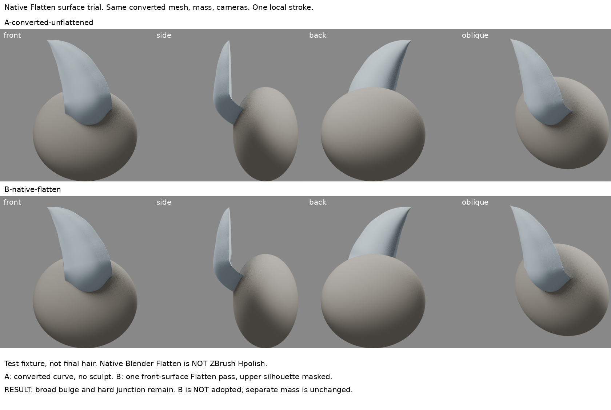
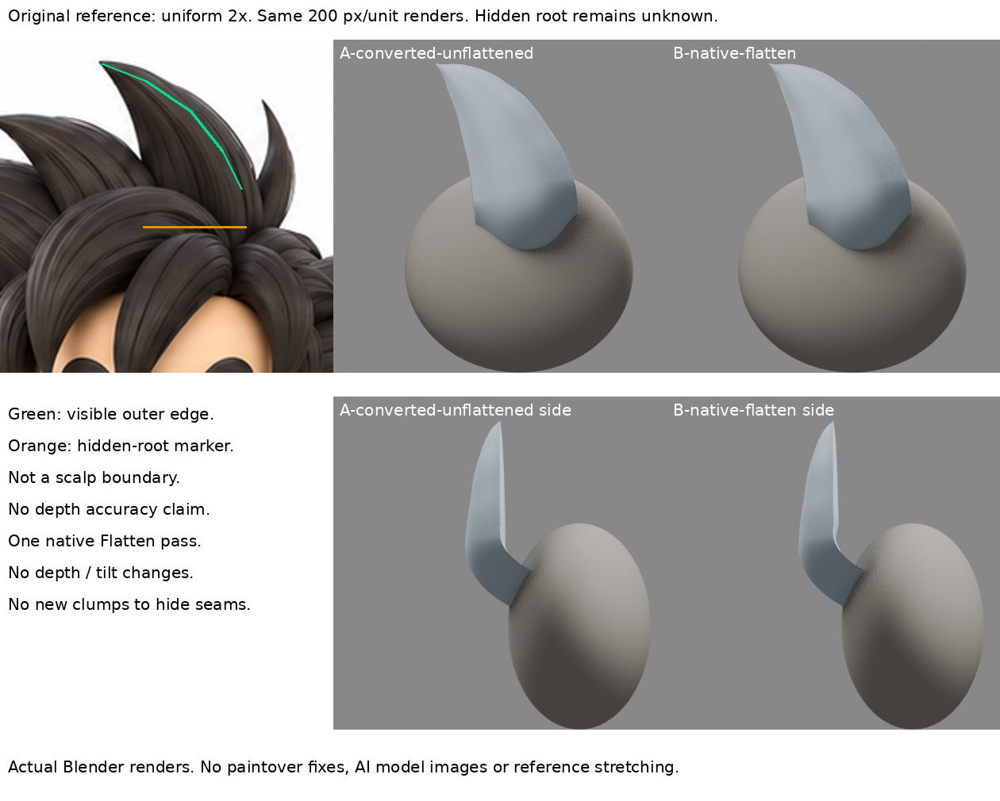

# 曲線轉網格後的寬面處理：原生 Flatten 局部試驗，未解接界

2026-10-30 13:36（Asia/Taipei）輪。局部方法練習；B不採用、不整合、不取代iteration04或前輪曲線基線。

## 問題與回顧
已讀本地LEARNING_INDEX及root-entry-direction、root-taper-scope、front-hair-layer。根彎入能移除浮離端帽，但寬面鼓與硬接界仍在；縮根變成梨形鼓包，刪底量會漏皮。此次不再掃根深度、半徑、Tilt或加束遮縫。問：曲線已定剪影之後，原生塑面能否獨立改寬面？它是否同時解接界？

## 實讀與實看（不把靜圖說成逐筆示範）
1. Maria Moreno，〈Maria Moreno - 3D character artist〉，2023-05-26，本人Rookies作品流程：
https://www.therookies.co/entries/22505
實讀頭髮段；在雲端瀏覽器逐張實看lightbox 8/43、9/43、10/43。8為較多細彩色曲線束，9為較少且較寬圓帶束，10為黑髮前後斜視完成面，寬面與轉折/溝共同形成分流。作者明說Blender自訂截面曲線定束，再轉幾何到ZBrush用damStandard/Hpolish處理形與邊；這支持「曲線不是表面的最後一步」，**不提供Hpolish筆觸位置、壓力或本案尖髮根的精確解法**。髮型為側分下垂短髮，本案向上尖髮，只適配曲線後塑面分工。
2. Pablo Muñoz Gómez，〈Sculpting Stylised Hair in ZBrush〉，2023-12-19：
https://www.pablander.academy/tutorials/sculpting-stylised-hair-in-zbrush
實讀主量、分束、Surface Blocking與後續細節段，實看彩色分大束與灰色Surface Blocking兩張階段圖。可見寬束面沿流向形成主要轉向，再加次級溝。作者強調先主量/大筆刷流向，再細節；不是「多刻幾條線就等於髮流」。本輪未使用他的付費筆刷、未聲稱重放其自訂筆刷。
3. Blender官方Flatten 3.6正文完整讀到：
https://docs.blender.org/manual/id/3.6/sculpt_paint/sculpting/tools/flatten.html
往筆刷半徑內區域平面的中間高度推拉，反向則增加對比。4.3直接頁面讀取402，不能聲稱讀到。
4. Blender官方Scrape Multiplane 4.3搜尋結果回傳相關完整正文，直接開頁仍402：
https://docs.blender.org/manual/en/4.3/sculpt_paint/sculpting/brushes/multiplane_scrape.html
雙夾角平面建立銳邊；動態角度跟隨筆下表面。另實讀本機4.3.2 RNA：multiplane_scrape_angle是雙面夾角、動態選項隨表面變角；original_normal/plane分別鎖起筆法線/平面原點。**本輪需要一塊寬面，不先增加新稜，故選Flatten而非Multiplane。Flatten不是Hpolish等效品。**

第三方圖只閱讀，不存入本實驗、公開稿或恢復包。舊版文件與本機版本差異已標示；未使用4.4之後Plane新工具。

## 實作控制與原生操作
- 來源為root-entry-direction/B-inward-root.blend；原檔保持不動。共同轉成網格，A保存未Flatten，B在同一網格上操作。主量仍是橢球測試治具，不是角色頭或已完成髮型。
- Blender4.3.2雲端GUI中執行原生`bpy.ops.sculpt.brush_stroke`、FLATTEN，不是自製座標位移；replay_ui.py可恢復。
- 單次前視短筆畫，Area平面、強度0.55、95px、25事件、前面限制，鎖起筆法線與原點。z0.28至0.4漸進遮罩，z>=0.4全保護。以上為本輪受控假設，不是作者參數。
- 第一段載檔使主控台上下文未繼續，保存initial-load-interrupted.py作環境失敗記錄；未產生失敗雕塑。已載入後移除重複載檔再跑成功。Sky文字輸入因無AT-SPI失敗，改用已文件化原生字元輸入，確認GUI及保存檔。
- 119/10692頂點有變，最大0.03744單位；z>0.4零位移。這是原生操作確實生效的診斷，不是造型分數。遮罩外形控制不等於全根輪廓保證。

## 真實四向與原圖比較
A/B同鏡頭、燈光、材質、420px、200px/unit；正側背斜共8張真渲染。原圖等比例2倍裁切，綠線為可見外緣，橘線僅隱藏根提示，非頭皮邊界。未拉伸、AI修圖、塗掉接界。
- 正面：主要寬鼓仍在，差異很小，不應包裝為精修成功。
- 側面/斜面：根部局部表面及過渡有改動，但主量右接界仍硬；沒有自然連續的表面方向。
- 背面：根被主量遮擋，幾乎不顯示差異，不能拿背面乾淨當成功證據。
- 可見上段尖髮剪影維持；原圖根被遮擋，不能由此判定深度更準。
- **B不採用。** 本次只證明曲線後可局部塑面且保護上段，尚未建立美觀寬面或主量切向連接。

## 學會、失敗戒條與下一個問題
學會：把曲線導向/截面與最後面形分開；Flat類工具依其取樣平面處理表面，並非自動把根貼到另一物件。保留前後並看四向，才看得出「工具動了」和「形對了」不同。
失敗/限制：單次平均局部面的Flatten不能消除整體鼓形；主量是獨立物件，不會自動焊接或建立跨物件切向。不能因幅度小就直接提高強度重刷，也不能把操作成功當作者方法已掌握。
下一問題：應先如何定義寬束根上表面的目標轉向，再選保留分層稜或連續面？需看可靠作者在連續髮主量上安排大平面/交界的實際操作，對比單一曲線殼與連續雕塑主量。先取得面向/分層依據，不再做同機制參數掃描。

## 恢復
A-converted-unflattened.blend / B-native-flatten.blend、replay_ui.py（先開原根B再在Console執行）、render.py、boards.py、verify.py、report.json、restore-check.json、8張原渲染及2張對照。原生可編輯曲線仍在前輪檔中。本輪模型已冷讀，網格、治具與筆刷存在；iteration04 SHA256未變：35cd1b71c9d288029d93d0fdb8d9741d62a5151bc3bc459ab48c789092b5aaa6。GitHub未寫入或重試，等待原核准。

## 公開附圖與恢復邊界

此公開稿僅含筆記與兩板；模型、原生重播腳本與量測資料不是repo附檔，另存私人恢復資料。仍是本地待同步，未聲稱遠端發布。
