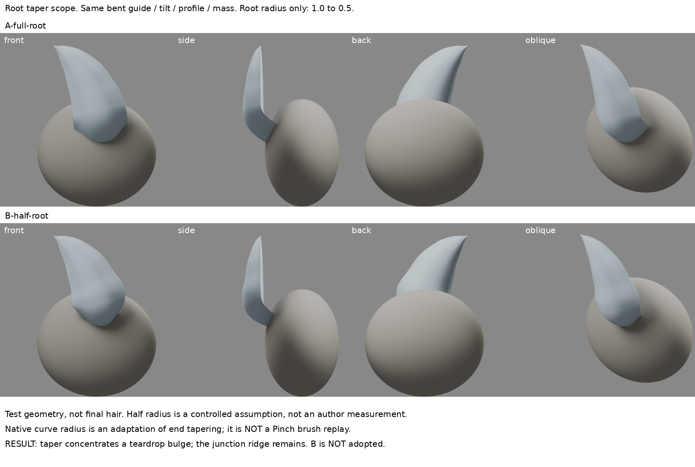
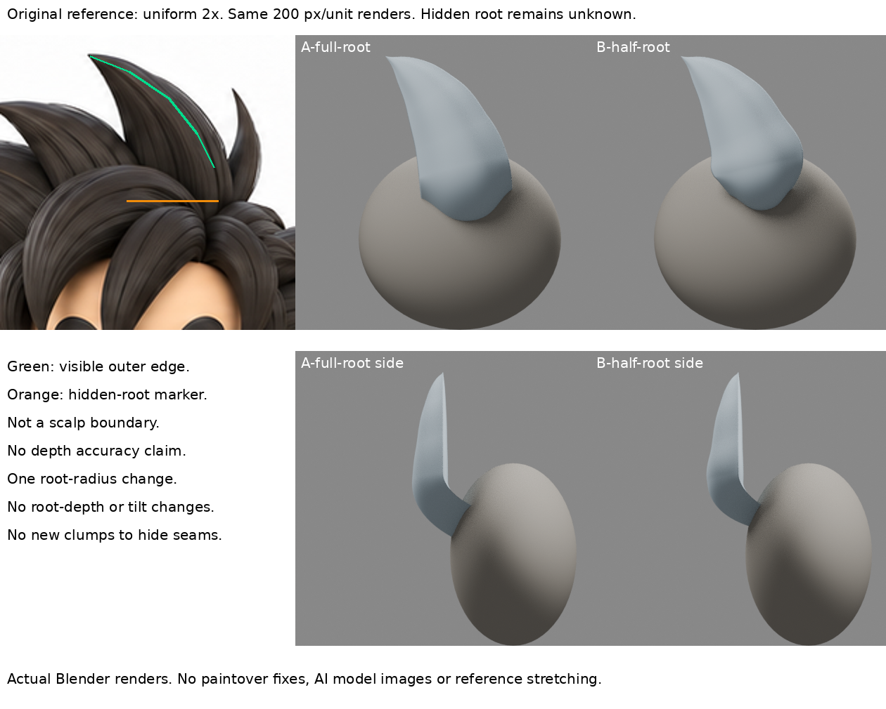

# 根端收束的適用界線：縮根沒有消掉鼓面

2026-10-30 13:06（Asia/Taipei）。局部負結果，未整合角色，iteration04不改。

## 問題與舊紀錄

先讀LEARNING_INDEX、root-entry-direction、hair-root-layering-research及front-hair-layer。上一輪根彎入主量解決浮根端帽，但根仍圓鼓、右側交界有稜。本輪不能再整束平移、調埋入深度或加細束蓋縫。問題縮小為：在既有入射方向下，作者的「根端收束」原則是否能改善鼓面？

## 實讀實看

James Hyun本人〈Complete Workflow for creating a Stylized 3D Female Action Character〉，Hair & Groom System第79–81行（網頁擷取行號）：
https://www.therookies.co/blog/breakdowns/complete-workflow-for-creating-a-stylized-3d-female-action-character

本輪重新讀該節，重新實看06-hair-1-1.JPG及06-hair-2-1.JPG兩張靜圖。不是新找到作者或影片，也不是看見Pinch操作前後。新處是將上一輪尚未測試的「兩端收束，根比尖端厚」拆出驗證。

作者文字在分離multi-strand的mini-strands之前談Pinch收端；圖片同時有多股彩色刷束和寬帶灰色束。因此這裡是幾何刷束的收端構造，不是髮絲材質的寬度參數。但靜圖無法證明每一寬束受Pinch的確切範圍，不能說作者規定了本案的截面比例。

作者工作流用ZBrush Pinch；本輪用Blender原生曲線半徑做**受限的截面收束適配**，不冒稱Pinch筆觸、等效求解或相同曲率。長髮原則轉到短尖髮是假設。

另查Antoine Dupuis ArtStation頁，未取得教學圖，JSON請求403後停止；Pablander 2023-12-19頁只讀到文字，沒有把它寫成已看影片或作為本次根半徑配方。

## 單一控制值與恢復

A由前輪B-inward-root原樣開啟（baseline-inward-root.blend），保留彎根與已做的框架補償。B只把第一個導向點radius由1改0.5，其餘五個半徑、控制點、柄、Tilt、截面、主量與鏡頭相同。0.5是清楚可重做的「半截面」測試值，**不是作者數值、不是原圖量測，也沒有搜尋最漂亮比例**。尖端radius仍0，根沒有收成第二尖端。

原生radius同時縮寬與厚，不能獨立控制表面法線或貼合主量。保留CARDINAL插值，沒有偷偷改插值讓結果好看。原圖等比例2倍裁切，四向同200px/unit，渲染A/B共8張。

## 實看結果

- A下段為寬圓鼓片。B根端截面縮小，但下方外觀變成更明顯的水滴／葫蘆形；肩部仍寬、右交界仍硬。**這次沒有自然過渡改善，不採用B。**
- 兩者根環66/66取樣仍位於相同橢球治具內，側視沒有重新出現浮離端帽。只證明此小樣端部嵌入，不能當全模型無縫／無穿插檢驗。
- CARDINAL半徑插值牽動相鄰段；z>.5共同表面最大位移0.011306單位，約2.26像素。上段控制點沒動不等於上段表面全不動。這是單一輸入欄位試驗，不是空間影響只限根部。
- 背視根被治具遮住，不能當過渡通過。主量是測試橢球，不是角色頭形或定稿髮底；未知根部深度仍未從原圖驗證。
- 不用原圖被遮擋的根區，主張「縮得更像」。可見尖端近似保留，局部鼓面失敗更明顯。

## 學會、停止條款與下一問題

接觸成立、根端收束、表面自然銜接是三個獨立問題。把寬度和厚度一起縮小不會自動讓兩側表面朝向一致；縮根還可能把視覺鼓量集中到肩部。這是負結果，不以數據或新增版本稱造型進步。

**停止繼續掃0.4/0.6等radius值，不換插值追求掩蓋此鼓面，不加細束遮縫。** 下一個需要的能力是辨認交界兩側主面走向及寬厚分開控制；應先找作者如何處理寬束面與底量的平面／切線，而不是先假設收更細就自然。若換連續主面建構，要另列來源和新假說，不將本輪失敗直接焊接平滑當解答。

## 保存

- A-full-root.blend、B-half-root.blend：兩個原生可編輯曲線模型。
- baseline-inward-root.blend：前輪原樣副本。
- build.py、boards.py、verify.py、metrics.json、restore-check.json及8張原始渲染。
- comparison-board.png、reference-comparison.png：只排真實渲染與使用者授權原圖，未拉伸或AI改造。
- root-taper-scope-frozen.zip：私人恢復包，公開repo不放原始模型。

冷讀核對只有第一點radius不同，基線iteration04 SHA256仍35cd1b71c9d288029d93d0fdb8d9741d62a5151bc3bc459ab48c789092b5aaa6。第三方圖不納入包。GitHub核准未決，不重試寫入；本輪資料僅本地待整理，私人恢復備份另存。

## 公開附圖與恢復邊界

公開版僅含筆記與兩板；上列模型、腳本及數據不是此repo附檔。仍為本地待同步，不表示遠端已發布。
