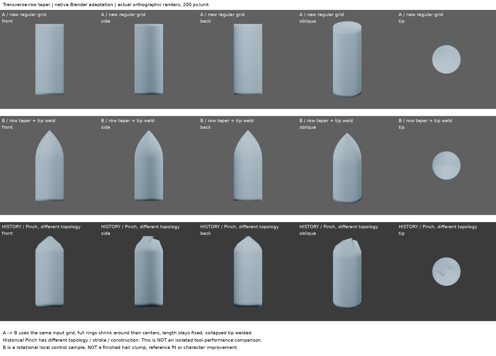
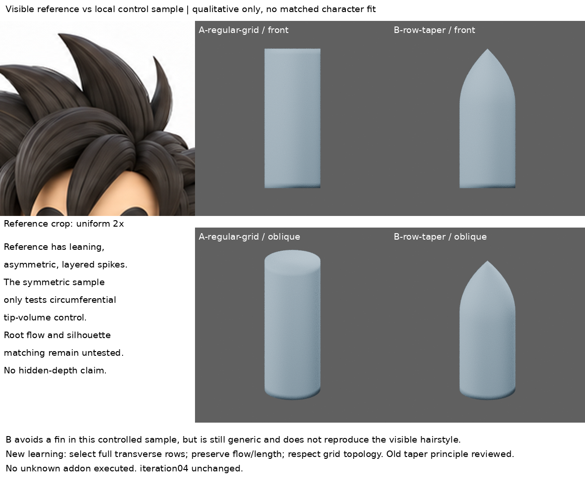

# 完整截面收尖：保長度的原生適配小樣

2026-10-31 01:36（Asia/Taipei）觸發，01:40–01:42 實作紀錄，非歷史補建。**新局部小樣，不是完成髮束，不整合 iteration04。**

## 問題與早期回顧

先讀最新遠端 README、LEARNING_INDEX、STORAGE_POLICY、本地累積索引及 hair-tip-strokes、pinch-tip-planes、spike-control-cage、root-taper-scope、mass-layer-separation。Pinch 的 AREA 與固定 Z 試驗均在斜角/端視留下薄鰭，不能繼續無依據掃筆畫或設定。早期曲線半徑與低控制籠已經做過收尖，本輪**不是發明新收尖原理**；具體要理解的是完整橫截面、固定中心/長度的適用條件，以及為何它不等同 Pinch。

## 實際讀了甚麼

- 作者 MOTOMODEL 的 [MT Hair Taper 官方商品/說明頁](https://motomodel.booth.pm/items/8986853)：實讀日文「対象となるメッシュ」「使い方」「コツ」「カスタムカーブ」正文；沒有觀看操作影片，沒有安裝、下載或執行插件，也沒有閱讀插件實作碼。網頁正文私存供來源追溯，第三方媒體/程式不公開。
- 作者說明以規則四邊格的完整橫列為選擇單位，包含閉合筒；保留長向位置、收縮橫截面。步驟是編輯模式選完整末端列，再指定影響列數、末端厚度與衰減。零厚度收至點。分岔/合流和無法規則追蹤的拓撲有適用限制；全體中心模式也要求多束橫列配置相近。
- 作者並未給出本輪的列數、二次曲線公式或尺寸。以下均是**依上述約束寫的原生網格適配**，不是插件實測、不是作者筆觸重現，也未驗證插件自動追蹤能力。
- Pinch 比較依已讀官方 [v4.3.2 pinch.cc](https://github.com/blender/blender/blob/v4.3.2/source/blender/editors/sculpt_paint/brushes/pinch.cc) 與前兩輪紀錄：其位移受筆畫方向和筆刷平面影響，不能當成對每個截面的全向等比縮放。本輪未新增 Pinch 操作。

## 最小實作與假設

A 是新建規則閉合筒：半徑 0.30、長 1.50、26 個橫列，每列 64 點。它與歷史 Pinch 的體素重網格不同，因此舊結果只是歷史對照，**不是兩工具單變因優劣測試**。

B 從與 A 完全相同的輸入格開始，只處理 z > 0.15 的上端。以 t=clamp((z−0.15)/0.60,0,1)，將每列相對中心的 x/y 位移乘以 1−t²，z 不變。這是我們選的平滑進入衰減，非作者參數。根部與下段不動。

末端零半徑會使 64 點重合；另做明確的末端焊點清理，避免保留零面積側面/頂蓋。因此 A/B 最終頂點數不同，不能稱最終同拓撲；同一輸入、縮放步驟與後續清理都可從腳本恢復。這一處理不等於插件的內部實作已確認。

## 實渲與原圖對照

A/B 真渲正、側、背、斜及端視，420×420、正交尺度 2.1，200 px/unit，相同燈光材質。歷史 Pinch 圖明標 HISTORY、不同拓撲；不是新渲或新成果。原圖裁切等比放大 2 倍，未拉伸；小樣沒有註冊到角色位置，不能作量化擬合。

目視：B 在正側背與斜角均收至尖端，端視沒有舊 Pinch 的薄鰭；每列寬深同步減小。但它仍是對稱、筆尖般的通用筒，**不符合原圖偏斜、非對稱、層疊的髮束造型**。只能說局部體積控制成立，不能說整體髮型改善。端視外輪廓仍被下方較寬主體佔據，需結合側/斜角判讀，而非把端視圓形當尖端鈍化。

## 學會、失敗與未懂

- 可重用方法：在橫列清楚的控制網格，先完整選截面，再固定中心/長度縮小橫向，能把「變細」和「彎曲/拉長」分開控制。原生縮放適配和曲線 radius 的舊原理一致；新增的是適用拓撲與選擇約束的明確化。
- 本小樣只驗證直筒，**沒有驗證彎曲中心線、扭轉截面、分岔或自動列追蹤**。不可對任意體素雕塑直接套用本腳本。
- 失敗/限制：B 不是原圖髮束，沒有根部髮流、分層、非對稱面轉折；不採入角色。固定中心收尖也不能自動補出這些造型。
- 下一問題：回到早期可見主髮束控制籠，先核對其完整截面與流向，再用既有可見輪廓約束做一束有方向的尖端練習；不能再以對稱筒或多次技術檢查替代造型學習。隱藏深度仍標假設，不修改頭形。

## 恢復與範圍

- 直接開 A-regular-grid.blend / B-row-taper.blend 可恢復場景與固定相機燈光。
- build.py 為自製腳本，使用已安裝 Blender 4.3.2，會清空場景，僅在新 Blender 背景程序執行；禁止在角色檔中執行。boards.py 為自製排板；歷史圖來自 mass-layer-separation，參考圖來自專案 reference。圖片未 AI 改造。
- report.json 保存列縮放與網格診斷；不是進步評分。檢查根段/長度與重開模型記於 verify.json。
- iteration04 SHA256 保持 35cd1b71c9d288029d93d0fdb8d9741d62a5151bc3bc459ab48c789092b5aaa6。
- 原始 blend、來源正文與恢復包僅私存；公開限此筆記、兩張對照與自製腳本。公開版不含原始模型。build.py 可獨立重建新 A/B 場景與渲染，verify.py 需先跑 build.py；boards.py 另需歷史 Pinch 五張原渲（未隨公開庫提供）才可重排完整歷史板，不能聲稱公開資料足以一鍵重排全部對照。

## 後續適用性回查（2026-10-31 02:06，Asia/Taipei）

沒有新模型或渲染。回查已保存的有方向主束：較連續拱面曲線的末端 radius 已為 0；早期低控制籠已由完整截面接到單尖點。兩者都不是尚未收尖的鈍端，沒有新增輪廓修正證據時，不再疊加 taper 或轉網格只為使用新方法。

作者說明也允許中間列，不應把末端三角面一律視為不適用；要看能否辨認完整橫列及實際修形需求。這次只回讀上一輪保存正文，線上重取未成功，並未操作作者插件。局部尖端已成立不等於根流、主量與前層的面轉向已解決；下一步回到這些未解造型，而非繼續收尖樣本。
