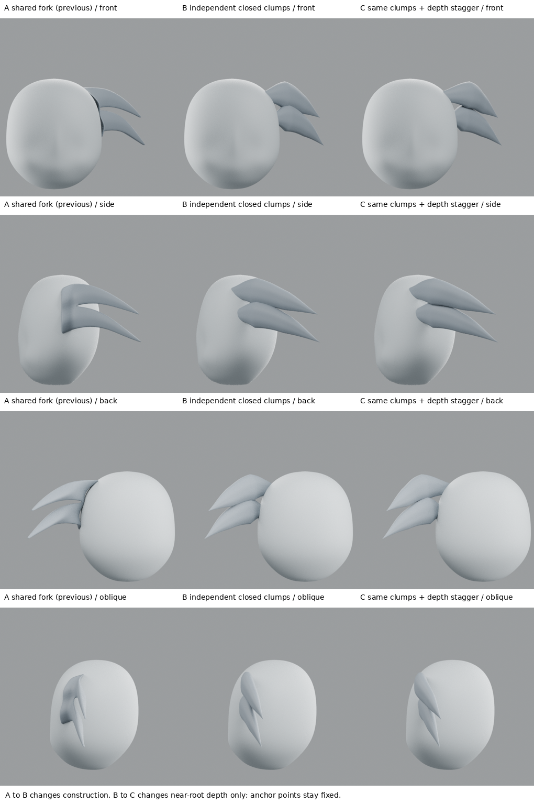
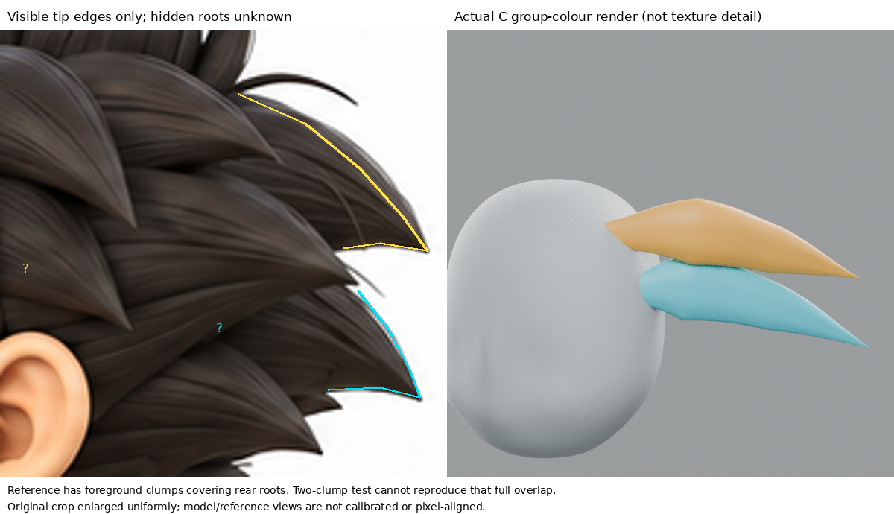
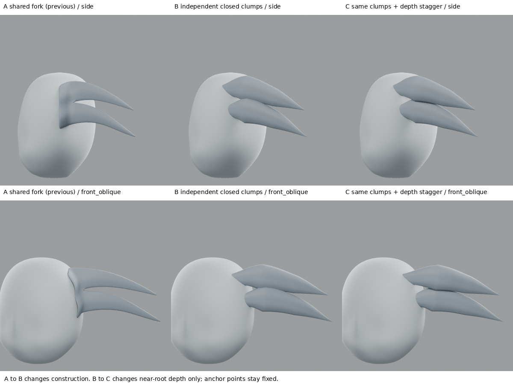

# 小練習：把共用分叉板拆成可獨立控制的髮塊

2026-10-28 17:36 UTC 研究紀錄。**兩束的獨立體積比前版清楚；根部仍不自然，未重現原圖前後層次，不整合全人物。**

## 新來源，實際看了什麼

[Antoine Dupuis：Stylized Hair Tutorial](https://antoinedupuis.artstation.com/projects/rRqEAa)。先以網頁搜尋確認作者公開教學，再在瀏覽器打開圖集，實際放大閱讀以下頁面：

- 圖集第3張，頁碼2：Blocking the hairstyle，先建立大形再作髮束。
- 第4張，頁碼3：Creating hair strands with curves，CurveTube／CurveTubeSnap、截面尺寸曲線、Lock Start以及逐束分組。
- 第5張，頁碼4：zRemeshing and sculpting strands，保留分組、低細分逐束調形，整理側面使其不只像圓柱。

本輪在Blender用獨立Bezier路徑、封閉bevel截面、半徑及固定根點練習其中的可編輯分束概念；未使用ZBrush，也未下載或購買工具。作者示範長髮，其構造方法與此問題相關，但不是本人物短尖髮的直接造型答案。沒有把該作者圖或文字全文收入交付包。

## 參考邊界先讀清楚

放大原圖側面耳後區後，發現前輪青線確實可能跨過不同髮塊。這輪停止把它當一束完整中心線。

`reference_occlusion_study.png` 僅標黃／青兩個後方可見尖端外緣，不把陰影線全當幾何邊界。真正根部被前景另幾束遮住，問號區無法從這張圖直接確認。沒有畫一條假裝確定的線穿過遮擋區，也沒有斷言兩個尖端必須共用同一根。

本輪兩束只是「獨立髮塊能否避免共用直邊」的構造試驗，沒有加入遮住根的前景髮束。因此不可能以這兩束就驗收完整參考層次。

## 實驗與因果界線

- A：上一輪共用根部、兩分支的網格原樣保留。
- B：兩條獨立、可編輯Bezier髮束；封閉扁橢圓截面、半徑由根到中部再到尖端收束。根點依實際頭皮射線定位並稍埋入，沒有共用那條直立邊。
- C：與B相同曲線、截面、半徑及根錨點；只改根後兩個控制點的X深度，上束略外、下束略內，尖端不移動。自動手柄會隨控制點重算，因此是控制點層級的單變因，而非表面各點僅平移。
- **A→B同時改變構造、路徑、截面與半徑，是方法比較，不能把外觀差異只歸因於「分件」。B→C才是深度差的小對照。**
- 參考不能決定精確X深度；試驗深度是待驗證假設，不是量測出的真實髮根。
- 前後使用相同頭部、材質、燈光、五個鏡頭（正側背、後斜與前斜）。

## 實際結果與失敗

1. B/C不再共享長直立根邊，能看見兩個獨立的厚尖髮塊；但根部仍有生硬插接感，體積還偏像葉片，未達原圖飽滿且層疊的髮束。
2. B→C只是細小的接觸線／陰影差異，不能聲稱深度錯層已解決問題。
3. 最初C移動連根點一起外移，造成端帽外露。已保存於 `failed-floating-root/`；修正為保持根點固定並以頭皮射線放置，僅調根後控制點。這是本輪修改前後證據。
4. 有意讓根錨點略在頭皮內，不代表完成融合；沒有完整自交／穿模或變形驗證。獨立閉合曲線有體積，也仍不是成品。
5. 原圖還有前景遮擋，本試驗缺少這個層次。不能靠把根藏進更多髮束就宣稱根結構正確。

## 學到與下個問題

學到：先辨認可見邊界與遮擋，不能把一條斜向高光或中心線當成單一完整髮束。保持獨立路徑與根錨點，比在共用分叉板上反覆加厚更容易逐束改形；但分件本身不保證好看。

下一步需要從正／側／背三圖交叉確認至少一個髮塊的可見範圍和前後順序，研究根到中段的圓滑過渡與截面朝向，再做局部驗證。別直接複製兩個尖葉片覆蓋整頭。

## 公開文字版範圍

本頁整理既有實驗筆記，未在本次公開整理中重新執行或獨立重現。原始 `.blend`、參考圖、渲染、量測 JSON 與實驗腳本未包含在此文字版；文中檔名只描述當時的證據，不是下載連結。第三方教學內容僅保留公開來源連結與閱讀／觀看範圍，未重散布圖片或程式。歷史階段與下一步以當時紀錄為準，最新方向請見根目錄索引。

## 公開附圖

下列為當時保存的原始圖片檔，這次僅整理上傳，沒有重新建模或渲染。研究分析板與舊版渲染不代表新模型；實驗成功、失敗及限制以本文記錄為準。

[固定角色原始三視圖](../../images/reference/character-three-views.png)
