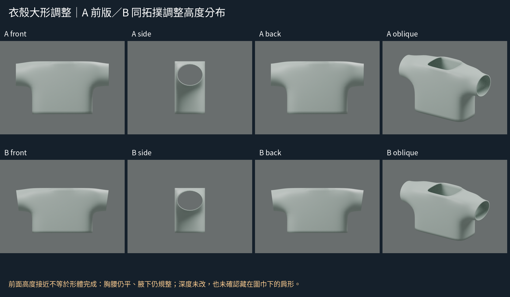
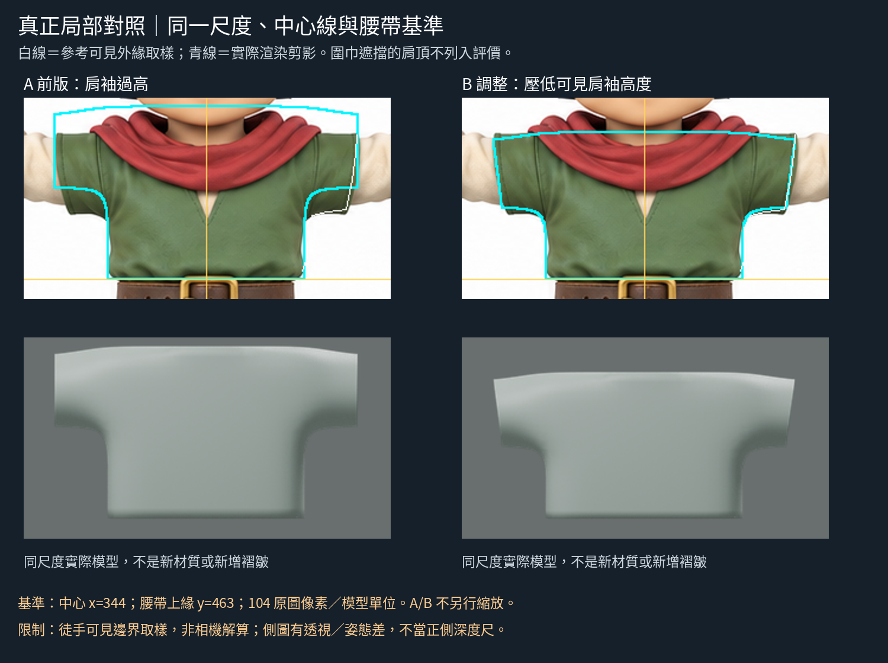

# 用同一基準對照肩袖：高度分布與袖端斜率
2026-10-29 11:06 UTC 輪；DOTS。**本輪首次把衣殼與原圖真正等尺度疊合；改的是低模輪廓，不是褶皺、材質或求解參數。**

## 來源與可學的動作
重新實讀 Soni Kumari Part 4 第4節第4／9步：在前視背景參考上調肩部與肩臂頂點；實看第9步的參考疊線配圖，能看到輪廓邊沿肩峰到腋下對照參考。
https://design.tutsplus.com/tutorials/female-character-modeling-in-blender-part-4--cms-20547
配圖 https://cms-assets.tutsplus.com/cdn-cgi/image/width%3D600/uploads/users/168/posts/20547/image/D%20%289%29.jpg
這次借用「固定視圖對照參考，調低密度控制點」方法；不是模仿作者女性人體比例。沒有看影片，也沒有聲稱作者給了這個角色的衣殼數值。

## 原圖拆解與不確定性
原圖1774×887。本輪取正面上半身綠衣輪廓，局部矩形(190,310)–(500,480)。固定中心x=344、腰帶上緣y=463，模型腰緣z=-.7；用104原圖像素/模型單位設定相機。袖外幅作尺度合理性參照，A/B都用同一映射，不各自縮放最佳化。
- 可見右綠袖上緣約(471,341)，下緣約(462,404)，腋下轉折約(433,409)到(428,420)，腰側約(425,456)。點為人工可見外緣取樣，有像素判讀誤差。
- 肩頂中央被圍巾遮住；不能認定完整肩頂應抬高或有某個曲率。疊線在圍巾上方只是模型輪廓，不列為成功區。
- 原圖標「側面」但手臂朝鏡頭且有姿態/透視差，不拿它當標準正側深度尺。本輪y深度不變，沒有虛構側向量測。
- 只對可見綠衣外緣做有限形狀對照，未將米色袖、圍巾或頸口遮擋當錯差。

## 實作、比較、再修
A為前輪連續衣殼B的複製品，網格/修改器未變。B保留相同拓撲與深度，只改控制點的高度分布：原z[-.7,-.35,0,.35,.7]映到[-.7,-.43,-.16,.165,.49]，列間線性插值。這些是依參考手工設計的控制點移動，不是來源原數值。
第一遍降低袖上緣、延長袖下方覆蓋後，真正疊圖發現袖端仍垂直、下部太寬。保存 first-height-only 的模型及疊圖，再把x>1.0的端部按高度逐漸收進，最大.08單位；肩根不動，沒有全圖拉伸。build.py列出完整可重製移動。

## 真實成效與不足
- 同尺度疊圖中，A袖上緣太高、袖下緣也過高；B靠近原圖可見上/下緣。第二遍端部收斜改善了原來垂直袖端的偏差。
- 腋下位置更接近，但轉面仍像規整圓角；胸腰正面依然平板、少布量起伏。不能因剪影更接近就聲稱布料形體完成。
- 不評被圍巾遮住的肩頂、未證明胸背深度或手臂活動空間；未製作米色回折袖、接縫或褶皺。
- silhouette_diagnostic.json只記右側少數人工取樣高度與實際alpha輪廓偏差，不是整體相似度，更不是美感分數。對稱模型不會完全符合原圖左右差異。

## 公開文字版範圍

本頁整理既有實驗筆記，未在本次公開整理中重新執行或獨立重現。原始 `.blend`、參考圖、渲染、量測 JSON 與實驗腳本未包含在此文字版；文中檔名只描述當時的證據，不是下載連結。第三方教學內容僅保留公開來源連結與閱讀／觀看範圍，未重散布圖片或程式。歷史階段與下一步以當時紀錄為準，最新方向請見根目錄索引。

## 公開附圖

下列為當時保存的原始圖片檔，這次僅整理上傳，沒有重新建模或渲染。研究分析板與舊版渲染不代表新模型；實驗成功、失敗及限制以本文記錄為準。

[固定角色原始三視圖](../../images/reference/character-three-views.png)
