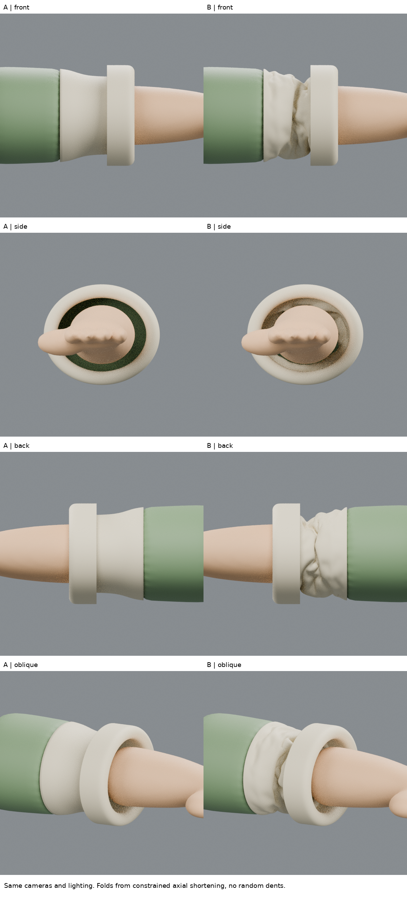
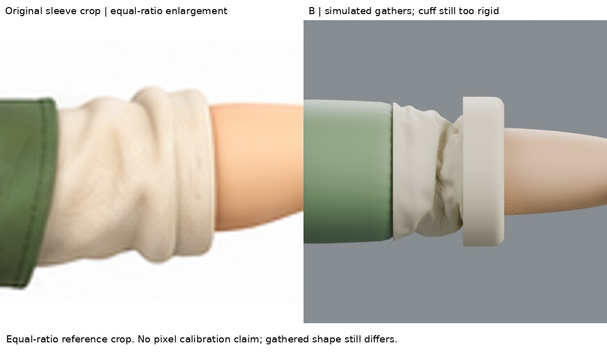
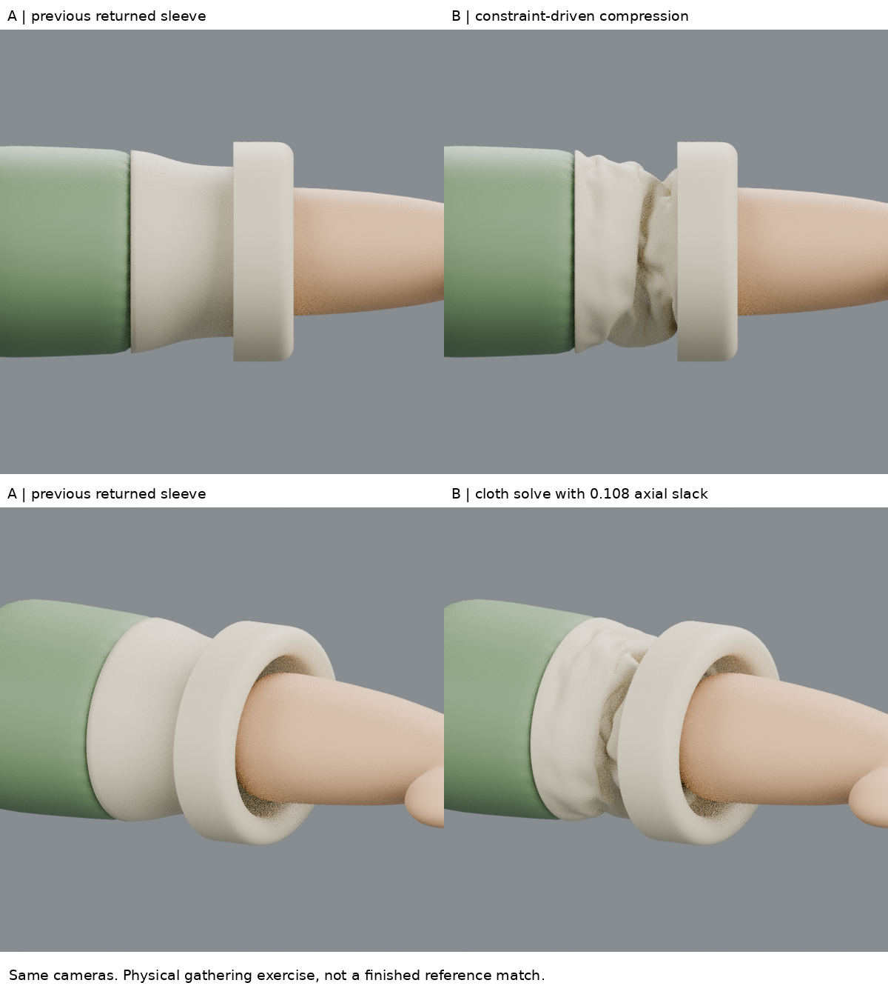

# 袖身壓縮摺練習 — 2026-10-28 22:06 UTC

## 有用結果
袖身不再只能靠手加凹痕：在連續袖面給定額外軸向長度，再收短兩端約束，布料求解產生了不對稱摺谷。相同求解器、拓撲與重力但零餘量的控制組幾乎維持光滑，因此本次證據支持「餘量遇到端部限制」是摺形成的原因。這是方法練習，不是完整人物改善或原圖匹配成功。

## 實際讀取的來源與方法
1. Blender 官方 Shape（雲端瀏覽器成功讀取全文；web抓取402後改用頁面；未看影片）
   https://docs.blender.org/manual/en/latest/physics/cloth/settings/shape.html
   實讀 Pin Group、Dynamic Mesh、Rest Shape Key 段落。頂點組權重控制固定強度；正常模式沿用首幀自然形狀，開啟 Dynamic Mesh 則每幀更新。採用端部固定組與動畫形狀鍵移動約束，關閉 Dynamic Mesh，避免把收短形狀直接當新自然長度。
2. Blender 官方 Physical Properties（雲端瀏覽器全文實讀 Stiffness/Damping；未聲稱材質校準）
   https://docs.blender.org/manual/en/latest/physics/cloth/settings/physical_properties.html
   Compression 是抵抗壓縮、Bending 控制摺的彎曲行為。採用高於彎曲阻力的壓縮阻力，使多餘長度藉彎折釋放，而非只縮短表面。
3. SideFX 官方 Cloth simulation（web完整讀取 Things to consider，尤其 Bend Strength / Compression Stiffness）
   https://www.sidefx.com/docs/houdini/vellum/clothsimulation
   說明彎曲阻力與壓縮阻力影響褶皺，以及模擬後可固定幾何。這是原理解釋，不把Houdini數值照搬到Blender，也沒有執行Houdini或看完整服裝影片。

來源提供官方機制，不是同款Q版袖子的逐步美術教學。程序與數值為本輪小實驗；尚未學會藝術化選擇原圖主要摺面。

## 實驗
- A：上一輪連續回折袖口原樣。
- B：保留回折與袖面連續結構，在主要袖段增加0.108軸向餘量，端部在1–36幀移回原位置，算到65幀。兩端固定，中段自由；沒有徑向噪聲或預先畫摺。
- 額外長度約為設計0.18段的60%，偏激烈，並非從圖片量到。
- 圓周48點，軸向約0.008分段，回折區維持固定；Cloth在Subsurf和Solidify之前。
- 張力/壓縮35、剪切15、彎曲0.08、quality12、質量0.15；重力(0,0,-0.35)。均為未校準試驗值。
- 手臂設碰撞，布料自碰撞開啟。端部回折整段固定，所以它仍像硬環；這是明確局限，不應誤認材質問題已解。
- control：完全相同程式僅 extra=0，零餘量；正面渲染顯示仍光滑。
- 固定四視角同燈光600×600；相機和上一輪一致。原圖袖子裁切等比放大，未拉伸，未聲稱像素校準。

## 比對與失敗
改善：實際能看到受限袖身的鬆量與摺谷；背面不與正面完全鏡像。零餘量控制支持成因判斷。
不足：B前面深谷太尖、背面摺聚成團，原圖是較寬、柔和且有選擇性的少數摺面。袖口固定區依然圓硬，綠衣接縫仍需真正縫線結構，不能視為完成品。未整合全角色。
有限檢查：抽樣2469個評估後袖面頂點，手臂內部命中0，最近距離約0.02981；不是完整三角面碰撞、自交或動態驗收。

## 下一個不懂的問題
如何在保留回折層次及手臂間隙下，只約束真實接縫/接觸位置，讓回折區也自然變形？如何按原圖辨識少數主摺，調整餘量與彎曲剛度，避免求解產生密集尖摺？下一輪需對應衣袖裁剪/皺褶作者案例，不能直接隨機修形。

## 公開文字版範圍

本頁整理既有實驗筆記，未在本次公開整理中重新執行或獨立重現。原始 `.blend`、參考圖、渲染、量測 JSON 與實驗腳本未包含在此文字版；文中檔名只描述當時的證據，不是下載連結。第三方教學內容僅保留公開來源連結與閱讀／觀看範圍，未重散布圖片或程式。歷史階段與下一步以當時紀錄為準，最新方向請見根目錄索引。

## 公開附圖

下列為當時保存的原始圖片檔，這次僅整理上傳，沒有重新建模或渲染。研究分析板與舊版渲染不代表新模型；實驗成功、失敗及限制以本文記錄為準。

[固定角色原始三視圖](../../images/reference/character-three-views.png)
