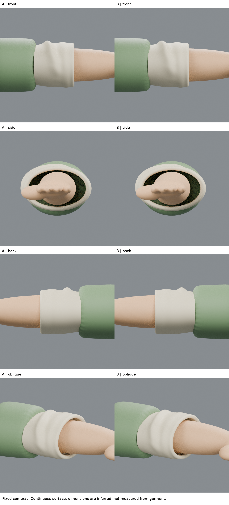
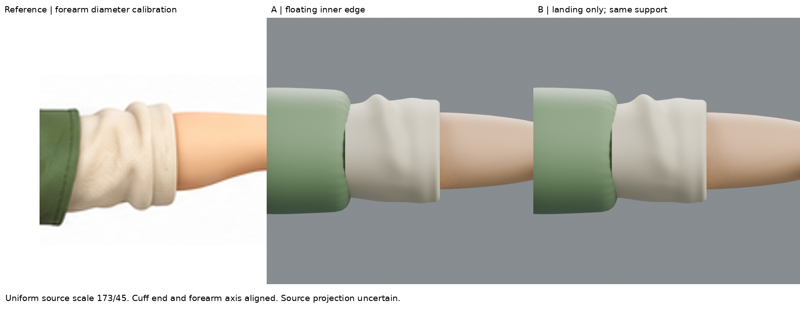
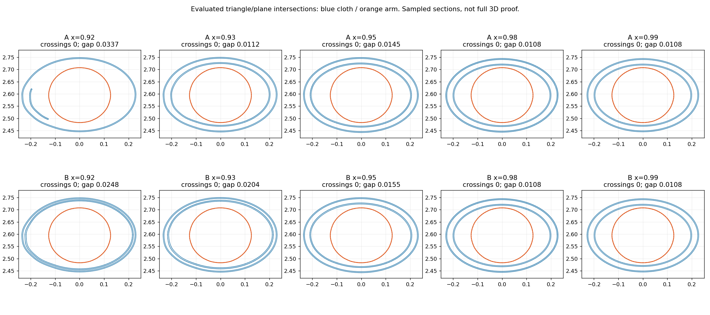

# 03:06 內貼邊落點：形體靠近不等於已縫合

## 來源與問題
本輪實讀 [Tilly and the Buttons袖帶教學](https://tillyandthebuttons.com/blogs/sewing/final-step-attach-cuff-bands) 內折邊、縫回及stitch-in-the-ditch段落：內折邊須覆到袖身/袖帶原接縫，縫線需抓住內外兩側並收妥毛邊。前輪已實看其熨燙與縫製照片；本輪沒有假稱新看另一部影片。
Blender Cloth Shape官網正文402、API staging403，只有搜尋摘錄提到sewing spring；因此不據此聲稱已學會並驗證布料縫合模擬，也未啟動模擬。
原圖沒有顯示內袖帶接縫位置，使用x=.92只是本局部假說的落點，並非量得裁片真值。

## 三件不同的事
1. 裝飾縫線：曲線/貼圖看似針腳，並不會固定布面。本輪沒有添加。
2. 連續網格：本袖面經外緣翻回內側是同一連續曲面，但貼邊末端仍是另一個自由邊界；「一個物件」不等於末端已接回袖身。
3. 物理縫合約束：需要可對應的接縫、合理厚度/碰撞及實際形變測試。本輪沒有這些，不能說已縫上。

## 有限練習
A保留原單回折的懸空終端。B只把內貼邊最後一段朝外袖內側逐步抬起，增加落點過渡（x=.95→.94→.93→.92），不是把端點直接焊到外壁或另加一圈線。
保持外表面造型控制、.004非零厚度、完整局部支撐代理和相機不變。新內端較靠近將來的固定位置，但仍有間隙，也未收妥真實毛邊/縫份，故只是幾何準備測試。

## 檢查方法與限制
用evaluated三角面抽出五個橫截面，另新增接近y=0的縱向剖面，看到自由邊界與外層相對位置；不用一條漂亮的裝飾線當成功證據。剖面圖是真實網格與平面相交，不是手畫概念圖。
四視圖與原圖沿用原校準，不單獨為B調原圖比例。靜態截面不代表全表面無交叉或動作能維持接合；隱藏手臂依舊是代理，不是真實解剖。

## 實際結果
縱剖面x=.9205處，內端與外袖間的垂直表面間隙：A上/下約.01894/.01895，B約.00492/.00494（場景單位）。它只是在幾何上更靠近固定位置，不是接觸、不構成固定力。
五個橫截面A/B均未見與支撐交叉；B最小抽樣淨空約.01079。端部位置變動沒有以壓入人體換取。
四視圖肉眼差異甚小，沒有相似度大進步的證據。新增縱剖面則清楚顯示端部已朝外層轉向，同時仍留下自由邊界。
**本輪不通過「已完成接縫」驗收。** 真實教學還要求毛邊折藏、針線同時抓住兩層；模型尚未具備它們。不能把小間隙直接焊死就當正統縫合，也不能以無動作的渲染證明固定。
下一個有用練習是獨立的小型接縫約束樣片：分清外觀表示、拓撲連接和布料固定，驗證受力後保持接合，才考慮整袖。不要先綁骨或跑整件衣物模擬。

## 公開文字版範圍

本頁整理既有實驗筆記，未在本次公開整理中重新執行或獨立重現。原始 `.blend`、參考圖、渲染、量測 JSON 與實驗腳本未包含在此文字版；文中檔名只描述當時的證據，不是下載連結。第三方教學內容僅保留公開來源連結與閱讀／觀看範圍，未重散布圖片或程式。歷史階段與下一步以當時紀錄為準，最新方向請見根目錄索引。

## 公開附圖

下列為當時保存的原始圖片檔，這次僅整理上傳，沒有重新建模或渲染。研究分析板與舊版渲染不代表新模型；實驗成功、失敗及限制以本文記錄為準。

[固定角色原始三視圖](../../images/reference/character-three-views.png)
