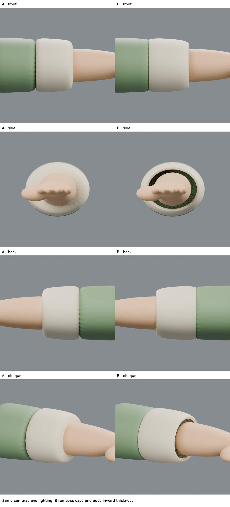
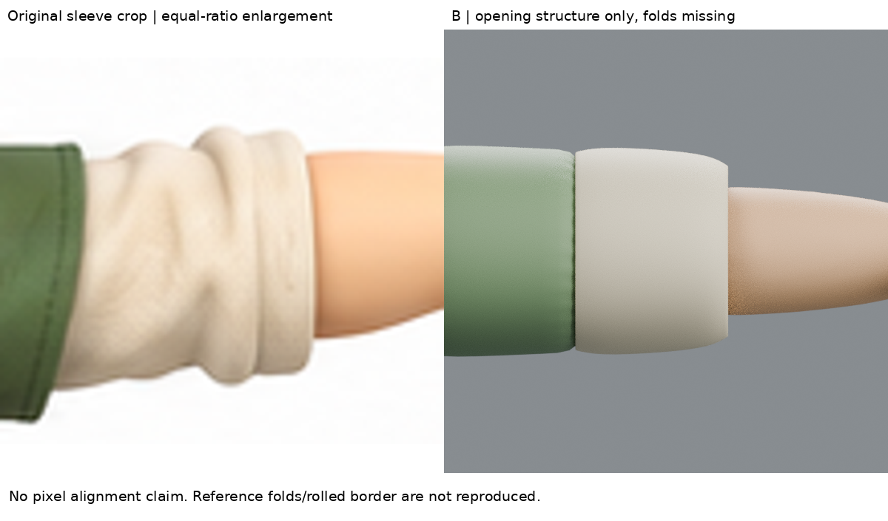
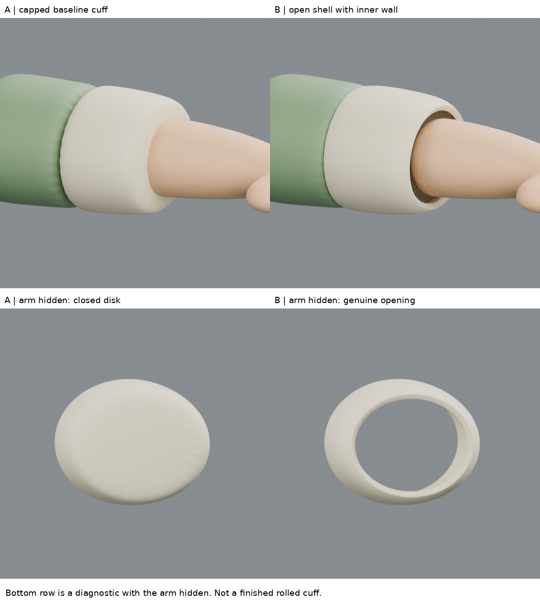

# 袖口開口與厚度：先修結構，再學捲袖

2026-10-28 21:06實驗。髮型完整視覺教學存取問題保留，改學衣物。**B已具真正開口、內壁與厚邊，但仍是平滑套筒，不是原圖的皺褶捲袖。不整合正式人物。**

## 問題與實讀來源
實查iteration04的袖口：外表面由五圈頂點構成，兩端以大面封死。手臂穿過封面，沒有布料內壁；不能只因外觀像袖子就當作合理服裝。

- Soni Kumari，[Female Character Modeling in Blender Part 6](https://design.tutsplus.com/tutorials/female-character-modeling-in-blender-part-6--cms-21357)：實讀1. Making Cloth的袖邊擠出步驟與2. Adding Detail的袖邊處理。雲端瀏覽器讀到全文，但教學配圖未顯示，因此不聲稱完整視覺跟做。作者是裙裝，這次只學袖口需有邊界並可延伸的觀念。
- [Blender官方Solidify說明](https://docs.blender.org/manual/en/2.93/modeling/modifiers/generate/solidify.html)：直接open返回402，搜尋索引卻返回Options完整相關段，實讀Thickness、Offset、Rim Fill、Even Thickness與非均勻縮放警告。該證據是索引返回的官方文字，不冒稱成功開啟頁面或看過影片。

具體方法：將衣物當作有邊界的表面，再向內生成厚度及連接內外緣。本輪從原物件去除封面，再Solidify，並非宣稱完整照抄Soni裙裝流程。0.020厚度是練習設定，不是原圖量出的布厚。

## 實作與因果界線
A是iteration04右側米色袖口原物件。B複製同網格，刪除兩端大面（2面），保留原外側控制點和原Subdivision，新增Solidify厚度0.020、offset=-1、Even Thickness、Fill Rim；最後0.003小倒角柔化厚邊。未建立折回一圈的布邊、未雕皺褶、未加貼圖。根部綠袖與手臂均沿用原件。

刪除封面會影響細分後邊界收縮，因此只能說控制點未搬動，不能說外表面逐點不變。這是封閉實體改為衣物殼的結構比較，不是單參數美術品質測試。

## 渲染、比對、結果
同相機／光線渲染正、側、背、斜四角。另將手臂與綠袖暫時隱藏，檢查米色件本身；圖板明標診斷用途，不冒充完整人物。

A診斷圖是封死圓盤；B可透過兩端開口看到背景，內側厚壁可見。斜角組裝圖可見手臂與袖口之間空隙，確實改善了「封面穿臂」結構。

不足：B的開口與外輪廓仍太均勻、像硬套筒；原圖米色袖有不規則壓縮皺褶及捲起的邊。未調整綠袖接縫、未驗證所有內側碰撞、未綁定變形。不能用開口成功推論布料造型成功。

原圖正面袖口等比例裁切放大；模型與原圖未作像素級校準，不拉伸配形。完整人物04和全部髮型練習均保留。

## 學到與下個問題
學會區分「封死的軸向塊」與「有內外壁的衣物殼」，並以拆掉手臂的診斷視角驗證。下一個問題是捲袖的回折斷面與壓縮皺褶如何連續建成；應先找實際捲袖作者步驟，不能直接用幾個相交環代替布料。

## 公開版範圍與復現限制

這是歷史實驗筆記；本文提到的模型、腳本、渲染、量測檔與原始參考圖均未包含於本倉庫，檔名只用於說明實驗，不是下載連結。此文字版不能單獨重跑該實驗，也不構成對結果的獨立重驗。來源讀看範圍保留原紀錄，未在公開整理時重新觀看。

[方法索引](../../LEARNING_INDEX.md) · [復現說明](../../REPRODUCING.md)

## 公開附圖

下列為當時保存的原始圖片檔，這次僅整理上傳，沒有重新建模或渲染。研究分析板與舊版渲染不代表新模型；實驗成功、失敗及限制以本文記錄為準。

[固定角色原始三視圖](../../images/reference/character-three-views.png)
