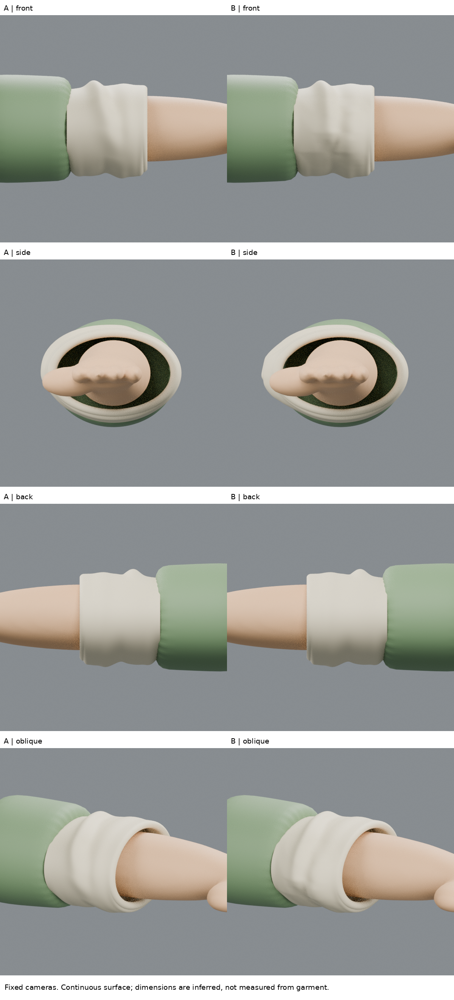
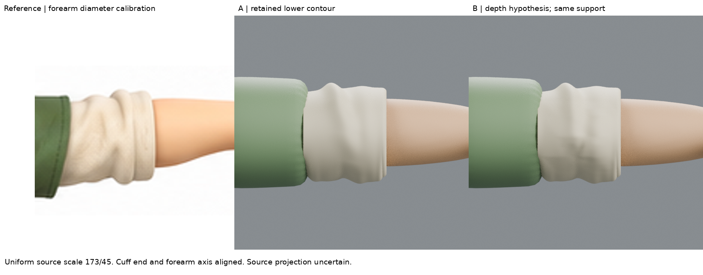
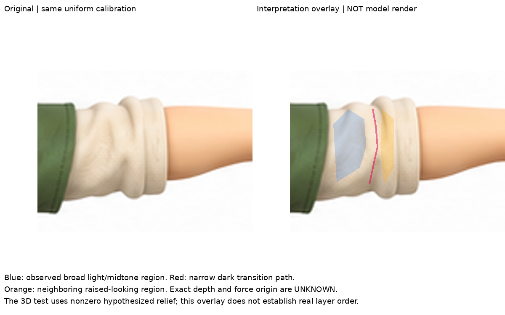

# 寬面／窄谷／隆起分組：標註成立，疊加深度的建模方式失敗
2026-10-29 05:36 UTC。DOTS局部學習，不是人物新版。

## 起點與範圍
從`before-lower-contour.blend`中`B reference lower silhouette study`開始，即上一輪upper-fold A／原本lower-contour候選。**沒有使用失敗的搬峰B。** 完整iteration04及全部前版保留。
這輪只研究奶油色袖段正面的形體分組，不做物理、材質貼圖、上峰搬移或新環件。

## 本輪實際讀／看
重新實讀Gvaat自己的教學之step-by-step與Zigzag段落：先安排主要形體，再分面朝向、陰影與亮面，不靠任意折線表現布。
https://gvaat.com/blog/how-to-draw-folds-in-clothing-and-fabric-a-step-by-step-tutorial/

在瀏覽器實際查看作者步驟插圖：
https://www.gvaat.com/wp-content/uploads/2020/04/drawing_folds_how_to_tutorial_9.gif
畫面是灰色褲子，一側腿彎曲；褲管大灰面保持安靜，膝周圍和小腿有窄、斜向的深灰折入區。這使我把「寬面」和「窄轉折」分開，而不是當成同寬凹線。
這是2D畫家圖解，不是3D雕塑影片；只看了實際顯示的圖像，沒有假稱完整播放所有動畫幀。第三方插圖不打包。

## 原圖標註：哪些觀察、哪些假設
`target_plane_interpretation.png`左邊保留原圖，右邊為**判讀標註，不是模型渲染**。
- 藍：原圖可見較寬亮／中間色布面。
- 紅：從上側向下略彎曲的窄暗轉折路徑。
- 橙：轉折右側較窄、看似隆起的區域。

能觀察到的是投影輪廓、色調區域及寬窄節奏。不能由此直接量測前後深度、張力、真實裁片或隱藏層次；暗色也可能受投影陰影與材質影響。
沿用固定校準：原圖尺度173/45，同倍率不拉伸；原圖(528,364.5)對齊render(389,299.5)。像素柔邊與約7%尺度不確定仍在。

## 小練習怎麼做
用35個控制點／48個三角面建立可編輯低階控制片，行為原圖y344/354/367/380/390，列沿寬面、谷、隆起位置彎曲。控制片本身保留在blend的隱藏Guide物件，**不當成衣物渲染**。
控制點的投影位置來自上述區域判讀；深度0–.04場景單位是明確的造型假設，不是由像素亮度反算。
這個測試將控制片的線性面深度加到A的前方表面，僅向外移y；後半部及x/z基礎位置不變。保留.004厚度設定、單折返與完整局部支撐。沒有把相交新基本體當成成品。

## 實際渲染判定：失敗保留
B正面出現不自然的中部隆包與橫向帶狀轉折；斜角仍讀成原有圓褶上疊補丁，而不是原圖那種寬斜面收進窄谷、再轉向隆起。
失敗原因可具體指出：
1. 我在**舊圓管式表面上加深度**，沒有真正取代／重建其面朝向；原本不合適的底層形體還在。
2. 控制片逐行歸零，造成橫向帶狀過渡，不是沿原圖折面方向漸消。
3. 35點控制片看似低階，不等於形體設計正確；平面分組不能只靠數值分區完成。

**B不比A更像，不整合、不替換基線。** 標註較清楚是分析進展，不能冒充3D外觀改善。

## 保留與檢查
實際正側背斜角渲染皆保存，同一相機、材質、光源，未改燈掩飾。
- 正面下緣10點估計殘差A/B皆2.2889px；只表示此輪未破壞該下緣，不是美感進步。
- 七個實際三角面剖面對支撐線段交叉均0；所取最窄值約.01079。最近點仍可在未變的其他方向，所以最小值相同不代表前方幾何完全相同。
- 剖面不是全表面實體認證，.004厚度設定也不是每個點的物理厚度校準。
- 內層仍是假設，完整支撐仍是根據可見前臂延伸的小練習，不是完整解剖完成。

## 學習結論與下一個未知
可以把原圖的大形分組說清楚，但目前尚未把這個分組轉成有說服力的3D面朝向。
下一步應直接看可信3D作者如何以低模／雕塑建立寬面和窄谷，再用隔離前方面片重建，避免繼續在舊環狀形體上疊變形。先驗證一組截面和兩個相鄰面如何接合，而不是重新調整35個深度追圖像分數。
本輪停止於這個有界失敗，保留可恢復證據。

## 公開版範圍與復現限制

這是歷史實驗筆記；本文提到的模型、腳本、渲染、量測檔與原始參考圖均未包含於本倉庫，檔名只用於說明實驗，不是下載連結。此文字版不能單獨重跑該實驗，也不構成對結果的獨立重驗。來源讀看範圍保留原紀錄，未在公開整理時重新觀看。

[方法索引](../../LEARNING_INDEX.md) · [復現說明](../../REPRODUCING.md)

## 公開附圖

下列為當時保存的原始圖片檔，這次僅整理上傳，沒有重新建模或渲染。研究分析板與舊版渲染不代表新模型；實驗成功、失敗及限制以本文記錄為準。

[固定角色原始三視圖](../../images/reference/character-three-views.png)
