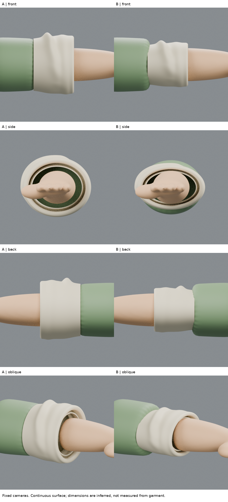
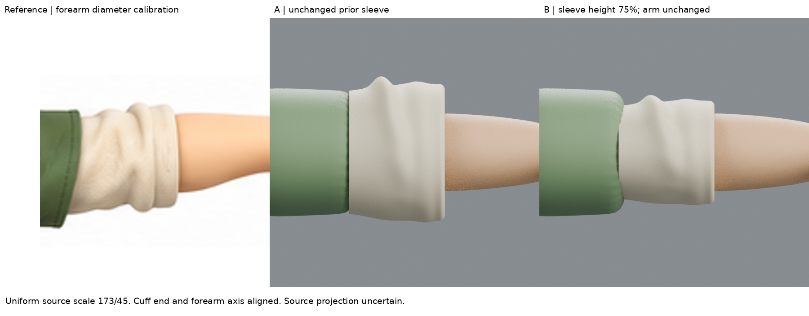
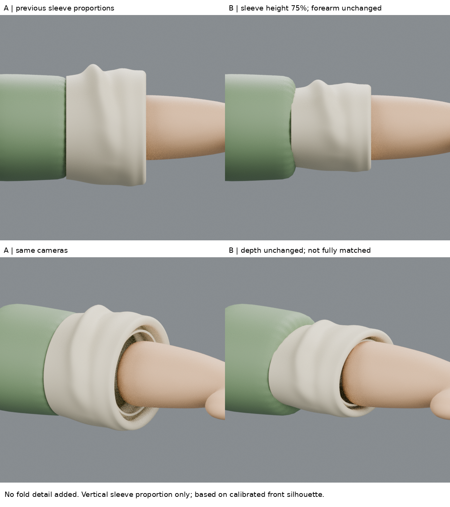

# 01:06 袖段／前臂比例校準：可量測的改善，結構驗收失敗

## 目的
停止增加布摺。先驗證袖段基礎輪廓與前臂比例。前輪 runout 作 A 對照，B 只將白袖網格的垂直尺寸收至75%，不改前臂、相機、髮型、人物基線 iteration04，也不把原圖壓扁。

## 實讀來源與方法
- [AVATAVI 官方製作教材](https://avatavi.com/PDF/HowtoCreateAvatar_inBlender_EN.pdf)：實讀 PDF 第2–3頁文字，前側參考以相同高度和腳底基準定位，降低透明度對照模型。沒有聲稱看完整部教學或套用其角色骨架。本輪將「共同基準」縮小為前臂截面和袖端，而非使用腳底。
- [Graphics and Programming 原作者教學](https://www.graphicsandprogramming.net/eng/tutorial/blender/modeling/import-reference-image-into-blender)：實讀 Size、Opacity 和建立參考系統段落。保留圖像比例、用共同幾何尺寸校準前側圖、處理不精確圖稿時明示近似。這篇以車為例，並不證明原角色是精確正投影。
- Blender 官網正文讀取回傳402，staging回傳403；未把搜尋摘錄假稱已讀全文。以上可讀正文足以支持本輪參考校準方法。

## 可重現量測
原圖1774×887，使用正面右側袖子，不拉伸：
- 綠白接界中段 x≈472±3；白袖右緣 x≈528±2；可見白袖寬約56±5px（接界本來是斜線，不是單一精確端點）。
- 剛出袖口前臂截面 x≈532：上緣 y≈342，下緣≈387，直徑約45±3px，軸心364.5。
- 白袖主輪廓高約60–64px，主摺影響最大值；不是布料厚度。
- A 前視渲染同區域 x400：背景轉前臂 y213至386，直徑約173±2px；袖端 x389。先用膚色閾值曾得159px，但高光和陰影被排除；逐像素檢查背景轉界後棄用159。**色區不等於幾何輪廓**。
- 因此只用一個縮放率173/45≈3.844；原圖袖口x528對齊渲染x389，前臂軸心364.5對齊299.5。原圖、A、B都使用同一校準，不為B另調。
- 原圖袖高映到約231–246px；A約326px；只測試0.75垂直比例，預期約245px。由原圖±3px界線誤差，尺度約有7%不確定性。這不是精密掃描。

## 實作
`build.py` 複製A網格，將白袖每個頂點的local z圍繞2.64縮至0.75，其他維度、層序、Solidify及前臂不變。這是比例敏感性試驗，不是完成的結構修復。保留`before-runout.blend`和含A/B的`sleeve-proportion-check.blend`。

## 固定四視圖結果
- 正面：白袖上下尺寸不再大幅超出校準目標；但輪廓中心較原圖偏高，下側鬆垂不足。寬度與端點仍有接界誤差，不以任意平移原圖掩蓋。
- 背面：同樣變薄，但原圖背面沒有做獨立量測，所以不能宣稱背面符合。
- 側面：**失敗**。只縮z使開口成扁橢圓，內部回折靠近甚至穿入前臂。單一前視輪廓變好不能代表3D結構可用。
- 斜角：綠袖接界台階和內層擠壓更明顯。白袖仍太規則，沒有原圖自然的斜面／下緣鼓起。

## 限制與下一個問題
原圖是造型參考，不確知焦距、透視與三視圖一致性。取同局部截面只建立相對比例，不確定全身或真實尺寸；手臂本身也未驗收，不能用它校準後就宣稱全角色尺度正確。袖深沒有可靠正面依據，因此沒改y；四視圖是檢查模型，不等於四視原圖驗證。
B保留為失敗試驗，不替代較好基線。學到的是：先固定共同標記，區分色邊／輪廓邊，比例改善和結構通過是兩件事。
下一步需根據前側參考重新核對袖口內部淨空及層序，外輪廓和內壁不應一起等比壓縮；先量測前臂截面再決定是否重建內回折，不再加摺掩飾。

## 公開版範圍與復現限制

這是歷史實驗筆記；本文提到的模型、腳本、渲染、量測檔與原始參考圖均未包含於本倉庫，檔名只用於說明實驗，不是下載連結。此文字版不能單獨重跑該實驗，也不構成對結果的獨立重驗。來源讀看範圍保留原紀錄，未在公開整理時重新觀看。

[方法索引](../../LEARNING_INDEX.md) · [復現說明](../../REPRODUCING.md)

## 公開附圖

下列為當時保存的原始圖片檔，這次僅整理上傳，沒有重新建模或渲染。研究分析板與舊版渲染不代表新模型；實驗成功、失敗及限制以本文記錄為準。

[固定角色原始三視圖](../../images/reference/character-three-views.png)
