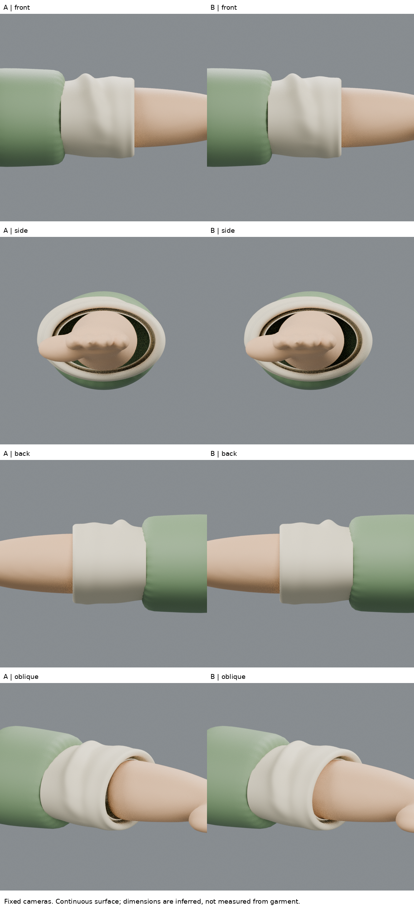
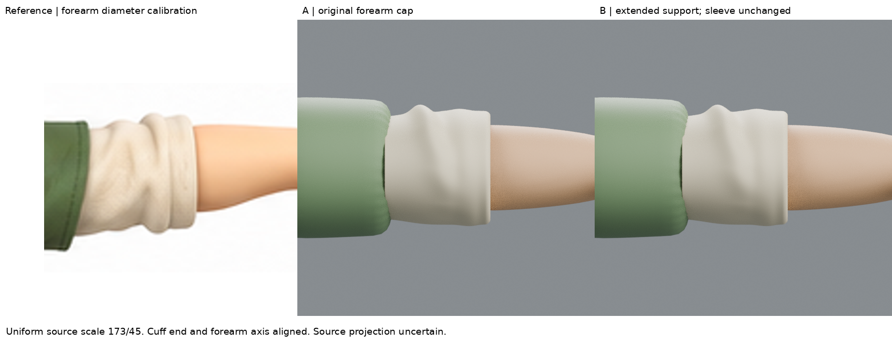
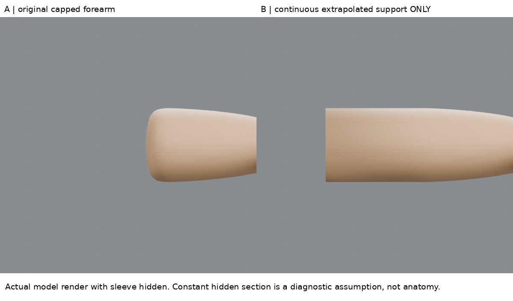

# 02:06 袖內支撐稽核：不能把沒有人體的空間當成合體

## 先確認缺口來自哪裡
讀取 full04 的 `reference-character-blockout.blend` 與前輪局部檔，右側 `Arm and palm continuous.001` 都是3722個頂點，座標SHA256完全一致（見`baseline_audit.json`），local x最小0.95255。
核對 full04/build.py：前臂loft從x=.95開始，且封口。最初sleeve-opening抽取只刪其他物件，沒有切這支前臂。因此可確認：**04的這個右前臂物件沒有延到袖內，並非此次局部抽取刪掉了延伸。** 此結論限於已查物件與流程，不擴大為全身解剖稽核，也不是指手掌部分斷開。

## 這輪實讀來源
- [Marvelous Designer 官方 Avatar Editor](https://support.marvelousdesigner.com/hc/en-us/articles/47358128221337-Avatar-Editor-ver-2025-0)：實讀 Avatar Size、Custom Avatar Size workflow。先確認對應版本，使用已知量測；沒有的尺寸不能冒充已知。
- [官方 Garment Fit Properties](https://www.marvelousdesigner.com/en-in/manuals/articles/47358145163033)：實讀檢查前提及註記；要用正確尺寸、姿態的avatar與適當布料，設計/布料變更後重算，不能把單一顏色或單一姿態當完整合體證據。
本輪取其「先確立檢查人體，再判服裝」原則。沒有啟用MD或做物理模擬；不把診斷截線叫成壓力圖。連續延伸是本輪有限假設，不是來源教人這樣建解剖。

## 一個小測試：連續支撐代理，不是假裝完成手臂
A是原封口前臂。B將實際SMOOTH後前臂在local x=1.015截開，移除袖內方向舊封口，將同一邊界迴圈接續擠出至x=.72並封端。不是另塞一個相交圓柱；新段和原可見前臂是連接網格。原x>=1.015可見表面不改。
延伸截面取自既有前臂，不任意加肌肉；然而藏在袖內的手臂形狀不可從原圖得知，常截面只是檢查假設。沒有延伸到肩膀、沒有關節或動作拓撲驗收，不能視為成品。
袖子完全保留前輪薄壁B（.004），不再縮薄、不改外輪廓或三層層序。`render_support.py`額外將衣服隱藏來實際渲染前後支撐，僅供看清改哪裡。

## 實際最終三角面截線結果
| x截面 | A原前臂 | B連續支撐 |
|---|---|---|
| .80 | 沒有前臂幾何，不能判淨空 | 無截線交叉，最近距離.02611 |
| .90 | 沒有前臂幾何，不能判淨空 | 無截線交叉，最近距離.03345 |
| .95 | 沒有前臂幾何，不能判淨空 | 2處交叉 |
| .98 | 無交叉，距離.00468 | 4處交叉 |
| .99 | 無交叉，距離.00018 | 4處交叉 |
數值為場景單位，截線由evaluated三角面與平面相交得到，不是只檢查頂點。此處交叉數是線段交點數，不是獨立碰撞區數；未構成全表面/動作/布料物理的證明。

## 四視圖、原圖與判斷
固定正側背斜角，袖子與相機不變；原圖用同一173/45等比例校準、袖端/前臂軸定位。外觀差異很小，斜角內部遮擋稍改；不能以此聲稱人物更像。
關鍵是：補進最保守的已知前臂截面延伸後，三層回折重新出現交叉。先前看似空隙夠大的結果，受封口前臂迅速縮小的假象影響。
**B不通過衣物合體驗收，也不替代人物基線。** 這是反證工具，不是交付造型。不能繼續把布厚壓到零，或縮小人體來讓測試通過。

## 下一個能力缺口
找造型相近的真實袖口構造，判斷原圖厚邊是否需要三層套回；目前三層只是練習假設，沒有原圖證據。先以合理完整的碰撞支撐核對層序，再修內壁；如需調整袖深，必須回頭檢查側視原圖而非只看正面。真實隱藏臂形仍未知，不能把代理固定為解剖真值。

## 公開版範圍與復現限制

這是歷史實驗筆記；本文提到的模型、腳本、渲染、量測檔與原始參考圖均未包含於本倉庫，檔名只用於說明實驗，不是下載連結。此文字版不能單獨重跑該實驗，也不構成對結果的獨立重驗。來源讀看範圍保留原紀錄，未在公開整理時重新觀看。

[方法索引](../../LEARNING_INDEX.md) · [復現說明](../../REPRODUCING.md)

## 公開附圖

下列為當時保存的原始圖片檔，這次僅整理上傳，沒有重新建模或渲染。研究分析板與舊版渲染不代表新模型；實驗成功、失敗及限制以本文記錄為準。

[固定角色原始三視圖](../../images/reference/character-three-views.png)
