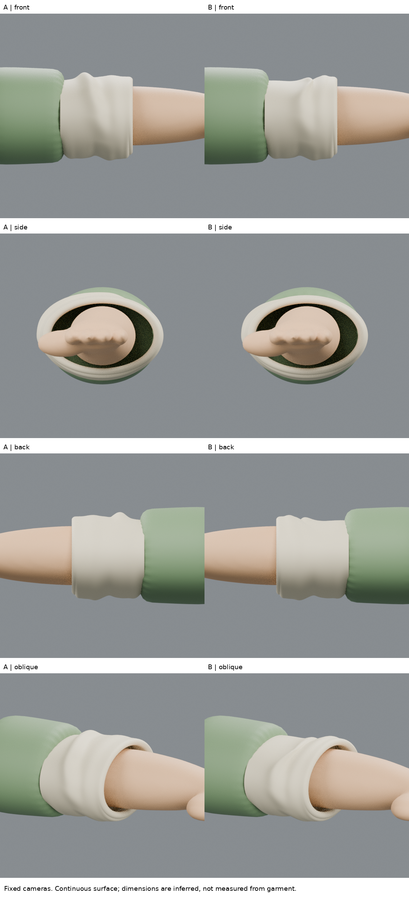
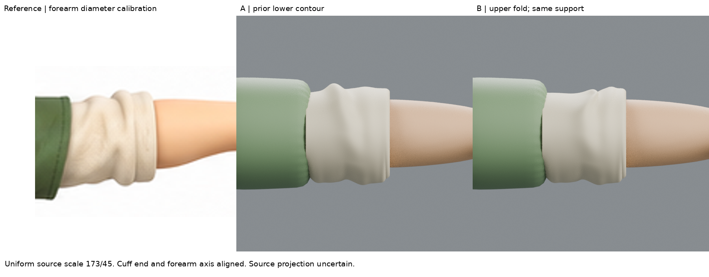
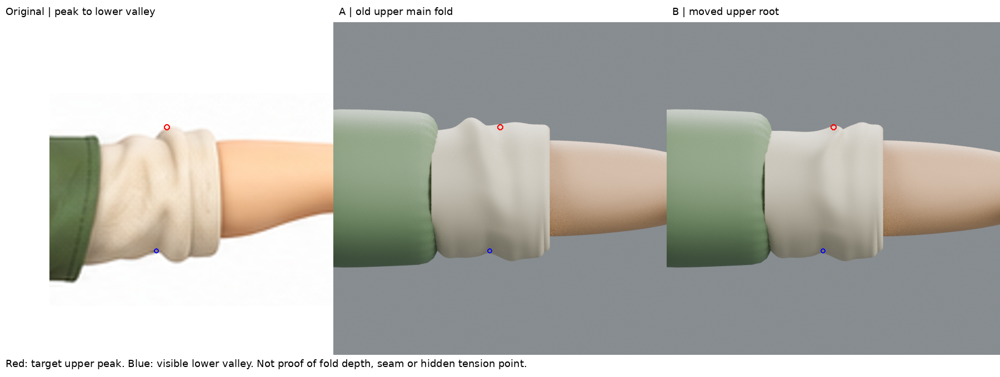

# 上側主褶搬移：位置接近，形體判讀仍失敗
2026-10-29 05:06 UTC。DOTS 局部練習；B保留為失敗實驗，不取代A／完整iteration04。

## 真正研究了什麼
這輪改研究畫家如何拆分摺面的方向，而不是再做接縫物理。
實讀 Gvaat 自己的教學〈How to Draw Folds in Clothing and Fabric〉的步驟與Zigzag段落：先辨認底層形體及主要摺，再區分面朝向與光影；轉折不應只是一批任意方向的線。
https://gvaat.com/blog/how-to-draw-folds-in-clothing-and-fabric-a-step-by-step-tutorial/

另外在瀏覽器實際開啟並看了作者插圖：
https://www.gvaat.com/wp-content/uploads/2020/04/zigzag_folds.gif
看見一段腿部布料：上段較寬且安靜的亮／灰面，下段壓縮成斜向交錯的窄亮邊與深灰谷；右側紫線標示zigzag。觀察重點是「寬面和窄轉折不是同一類形體，不能把整個布量壓縮成一條線」。這是2D作者圖解，不是3D建模影片；沒有聲稱實際操作其軟體、重播完整動畫或知道本角色隱藏支點。第三方圖未打包。

## 原圖與初始假設
前版上側主要峰在render約(243,174)，對應原圖約x490附近。原圖較窄主峰約(505,336)，下方可見谷口約(500,394)。沿用相同前臂校準，預期上方根部向右移，向既有下方谷口斜接，而不是整圈直立凸條。

保留的原圖影像是原檔；倍率173/45，原圖(528,364.5)→render(389,299.5)，兩軸相同。原圖峰位約±3px，渲染讀點約±2–3px；尺度仍約7%不確定。照片式原圖光源和相機不明，不把暗色直接當幾何谷深。

**錯誤假設：我把原圖上側的「左邊寬布量＋右邊窄主峰」當成單一峰搬移。** 後續渲染揭露了這一點。

## 小範圍試作
A為上一輪lower-contour候選；B獨立複製網格。
以原圖可見峰位置決定上半部的單調x重映射，峰附近略向下移。變形權重在z=2.64以下為0，上側漸增；保留既有下緣、袖口x>=1端點、.004厚度與支撐。沒有添環、沒加新裝飾線、沒有調燈光掩飾差距。
`change.json`保存實際對應與重映射控制點。這是可恢復的多邊形形體變形，不是假稱手動雕塑或物理解算。
上側前後面一起變形，背側是連續性適配假設，非原圖隱藏結構事實。

## 實際渲染後的判定
- 正面：欲移動的峰出現在render約x301、y187，靠近標記。但原先左側寬布量被壓平；原有末端次峰約x346、y181反而更高，造成主次顛倒。
- 斜角：斜向接法確實建立，比原來直立環紋的方向更明確；然而仍是過度圓滑的套筒，沒有原圖寬亮面、窄谷、厚隆起三者的關係。
- 背面與側面：開口保留，但這不代表背面造型已配準。四角度圖全部實際渲染，未只挑正面。
- **B不能算比A更像，不整合。** 單點位置對上，不能當作形體理解成功。

## 保留與技術檢查（不是美感分數）
- 下緣同一10個點的估計殘差A/B皆2.2889px；這只驗證沒有破壞上輪下緣，不是新增進步。
- 7個evaluated三角面剖面x=.78,.82,.86,.90,.94,.98,.99對支撐交叉均0。
- B最窄約.010783，A約.010790，微小差在此取樣意義上近似保持；部分上側間隙變小，如x.82從約.0451到.01635，仍須警惕，不可只報全局最小相近就說內部完全沒變。
- 剖面不是全表面無碰撞認證；厚度設定相同不代表每處物理厚度已驗證。
- 原角色iteration04及先前候選未變；B包含在可恢復檔案供檢查，不替代較好基線。

## 學會、失敗、下一個未知
此次有用的失敗是：先前把問題當「主峰座標錯」太簡化。Gvaat圖解中寬面與窄谷的區分，在實作時沒有保持，因此移峰同時破壞了布量階層。
下一輪應回到A，把原圖拆成左側寬斜面、中央窄谷、右側隆起三個區域，先確認各面的朝向／銜接，再做局部改形。不是繼續把峰往上挪幾像素，更不追加環形波紋。
本輪停止於此有界失敗，沒有加碼物理或反覆參數追分。

## 公開版範圍與復現限制

這是歷史實驗筆記；本文提到的模型、腳本、渲染、量測檔與原始參考圖均未包含於本倉庫，檔名只用於說明實驗，不是下載連結。此文字版不能單獨重跑該實驗，也不構成對結果的獨立重驗。來源讀看範圍保留原紀錄，未在公開整理時重新觀看。

[方法索引](../../LEARNING_INDEX.md) · [復現說明](../../REPRODUCING.md)

## 公開附圖

下列為當時保存的原始圖片檔，這次僅整理上傳，沒有重新建模或渲染。研究分析板與舊版渲染不代表新模型；實驗成功、失敗及限制以本文記錄為準。

[固定角色原始三視圖](../../images/reference/character-three-views.png)
