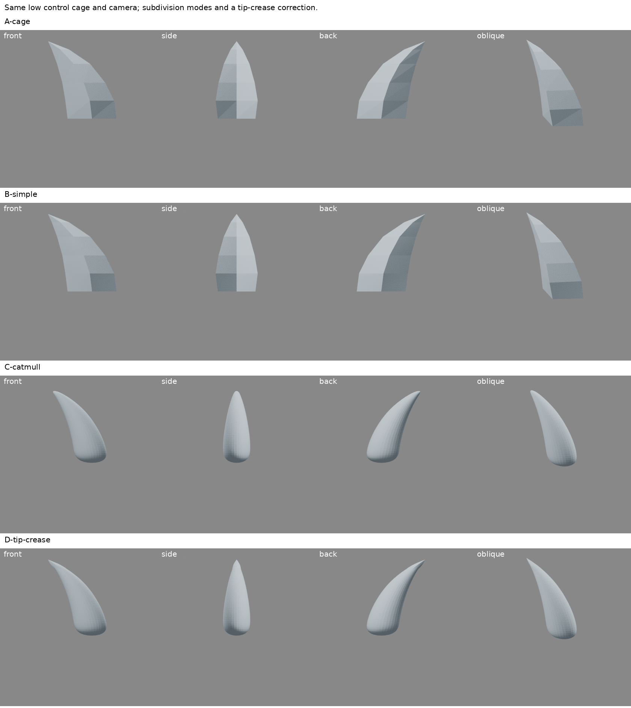
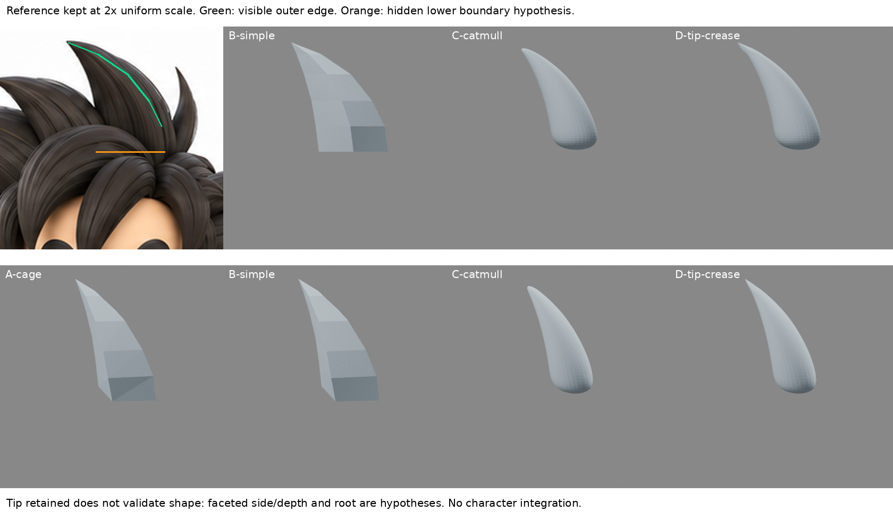

# 低控制面尖束：保形密化不等於平滑細分

2026-10-30 08:06（Asia/Taipei）。本輪有新連續草模、16張四向實渲及參考對照；**不是完成髮束，不整合人物，不替代 iteration04。**

## 問題與讀回

已讀最新 GitHub README、LEARNING_INDEX、STORAGE_POLICY、本地索引，以及主髮量研究、局部 Snake Hook 和前輪反覆成葉形的限制。本輪不從舊圓葉繼續拉，不添加第二束遮根，而是測「先定尖形，再加密」是否被平滑細分破壞。

## 這次實讀實看

重新讀 [Teng Chia／omnilight 第99帖](https://www.zbrushcentral.com/t/dragonball-sculpt-i-ssj-goku-ii-freeza/205120/99)：作者從盒狀網格合併一端成尖，少量控制點先定形，再以 Tessellate 增密，最後各束送入 ZBrush。重新實看本地保存的 [第24帖](https://www.zbrushcentral.com/t/dragonball-sculpt-i-ssj-goku-ii-freeza/205120/24) WIP04 普通悟空前後線框，確認是分段寬面主尖束，而非圓管。沒有看見逐束根部建構影片，也不把他的髮型直接套用。

在 dot 雲端瀏覽器實際讀 [Blender 4.3 Subdivision Surface 官方頁](https://docs.blender.org/manual/en/4.3/modeling/modifiers/generate/subdivision_surface.html) 的 Options、Control、Weighted Edge Creases 與 Edge Loops 正文。Simple 主要加密而非圓化，但非共面面仍有例外；Catmull–Clark 同時平滑；crease 可抵抗局部圓化。搜尋讀取器回402，但雲端瀏覽器正文成功，並非只讀摘要。**Blender Simple 只是本輪適配候選，不宣稱等於 3ds Max Tessellate，也不是 Triangulate。**

## 單束選擇、比例與未知區

重新看完整1774×887原圖，只選正面最高的一束：尖端約原圖(309,15)，右外緣經(337,26)、(365,45)、(385,70)、(397,94)。這些手選點只是可見外緣草模採樣，不能當高精度輪廓真值。下方被前額弧束遮住，根截面約y118為假設；左緣下段、後側與厚度也是假設。

新控制籠以五個四點菱形截面加單一尖端，共21頂點、21面，連續閉合。截面深度0.08–0.28自訂，未從非標準側圖反算。沒有相交基本體，也沒有把草模當成品。正面尺度固定100原圖像素對1單位；渲染420×420、正交尺度2.1，故參考裁圖也只等比例2倍放大。比較板中綠色為選定可見右外緣，橙色為遮擋下界假設。沒有拉伸原圖。

## A／B／C 與有限修正 D

- A：原始低控制籠。
- B：同籠、Simple三級。
- C：同籠、Catmull–Clark三級。
- D：與C相同，只將連到尖端的四條邊 crease 設1，測官方所述的局部抗平滑。這是依來源預先設計的修正候選，不假稱作者示範該權重。

所有變體保持相同頂點起點、相機、燈光、材質與平面著色設定；沒有再用 Smooth Shading 混淆幾何平滑，沒有雕刻或自訂筆刷變形。`use_limit_surface=False`、相同細分層級3。正、側、背、斜角皆是真實Cycles渲染。

[四向比較](../../images/spike-control-cage/comparison-board.png)

實看結果：A／B保留明確尖端與折面；C的主量明顯收縮、尖端後退且變圓；D可恢復尖端位置，卻沒有恢復C流失的寬度與根部主量。A／B仍過於稜角、底部截斷；D則仍像收窄單塊，不能說比參考更好。側背厚度沒有原圖驗證。

[原圖與修正比較](../../images/spike-control-cage/reference-comparison.png)

本輪有限答案是：先建立尖端的控制籠可以避免「完全靠拖拉產生尖端」；但密化和平滑是不同決策，只加尖端crease不能解決整束主量。**尖端更尖不等於人物造型更準。**

## 數據只是機制診斷

A／B尖端最大z均約1.05；C約0.993604；D約1.05。A體積0.114469，B約相同，C0.069028、D0.069254，均為本草模單位而非角色毫米。C/D的主量縮小仍嚴重，不拿尖端恢復掩蓋。

B雖然保持尖端和體積，對原A三角化表面的最遠「B頂點」距離仍約0.005682，證明不能籠統稱完全相同表面。原籠有非共面四邊面，與官方提示一致；此檢查只是頂點至三角面的單向距離，不是完整Hausdorff距離。C/D此值約0.082635。細分後1282頂點／1280面、非流形邊0只表示技術狀態，不是造型驗收。

## 下一個缺口與停止條件

不再調同一束的筆刷行程，也不靠更多細分把形體磨圓。下一步應先研究如何用支撐面／邊線保住所需寬面和曲率，同時避免所有邊都硬折；必須有作者或官方操作依據，再局部驗證。這仍不等於髮根交疊已解，主束形體未成立前不增加第二束。

## 恢復及執行紀錄

`build.py`從確定性控制籠重建四變體與16張渲染；`boards.py`只排版真渲、等比例原圖裁圖與註記；`verify.py`冷啟動重新開四份blend並量測。各blend保留原籠、modifier、相機燈光，並未只保存不可編輯結果。Cycles24samples，關閉本build不支援的去噪。

第一次空白scene沒有World，設定World.color報錯、未產生渲染；已保存 failed-empty-world.log，顯式建立World後成功。這是場景初始化修正，不是造型進步。

四份blend冷恢復通過，模型/腳本/圖/數據另存恢復ZIP。公開僅筆記與自製比較圖，不附第三方線框或原始模型。iteration04再次核對未變：35cd1b71c9d288029d93d0fdb8d9741d62a5151bc3bc459ab48c789092b5aaa6。

## 公開附圖與恢復範圍

上述模型、建模腳本和量測檔是原實驗的恢復資料，未包含於公開repo。此頁只隨附兩張自製比較圖；第三方作者線框未轉載。
