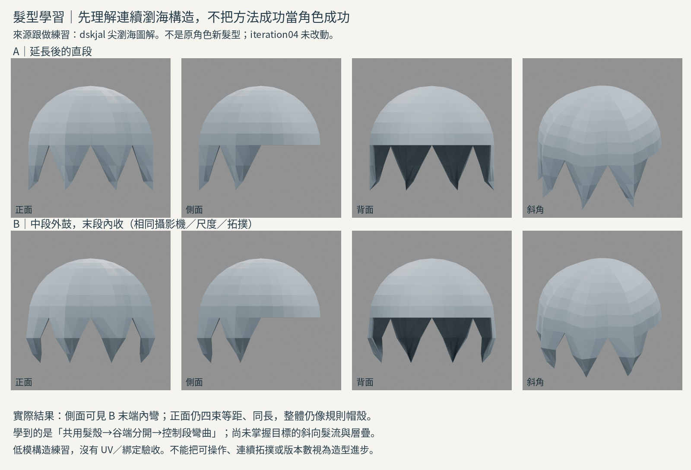
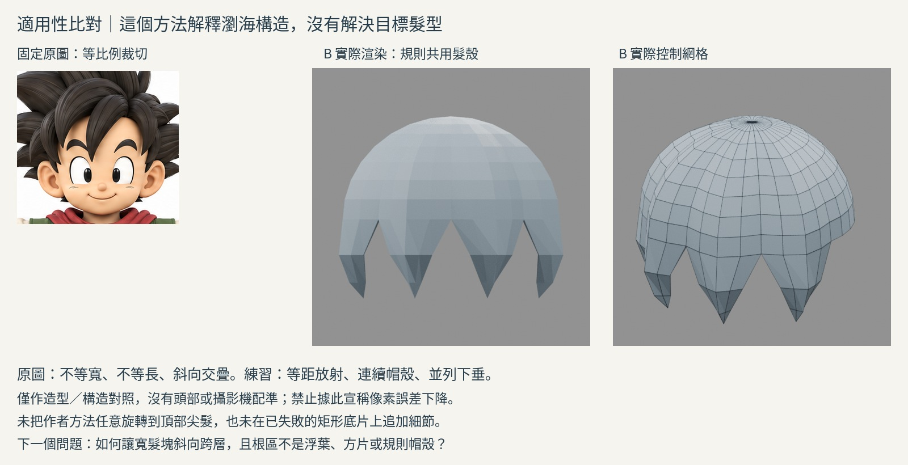

# 尖瀏海構造：來源跟做與適用性失敗

2026-10-29 14:36 UTC 輪。**完成一個來源引導的低模方法練習；沒有改善原角色，也沒有整合 iteration04。** 這不是短尖髮完整解法。

## 先處理的問題

讀過 reference-flow、base-extrusion、boundary-valley、whole-clump-study 的 NOTES。舊路線在尚未理解整束形體時，一直修改平板、厚度和根半徑。矩形底片與長束直接旋轉適配均維持停止。

這輪改問：連續的髮量，如何在下緣分成幾束有彎度的短尖瀏海？暫不解決頂部朝上的尖髮，也不改五官。

## 三種構造與適用範圍

- **曲線＋封閉截面長束**：之前實看的 Danny Mac 馬尾示例可控制完整長束的彎曲與半徑，但不能直接回答目標短寬層疊。舊練習有管感和擁擠內彎。這輪沒有重新聲稱看新影片。
- **髮殼分區＋末端分束**：本輪 dskjal 尖瀏海圖解可直接看到連續表面如何分脊、分谷和下伸，適合檢驗齊下垂瀏海；其規則放射不是原圖斜向交疊的解法。
- **從低模全體逐區擠出短尖髮**：Tohawork 伏黑惠案例的文字摘要符合短尖多角度剪影，但本輪只有讀到摘要及作者留言，沒有看見操作影片。不得以它為本輪完整實作證據，也未重試已阻塞影片。

## 實際讀了／看了什麼

[dskjal：アニメ風のとがった前髪のモデリング](https://dskjal.com/blender/anime-hair-from-sphere)

完整讀該頁短文。再於 瀏覽器實看以下四張原始圖，而不是只看搜尋摘要：
1. `blender-modeling-anime-hair-scale-normal-min.jpg`：半球多條經線抬起，脊線仍在共同表面。
2. `...-rip-min.jpg`：標圈在束間谷的下端，分離發生在末端，不是將整束根部剪斷。
3. `...-split-front-min.jpg`：拉長後的尖端增加一列橫環。
4. `...-round-min.jpg`：保留中段寬面，末端向內形成折向。

後半的細分分束／bevel文字有讀，但未逐圖驗證、不納入本輪操作。沒有下載或執行作者程式。直接下載圖片回403；瀏覽器正常可見，因此視覺證據來自瀏覽器截圖閱讀，不是本機下載。第三方圖片不收入交付。

[Tohawork：短髪モデリングは難しい](https://tohawork.com/hairmodeling)：本輪重讀①～④和⑰～⑳的文字摘要，以及作者答覆：不同束不必相同切分數、方法依用途決定。只作方法選擇背景，不聲稱觀看20小時影片。

## 如何實作、哪些是我的假設

新空場景，32經線／8列的半球表面，前半四區抬起脊線，從下緣延續四組逐漸收窄的面，谷端之下分開，上層共用頂點。由程式建立與圖示相似的結構，**不是按鍵逐操作重播，也不是作者原始網格**。四束等長是控制練習，非原圖判讀。

A：末段近直線延續。B：只改下段徑向位置，中段外鼓、末端內收。拓撲、上殼、長度、材質、光、各向相機固定。數值皆自定，不冒稱來源數據。0.025薄背襯及尖端減薄是呈現用假設，來源未指定厚度。

不加細分曲面遮蓋控制形體，不堆相交錐體。這仍是低模構造練習，不是成品。檔內同存A/B；沒有讀寫人物04。

## 真實渲染後的判斷

AB-fourviews.jpg 是正／側／背／斜的實際渲染。同尺度相機，不拉伸。B側面可見末段內彎，證實學到控制段曲率；但折角仍硬，正面等距同長，整體像規則帽殼。這不是原圖造型改善。

reference-fit.jpg 保留原圖裁切長寬比，和實際B、控制線框並列。**沒有做頭部尺度／相機配準**：本次是不同髮型的來源跟做，不宜將它硬塞到原角色尺度、捏造像素誤差。這一項只完成適用性比對，未完成原角色四向對齊驗收。

目標前髮有斜向越過額頭的大束、寬度長度不等、前後互遮；本練習由共同球面向下放射，不能產生那些層次。頂部高尖、側後髮也未練。B不取代任何基線。規則球殼再加刻線不會修正這個差異，故停止在這裡擴成整頭。

## 學到／失敗／下一個不懂

- 學到：分束不等於獨立漂浮物；可保持上方連續髮量，只在谷端以下分開。彎度來自沿束控制段，而不只尖端旋轉。
- 失敗：這種規則分區套到原圖仍是錯髮型；方法操作通了不表示造型理解通了。
- 未理解：寬短髮塊如何斜向越過另一束、根部如何融入上層髮量，又避免浮葉／方片／帽殼。下輪需可見的這類完整建構示範；不是再調球殼半徑。

## 公開版範圍與復現限制

這是歷史實驗筆記；本文提到的模型、腳本、渲染、量測檔與原始參考圖均未包含於本倉庫，檔名只用於說明實驗，不是下載連結。此文字版不能單獨重跑該實驗，也不構成對結果的獨立重驗。來源讀看範圍保留原紀錄，未在公開整理時重新觀看。

[方法索引](../../LEARNING_INDEX.md) · [復現說明](../../REPRODUCING.md)

## 公開附圖

下列為當時保存的原始圖片檔，這次僅整理上傳，沒有重新建模或渲染。研究分析板與舊版渲染不代表新模型；實驗成功、失敗及限制以本文記錄為準。

[固定角色原始三視圖](../../images/reference/character-three-views.png)
