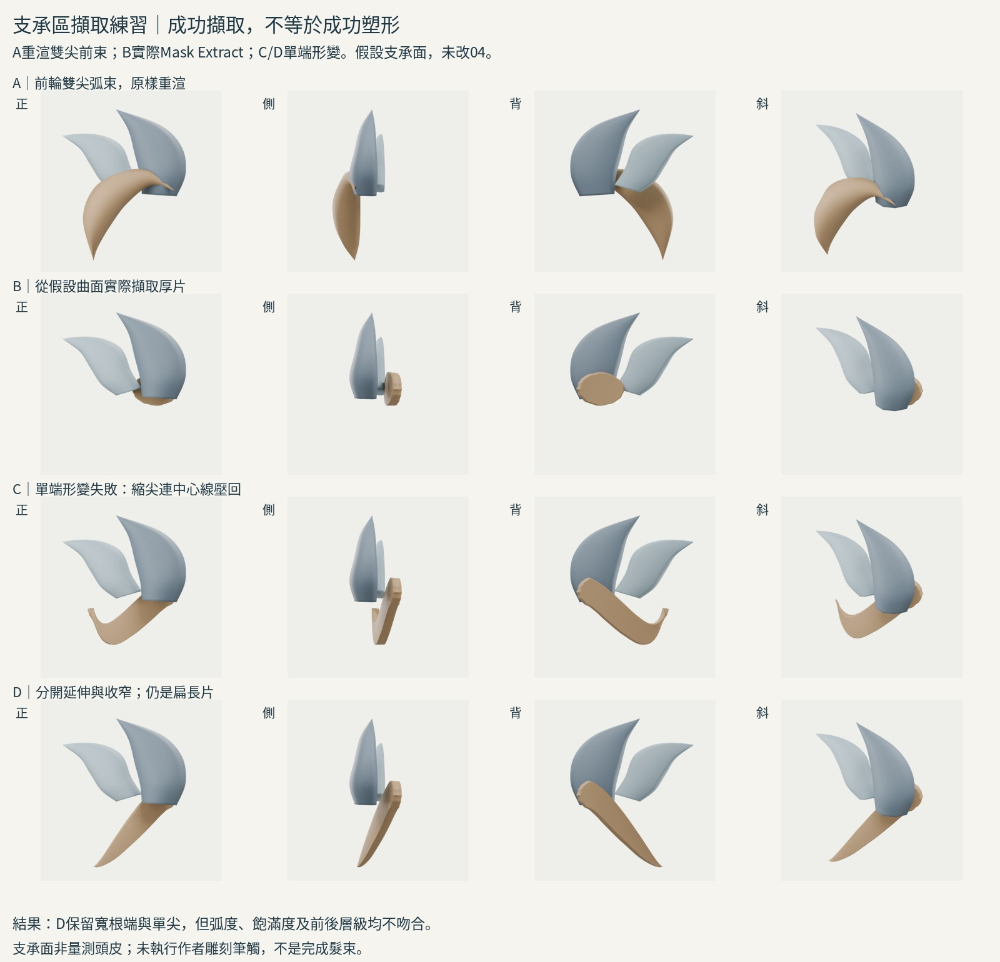
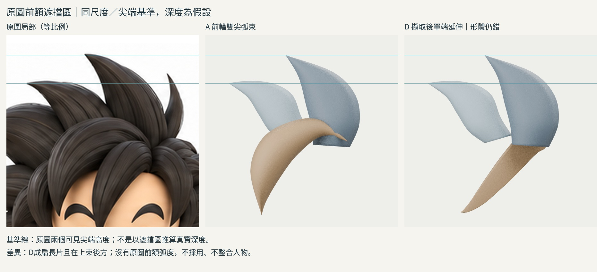

# 19:36 支承區擷取與單端延伸

本輪有實際 Mask Extract 與新四向渲染，**操作成功、造型失敗**。不整合 iteration04。

## 來源實讀／實看
Boehmy https://www.zbrushcentral.com/t/how-to-sculpted-hair/373187 ：讀作者帖文，重新實看Step3、Step4兩張完整圖的文字與模型。Step3在頭部遮罩出支承區並擷取帶厚度形體；Step4用Move Topological、SnakeHook、Inflate推拉，依髮流轉折決定分塊。這是側分長髮，不複製其髮際線。
Blender 4.3與4.5官方Mask手冊及2.81release頁本輪返回402；搜尋摘要有Mask Extract說明，但**不稱完整實讀手冊**。本機4.3.2 RNA確認操作參數，實際執行bpy.ops.mesh.paint_mask_extract，回傳FINISHED。作者圖是ZBrush階段圖，未實看對應Blender雕刻逐筆影片。

## 方法比較和適配限制
前輪封閉環兩端合點，錯誤把內部交界當第二髮尖。候選方法是從支承面擷取，保留一側支承區，只延伸另一側。這輪用自製局部彎曲網格當假設支承面，不是原角色頭皮、不是原圖推算深度。遮罩橢圓範圍亦是假設。
實際原生Mask Extract設定threshold0.5、boundary loop、smooth4、project、solidify。產物保留Solidify厚度0.12。支承面在blend留存但交付四向圖不顯示，以便觀察擷取片與上束關係。這不等於對完整頭型依附驗證。
隨後形變為自製加權頂點變換，**沒有使用或冒稱作者的雕刻筆觸**。這只練習根端不收尖和單端延伸；不能從這次失敗斷言作者方法失敗。

## A/B/C/D實驗
A前輪雙尖前束原樣重新渲染；B實際從曲面擷取的原厚片，連同上兩束顯示。C複製B，保留右側支承區，左側加權延伸/收窄；但把中心線位移也乘入收窄係數，造成鉤狀回彎，失敗保存。
D從B重新開始，把中心線下移和橫向收窄分開，並用Solidify頂點權重減薄伸出端。右側支承區不合點，左端近尖但並未拓撲合併成一點。D修正了鉤形，卻成扁長片；沒有原圖弧束的拱起量，也因支承深度假設落在上束後方，前後遮擋錯誤。
所有組相機、材質、比例一致。原圖沿用x210..450/y-10..230等比例裁切，orthographic2.4，固定兩上束尖端基準。新伸出端未精準落在原圖髮尖，不能稱輪廓還原。A到B同時換方法、形狀、支承，非單變因比較。

## 所學與下一缺口
學會真正從帶mask的支承面擷取新物件並保留厚度；端點不必兩側皆合點。發現形變中心線和截面縮放混用會產生回鉤。
失敗：擷取只解決來源表面，不能自動形成正確髮流/飽滿度。自製加權拉伸不是作者雕刻方法；這個適配尚不充分。
下一輪不要再改任意位移係數。需要實看如何在擷取厚形上用Move/Grab保持主量、建立前額弧度的操作，或查可在既有頭部支承面保持根區的多邊形方法；應先確認支承面與可見層級，而非用另一片任意曲面代替。

## 公開版範圍與復現限制

這是歷史實驗筆記；本文提到的模型、腳本、渲染、量測檔與原始參考圖均未包含於本倉庫，檔名只用於說明實驗，不是下載連結。此文字版不能單獨重跑該實驗，也不構成對結果的獨立重驗。來源讀看範圍保留原紀錄，未在公開整理時重新觀看。

[方法索引](../../LEARNING_INDEX.md) · [復現說明](../../REPRODUCING.md)

## 公開附圖

下列為當時保存的原始圖片檔，這次僅整理上傳，沒有重新建模或渲染。研究分析板與舊版渲染不代表新模型；實驗成功、失敗及限制以本文記錄為準。

[固定角色原始三視圖](../../images/reference/character-three-views.png)
