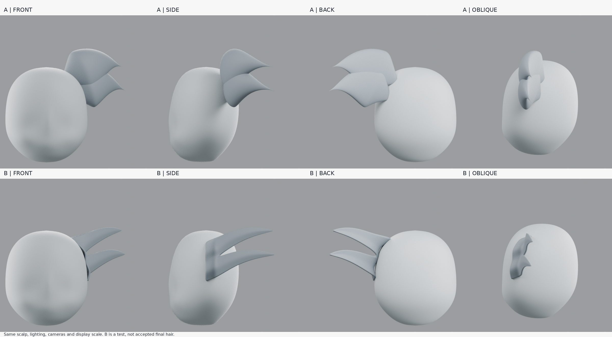
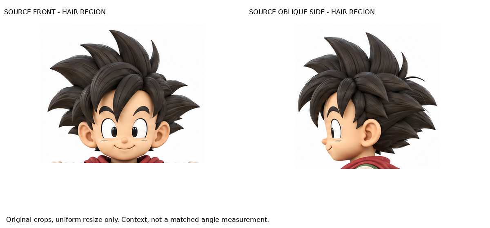
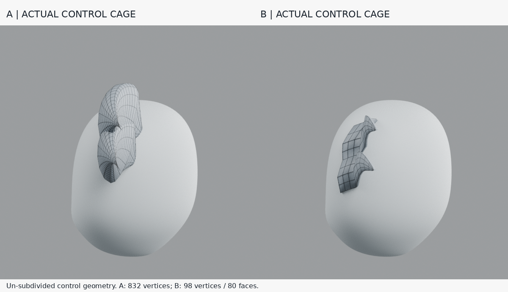

# 小練習：相鄰兩束髮根 A/B

## 問題
能否同時做到：根部連續、不突然鼓包、束間谷仍清楚，而且斜角不像厚板？本練習不整合回全頭。

## 讀到的規則 vs 我的假設
- **作者原則：** [Tohawork〈短髪モデリングは難しい〉](https://tohawork.com/hairmodeling) 本文摘要提到先用低模押出建立剪影、跨角度檢查、再調曲率；尖髮辨識不只在尖端，也在根部之間的谷。已讀本文摘要與答覆，**未觀看完整影片，也不宣稱重現作者完整操作**。
- **待驗證假設：** 一個共用寬根四邊面片，分成兩段薄押出，可能比兩個獨立膨起的根部更連續；保留分叉谷，不用融合抹平。以下參數與網格是我的實驗，不是作者配方。

## A/B 怎麼做
- A：直接讀取04的 `Right side sweep`、`Right lower sweep`，不改形，832個原始控制頂點。
- B：新建98頂點、80面控制網格；兩束共享根部頂點與中央谷，沿真實頭面取樣後分叉、彎曲、收尖。一次細分預覽、0.018厚度；無體素、無細髮或紋理。
- 兩者同一04頭形、同材質、同光線、同相機與縮放，分別輸出正／側／背／後斜角，以及未細分控制網格線框。
- A/B 同時改了根寬、厚度與連接方式，**不是單一變因因果證明**。這只測一套局部構造是否值得繼續。

## 觀察與結果
- **側面：** B少了A兩個獨立圓鼓根，分叉負空間仍清楚；但寬根外緣仍很直，像一塊叉形片。
- **後斜角：** B輪廓較薄，但明顯變成薄板／折片，並未得到自然髮束體積。谷也會因視角縮短而不易讀。
- **線框：** B的根部確實共用拓撲，兩個分支可單獨控制；這只是可編輯性，不等於造型成功。
- 第一輪根區跨出真實頭面，使用替代座標造成局部凹折；第二輪縮限根區並加入頭面射線命中斷言，消除這個採樣錯誤。這項修正沒有解決薄板感。

**判定：未通過全部條件，不整合全頭。** 已學到「連續根＋保留谷」可以用低模拓撲明確構造；也確認把厚度壓薄不會自動得到髮束，仍須設計各角度的截面與扭轉。

## 下一個單一小變因
固定本次B根區、分叉位置與尖端，只調兩束中段截面的扭轉／凸度，檢查是否能減少後斜角薄板感；不要增尖刺數、不要重做人物，也不要同時改根部和剪影。

## 公開版範圍與復現限制

這是歷史實驗筆記；本文提到的模型、腳本、渲染、量測檔與原始參考圖均未包含於本倉庫，檔名只用於說明實驗，不是下載連結。此文字版不能單獨重跑該實驗，也不構成對結果的獨立重驗。來源讀看範圍保留原紀錄，未在公開整理時重新觀看。

[方法索引](../../LEARNING_INDEX.md) · [復現說明](../../REPRODUCING.md)

## 公開附圖

下列為當時保存的原始圖片檔，這次僅整理上傳，沒有重新建模或渲染。研究分析板與舊版渲染不代表新模型；實驗成功、失敗及限制以本文記錄為準。

[固定角色原始三視圖](../../images/reference/character-three-views.png)
