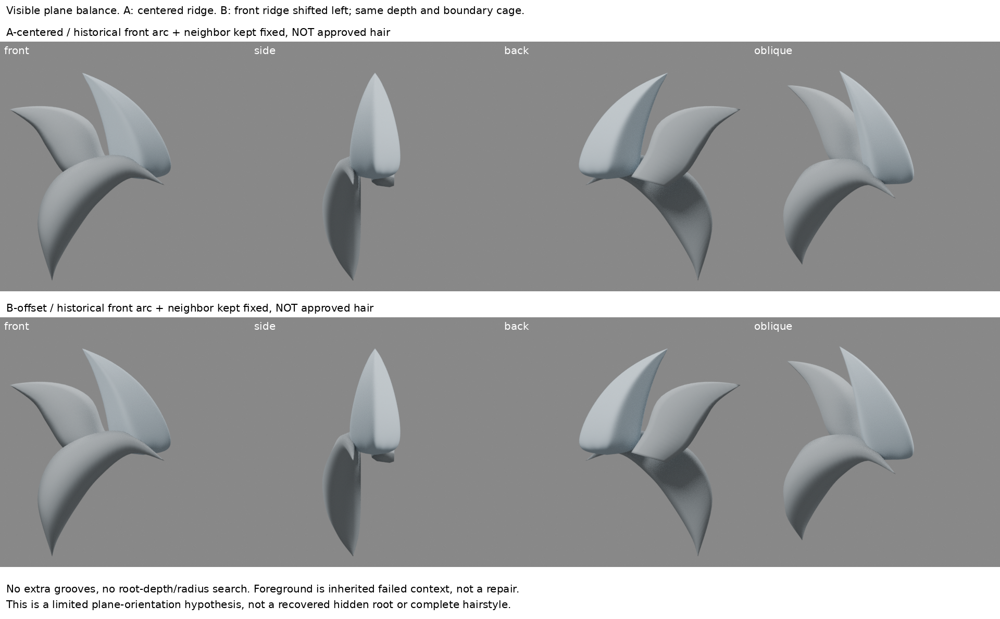
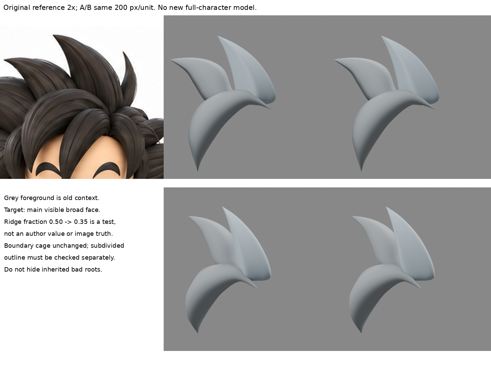

# 可見主脊的位置與左右寬面：有面向變化，未證明更像

2026-10-30 14:36（Asia/Taipei）輪。新局部多邊形試驗與真實四向對照；不整合、不取代iteration04。不是完整髮型成果。

## 問題、舊方法與這次差別

讀回LEARNING_INDEX、hair-boundary-design、root-surface-flatten、closed-hair-sections、spike-support-edges及profile-convexity。舊輪已比較菱形/拱形、凸度/扭轉、支撐線距離；不能換個名字再做。此次固定深度、截面高度、支撐距離與外緣控制點，**只改可見長向主脊在左右寬面之間的位置**。這會重新分配兩側面寬及法線，而非增加細溝、根深、根半徑或筆刷強度。

回到原圖高尖束可見區，加入既有前弧與鄰束作固定上下文。兩者來自front-hair-layer舊C，仍有平帽、根交界和側視缺陷；不是臨時加束遮錯，也未因本輪出現就改稱合格。

## 實讀實看來源

六色，〈髪の毛のモデリング〉第4節及第5節：
https://note.com/rikuhayasaka/n/n5ab4a25233d1
實讀筒形截面與細分注意段，重看截面原圖1744456194-v3RQaqfpNUdLDhmt7EwJ19i0.png。圖中較平背側與有折轉的前拱面分開安排，其中主脊未必位於兩邊的數學中點。這是幾何截面示意，不是本案高尖髮的逐步影片。**從示意推導「內部主脊位置可另作控制」是本輪適配，不把0.35說成作者配方，也不將原圖亮帶當作確定脊位置。** 此來源以前讀過；新知是把位置和凸度、支撐距離分離測試，而非發現新截面。

完整讀到Blender4.3官方Move與Transform Orientation正文：
https://docs.blender.org/manual/en/4.3/scene_layout/object/editing/transform/move.html
https://docs.blender.org/manual/en/4.3/editors/3dview/controls/orientation.html
web頁面讀取器回402，dot雲端公開HTTP讀取200後解析正文成功。Edit Mode移動頂點不改物件原點；Global軸與Normal/自訂方向不同。此次正面相機世界X是橫向，使用原生Edit Mode的transform.translate沿Global X，不旋轉自訂著色法線、不用自製雕塑位移冒充作者筆刷。另讀Scale頁作方法篩選，最後未用Scale。

第三方圖只私下閱讀，不進本實驗、公開庫或恢復包。

## A/B與範圍修正

- 主束來源為spike-support-edges/C-wide-support的61頂點控制籠。共同Catmull三級、支撐位置30/70%、尖端原四邊crease、平滑著色、光材機。A重新渲染，不拿舊圖當新成果。
- B在上方四個環中，前側主脊從橫向0.50改為0.35；兩側支撐點按同一面內比例重排。20個前側內部控制點只改X，Y/Z不改。根環、尖端、兩側外緣及背側控制點不改。
- 0.35是一次預先指定的可觀察測試值，非來源量測、不是最佳值。沒有掃0.4/0.3等參數。
- 第一稿錯將最下方隱藏根環也移動。覆核後將該稿保留於initial-root-scope，恢復根環不動再重新渲染；這是修正實驗範圍，不稱美術改善。第一稿輪廓最大差4px，最終稿最大差1px，不把這項範圍修正歸功於審美。
- 固定上下文從舊原點換算到本試驗同一原圖座標，兩版完全一致。未改前弧去蓋更多根，未增加新束。

## 四視圖與真正的剪影檢查

480×480、正交尺度2.4，即200px/unit；原圖等比例2倍，超出原圖的上方區域只補白，不拉伸。正側背斜均相同鏡頭/光材。另輸出主束單獨透明背景正視圖做輪廓診斷，這張不替代含上下文的品質比較。

- 正面：B左側面縮窄、右側寬面擴大，亮暗帶分配改變，沒有增加細線。白隙仍開，前弧仍遮下部；不代表兩者已吻合原圖。
- 側/斜：B面轉折仍偏硬，根仍有截斷形；舊前弧側面缺陷也仍可見。不能因正面下段被遮就當根修好。
- 背面：背側控制點未改，但細分會傳遞相鄰影響；不能把固定控制點當整個評估表面固定。
- 最終A/B主束alpha>=128輪廓IoU約0.9862，238像素不同，逐列邊界最大差1px。**外緣控制籠零位移不等於實際渲染剪影完全不變。** 此數字只對A/B機制診斷，不是對原圖精度或進步分數。
- 中段控制面左右平均法線分別轉約10.26°／7.31°，說明位置確實影響兩側面向；這不是藝術通過。

## 結論、停止條件與下一問

主脊的橫向位置可以在不加凸度、不刻槽的情況下重新分配兩側寬面。原生多邊形變換比單次平均Flatten更明確地指定了改哪一側，但目前仍是硬分面、截面厚度/自然面形未成立，**B不採用、不升級基線**。

已回答位置與面向的關係，不繼續掃主脊比例。下一個問題是怎樣保留寬面朝向而把轉折帶做成可控連續曲率，且不讓細分帶動外緣；需對照舊支撐線與曲線截面失敗，先找作者處理轉折帶的實際證據，不立即反覆調同組支撐距離。

## 恢復

source-main.blend與source-context.blend是本輪輸入副本；build.py從這兩份檔重建A/B並渲染，原生編輯變換可檢查。boards.py從同包reference.png及實渲排版；verify.py冷讀兩份A/B核對控制點、固定上下文、modifier及iteration04（外部基線存在時才校驗）。restore-check.json、outline-check.json、plane-normal-check.json是診斷，不是品質認證。

A/B已冷讀：根環/邊界/尖端控制點最大變動0、Y/Z變動0、上下文一致。iteration04 SHA256保持35cd1b71c9d288029d93d0fdb8d9741d62a5151bc3bc459ab48c789092b5aaa6。私人包含兩來源模型、失敗初稿、原圖與腳本，不公開模型。沒有執行解壓到另一環境的完整重播，不宣稱該項已測。GitHub原批准未決，本輪未寫或重試。

公開版僅含本筆記及兩張比較板，文中模型、重播腳本、診斷JSON與失敗初稿未包含；私人恢復包另存。這份本地稿仍待同步，不代表已發布。
