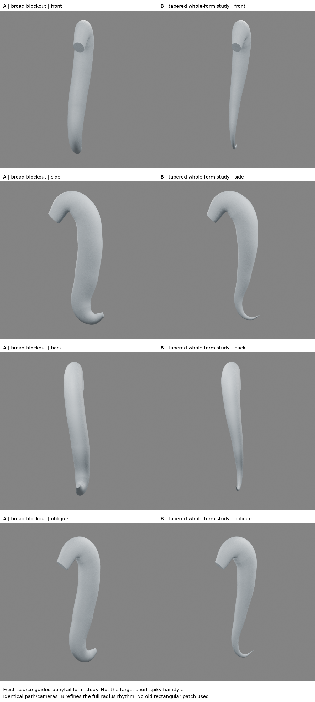
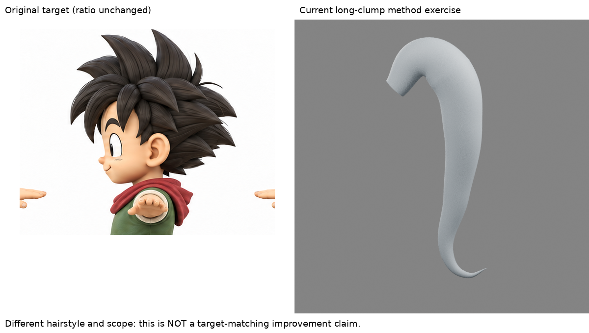
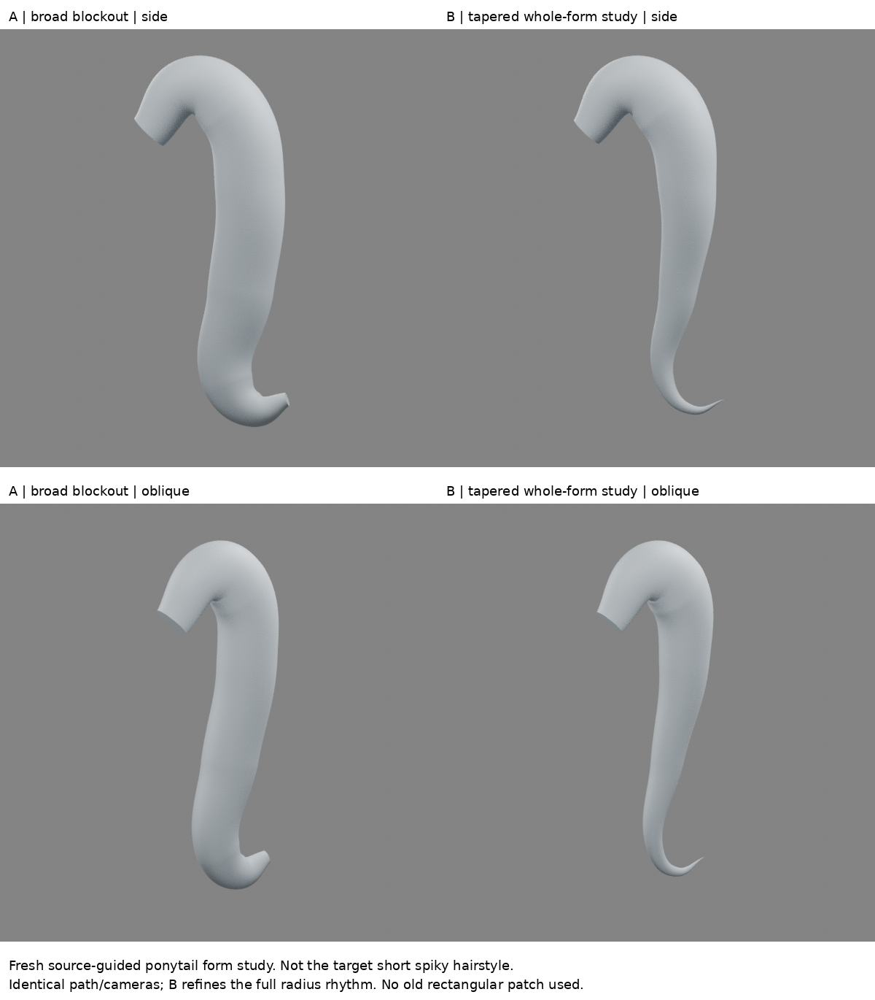

# 從完整外形重新開始：長髮塊造型研究

2026-10-28 20:06實驗。停止矩形測試片，這輪從空場景建立完整髮塊。**這是來源引導的形體研究，不是逐操作完整跟做，也不是原角色短尖髮的改善成果。**

## 真正看到與未看到的來源

優先嘗試夏森轄 [髮型影片](https://www.youtube.com/watch?v=Ng8FbOHvsLQ)。頁面章節及字幕可讀，但播放器停在黑畫面緩衝，重載一次亦未取得建模畫面。不能聲稱看過影片示範。

改讀 Danny Mac [原文](https://blog.cgcookie.com/posts/how-to-model-hair-in-blender/) Step3–4，並在雲端瀏覽器實際查看三格過程圖、調形GIF及中型髮束圖。圖中可見高處彎起、往下收束、末端回勾的整束形體；GIF顯示側面與上方視角及控制柄，不能從幾個可見畫面還原每次按鍵。方法為曲線配封閉截面、逐點改半徑，先驗完整剪影，再分出中小束。這是馬尾示例，不是目標短尖髮。原作者圖片未收入交付包。

## 實作界線

從新的八點Bezier路徑開始，以獨立閉合橢圓作截面。先建立A粗形，再保持路徑與鏡頭，調整沿長度的半徑成B。上部保留飽滿轉彎，中下段漸細，尾端回勾並收尖。控制點座標及半徑是我依可見輪廓自行設定，不是擷取作者原始資料，也不是作者指定數字。

沒有讀取或修改舊矩形底片；完整人物04及此前全部練習保留。A是本次新形體修改前版本，不冒稱它是上一輪矩形模型。同一場景四角度輸出，原圖單獨等比例列出，說明造型用途不同，沒有用原圖硬配馬尾。

## 檢視結果與限制

B可讀成上部彎起、下部漸收的完整長束，沒有方片基座；但仍是簡化管狀大形，沒有中型分束和自然根部，也沒有驗證頭皮接合。正面／背面因路徑近側平面，寬度和側面呈現不同，這是需要從多角度控制的限制。根端封口仍可見，不能視為角色成品。

相對A，只能說漸細與尾端收束更清楚；不能說目標人物更像。與作者圖也不是精確重建，未校準相機或量測匹配。這輪沒有適配短尖髮，避免又把理解不足的長束直接旋轉貼上頭。

## 學到／下一個未理解問題

先建立整束連貫剪影，再討論接合細節，比在方片上堆操作合理。但尚未理解如何把這種整束建構轉成原圖短、寬、層疊的髮塊。下一輪應找可實看的短尖髮完整形體示範；若只能取得文字，不應硬稱已掌握。矩形測試片仍保持停止。

## 公開版範圍與復現限制

這是歷史實驗筆記；本文提到的模型、腳本、渲染、量測檔與原始參考圖均未包含於本倉庫，檔名只用於說明實驗，不是下載連結。此文字版不能單獨重跑該實驗，也不構成對結果的獨立重驗。來源讀看範圍保留原紀錄，未在公開整理時重新觀看。

[方法索引](../../LEARNING_INDEX.md) · [復現說明](../../REPRODUCING.md)

## 公開附圖

下列為當時保存的原始圖片檔，這次僅整理上傳，沒有重新建模或渲染。研究分析板與舊版渲染不代表新模型；實驗成功、失敗及限制以本文記錄為準。

[固定角色原始三視圖](../../images/reference/character-three-views.png)
